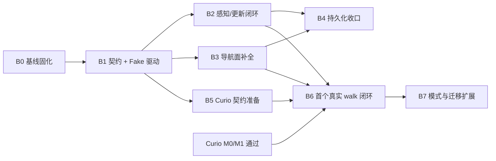

# 空间记忆与导航库实现审计（0.10.0 / HEAD `0737f30`）

> 审计日期：2026-11-06
> 代码基线：`0737f30`（2026-11-05，`feat(topology): store opaque metadata and durable nodes`），`package.json` 版本 `0.10.0`
> 文档基线：`docs/spatial-memory-library-design.md` 工作区版本（v0.5，未提交改动）；`docs/design-progress-0.9.0.md` 仅作为历史进度记录
> 审计范围：本仓库源码、测试、文档和包入口；只读源码审计 + 基线命令验证
> 非审计范围：Curio 宿主仓库源码、真实 Minecraft Java 1.20.1 / mineflayer 联机运行
>
> 本文回答“现在实际有什么、还缺什么、下一步怎么排”，不修改设计文档，也不把计划中的能力写成已完成。文中的完成度是**实现证据等级**的估算，不是测试覆盖率、发布门槛或真实游戏验收结论。

---

## 0. 证据等级与判定规则

| 等级 | 含义 | 本文如何标注 |
|---|---|---|
| 已验证离线 | 源码存在，且离线测试/命令实际通过 | “已验证离线” |
| 已实现未验证 | 源码存在，逻辑可读，但没有真实游戏或宿主验收 | “已实现未验证” |
| 仅类型或声明 | 只有类型、接口或能力表，没有运行时入口 | “仅类型/声明” |
| 缺失 | 没有公开入口，也没有可替代的运行时路径 | “缺失” |
| 阻塞外部 | 需要 Curio/游戏先满足前置条件，本库无法单独完成 | “阻塞外部” |

四条硬规则：

1. **源码存在 ≠ 可执行 ≠ 已联机验证。** 本文分开写“实现了什么”和“能实际做什么”。
2. **`geometry_only` ≠ 可导航。** 陆地/水面验证器的结果携带 `assurance: 'geometry_only'`、`executable: false`，不能当成执行能力。
3. **dry-run ≠ 迁移完成。** SQLite 的旧数据迁移目前只有离线演练，没有 JSON→SQLite 权威源切换。
4. **单测通过 ≠ 真实世界通过。** 导航身体、感知、物理、碰撞和流体规则均由调用方注入；测试中的执行器是 Fake。

---

## 1. 执行摘要

**总体完成度约 62%（区间 60%–65%）。** 这是“按设计文档端到端目标”的估算。若只看数据、证据、拓扑、动态更新和持久化这些库内核心，完成度约 **84%**；把首版 walk 导航和结果接缝也算进来，约 **73%**。

| 判断 | 结论 |
|---|---|
| 最强的部分 | 观测/证据模型、稀疏体素地图、拓扑历史、SQLite 单 Worker 持久化 |
| 最弱的部分 | 真实宿主接入、非 walk 移动模式执行、完整导航参数面、迁移权威切换 |
| 已经可用的最小闭环 | 内存地图 + 同高单格 walk 搜索/复验/执行 + SQLite 显式 checkpoint，全部由调用方提供感知、身体和搜索环境 |
| 当前最大阻塞 | `src/adapter/` 只有类型契约，没有 mineflayer/Curio 运行时适配；真实联机验收为零 |
| 外部硬门槛 | Curio 的基础移动元语（设计 §10.3 M0/M1）必须先修复并独立核验；在此之前不应开始 M2 真实 walk 接线和联机排查 |
| 一句话 | **数据底座已相当完整，但“陆地 + 水面全模式导航”和“真实 Curio 接线”还没有闭环。** |

现有 `docs/design-progress-0.9.0.md` 对 §3–§9 自评约 90%，但那是“0.9.0 已声明支持子集”的完成度，不是设计文档完整目标的完成度。例如 §7 只执行同高 walk，而设计范围还包括跳跃、台阶、梯子、下落、游泳和已乘船。

---

## 2. 评分口径

评分锚点：

| 分数段 | 含义 |
|---:|---|
| 90–100 | 设计要求基本覆盖，离线验证充分，仍有真实环境未验 |
| 75–89 | 主体实现，边界清晰，缺少部分模式或集成 |
| 60–74 | 核心构件存在，但关键路径不完整或依赖外部 |
| 40–59 | 只有部分入口/几何验证，不能声称完整能力 |
| 20–39 | 类型、声明或局部工具，没有端到端路径 |
| 0–19 | 缺失或仅有远期设计 |

| 领域 | 权重 | 估算分 | 加权 | 置信度 | 主要依据 |
|---|---:|---:|---:|---|---|
| A 数据/证据（§3–§4） | 20 | 88 | 17.6 | 中 | Observation、CellEvidence、Palette、位图、revision、ChangeReport |
| B 拓扑/历史（§5） | 12 | 85 | 10.2 | 中 | FragmentStore、边验证、portal、锚点、占用、合并拆分 |
| C 动态更新（§6） | 10 | 78 | 7.8 | 中 | 差分、局部失效、在途撤销、TTL；宿主接线与队列未闭环 |
| D 导航/执行（§7） | 20 | 45 | 9.0 | 高 | 仅同高单格 walk 可执行；其余模式是几何验证或显式拒绝 |
| E 持久化/迁移（§9） | 13 | 80 | 10.4 | 中 | 真 SQLite Worker、checkpoint、增量、驻留；迁移仅 dry-run |
| F 适配/宿主接入（§2） | 15 | 18 | 2.7 | 低 | 只有 `WorldAdapter` 类型；无运行时桥 |
| G 心智接缝（§8） | 5 | 65 | 3.25 | 低–中 | NavResult/problem/ActionRecord 有；宿主映射和注册未接 |
| H 验收（§10–§11） | 5 | 30 | 1.5 | 低 | 离线测试强；真实 Java/多人/流体验收为零 |
| **合计** | **100** |  | **62.45 ≈ 62** |  |  |

派生结论：

- **库内核心（A+B+C+E）**：46.0 / 55 ≈ **84%**。
- **含导航与接缝（A+B+C+D+E+G）**：58.25 / 80 ≈ **73%**。
- **端到端（A–H）**：**约 62%，报告为 60%–65% 区间**。

评分的两个限制：

1. 分数是“实现证据等级”，不是“测试覆盖率”，也不是“发布就绪度”。
2. F/G/H 的置信度低，因为本库没有真实宿主；这三项应作为风险区间看，不应作为精确 KPI。

---

## 3. 设计章节完成度对照

| 设计章节 | 状态 | 已经落地 | 主要缺口 / 不能声称 |
|---|---|---|---|
| §1 原则与边界 | 已落实到模块边界 | 库不选目标、不自动施工、不接管救援；`nav` 只消费调用方环境 | 宿主是否遵守同一授权链，需 Curio 侧核验 |
| §2.1 `WorldAdapter` | 仅类型/声明 | `state`、`observeBatch`、`capabilities`、`moveTo`、`swimTo`、`dig`、`placeBlockAt`、`subscribe` 类型齐备（`src/adapter/types.ts`） | 没有任何运行时实现；类型存在不等于已接 mineflayer |
| §2.2 Curio 接口对照 | 阻塞外部 | 设计记录了旧入口、`SkillResult`、仲裁链与参数映射 | 本仓库没有 Curio 桥；`data.nav` 映射、动作注册、嵌套、恢复均未接 |
| §2.3 当前快照 | 文档落后于代码 | 设计头部仍称 SQLite 未完成，实际已有 SQLite Worker | 以本文和当前源码为准；不要据旧头部判断实现缺失 |
| §3.1 历史几何 | 已验证离线 | `FragmentStore`、`PathFragment`、traversal evidence、links、bridge 来源 | 自动发现、旧记录迁移仍由宿主/后续批次负责 |
| §3.2 当前观测状态 | 已验证离线 | `Observation` 的来源/证据/完整性/时间/会话/gap、`CellEvidence` 新鲜度与 `validUntil`、严格校验（`src/observation/`） | `sequence` 已校验但未用于写入排序；`risk` 位从不写入 |
| §3.3 通行性 | 已实现未验证 | 四态、方向/模式/身体上下文、跨 Section 依赖、支撑/净空、hazard、TTL（`src/traversability/`） | 执行器只支持同高 walk；step/drop/jump/ladder 只是几何验证 |
| §3.4 水与岩浆 | 已实现未验证 | 水面游泳与已乘船几何验证、流体/含水/气泡柱证据、`geometry_only`（`src/water/`） | 没有游泳/船执行器；不能把“几何可通过”写成“能游过去” |
| §4 稀疏存储 | 已验证离线 | Section/Palette/位打包、负坐标、`explored/traversed/stale/modified`、逐格 revision、LRU/Pin（`src/voxel/`） | `risk` 位图是空转索引；自动 TTL 清扫器由调用方负责 |
| §5 拓扑与垂直连接 | 已验证离线 | 节点/边、方向×模式验证、portal 独立图、占用 TTL、锚点、碎片合并/拆分（`src/topology/`） | `SpatialEdge` 是 `TopologyEdge` 的有损投影；容器内容仍归宿主精确账本 |
| §6 动态更新 | 已实现未验证 | 观测差分、局部失效、执行器在途撤销、ChangeReport（`src/voxel/`、`src/execution/`） | `ObservationQueue` 未接入 `VoxelMap`；`TransientOccupancy` 未组合进 store；宿主必须手动转发 ChangeReport |
| §7 导航接口 | 部分实现 | `navigateTo`、`followKnownPath`、`inspectRoute`/`inspectKnownRoute`、`frontierCandidates`（`src/navigation/`） | 只执行同高单格 walk；`near`/`reach_block`、挖/放/搭柱/材料/`avoid`/frontier 全部拒绝；`recall_route` 缺失 |
| §8 心智接缝 | 部分实现 | `NavResult`、结构化 `NavProblem`、语义 `message`、`ActionRecord`、能力表（`src/navigation/`） | 宿主 `SkillResult.data.nav` 映射、动作注册、仲裁/嵌套/恢复未接；`ActionRecord` 不自动落库 |
| §9 持久化 | 大部分实现 | 单 Worker、WAL、事务、checkpoint ACK、增量 Section、WorkingSet、journal/账本、schema v7（`src/storage/sqlite/`） | JSON→SQLite 仅 dry-run；无权威源切换；无 Minecraft 游戏版本列；无自动保存（当前策略是显式 checkpoint） |
| §10 阶段 1–6 | 部分完成 | 阶段 2 库内完成；阶段 3 首版 walk；阶段 4 大部分；阶段 5 部分 | 阶段 1 感知接入、阶段 6 学习/真实联机验收未完成 |
| §11 必测场景 | 部分覆盖 | 负坐标、局部失效、墙体对照、会话、持久化等大量离线用例 | 真实 Java 1.20.1、多人、流体、断线重连、取消仲裁为零 |
| §12 范围取舍 | 遵守 | 不包含飞行/鞘翅/水下三维导航；没有把水/岩浆写成永久禁止 | 真实游戏行为仍需联机验收 |

---

## 4. 已落地能力

### 4.1 观测与证据

`src/observation/` 已实现设计 §3.2 的核心字段：`source`（`vision/agent_action/local_rescan`）、`evidence`（`seen/contact/confirmed_effect`）、`stateComplete`、`observedAt`、`worldId/dim/sessionId`、`originObservationId`、`sequence`、可选 `actionId`，以及 `ObservationGap` 的未观察原因。边界校验要求 `agent_action` 必须配 `confirmed_effect` 和 `actionId`，不能凭时间接近归因。

已验证离线：来源/证据约束、gap、批次原子性、队列容量与字节上限、恢复后 STALE。

未闭环：`ObservationQueue` 是独立有界工具，未被 `VoxelMap` 消费；顺序仍按 `observedAt`，`sequence` 未参与写入排序。

### 4.2 稀疏体素地图

`src/voxel/voxel-map.ts` 已实现 Section/Palette/位打包、负坐标、`explored/traversed/stale/modified/risk` 位图、逐格 `CellEvidence`、内容 revision、局部 `ChangeReport`、会话隔离、过期判断、手动驻留、LRU/Pin。

已验证离线：负坐标、位宽扩容、已知空气与未知区分、重复确认只刷新时间、同名属性变化、历史位不推进内容 revision、恢复为 STALE。

未闭环：`risk` 位从未被写入；`markStale` 是整维度粒度；没有自动 TTL 清扫器（评估器在读取时检查 `validUntil`）。

### 4.3 通行性、陆地与水面验证

- `src/traversability/step.ts`：四态、连续支撑、身体 AABB 扫掠、头部净空、证据会话/完整性/过期、跨 Section 依赖、`HazardFact`、`contextKey`。**只支持 `walk`，同高、±1 沿 X 或 Z。**
- `src/traversability/land-transition.ts` / `land-route.ts`：`step/drop/jump/ladder` 的几何验证，支持注入版本化 `LandMotionModel` / `ClimbRegionProvider`；结果固定 `assurance: 'geometry_only'`、`executable: false`。
- `src/water/verify.ts`：`surface_swim` 与 `mounted_boat` 两套几何验证，检查碰撞、净空、呼吸空间、水面带、证据新鲜度；同样不可执行。

已验证离线：碰撞/支撑/净空边界、跨 Section 依赖、版本失效、预算、流体/含水/气泡柱、船体与乘员几何。

未闭环：没有 step/drop/jump/ladder/swim/boat 的执行器；`navigateTo` 会拒绝这些模式。

### 4.4 拓扑与历史

`src/topology/` 已实现 `FragmentStore`、`TopologyStore`、方向/模式分别验证的边、独立 portal 图、`TransientOccupancy`、碎片连通分量/合并、可达分量内的 surface/deepest 锚点、`recordNode`/`markGone`/`goneNear`。

关键边界已落实：堵塞只改当前验证，不删 fragment；A→B 与 B→A 分开；portal 不混入步行图；临时占用不写永久地形；合并必须有实际 traversal 证据。

未闭环：`SpatialEdge` 是 `TopologyEdge` 的有损投影；容器内容、床/熔炉/农田语义仍归宿主精确账本；自动锚点发现由宿主观察驱动。

### 4.5 导航与受控执行

- `navigateTo`：校验原请求 → 读取实测起点 → 有界 `WalkRouteSearch` → `WalkRouteExecutor` 逐段复验 → 实测到达。`ARRIVED` 要求 `confirmed: true`、实测 `lastPosition` 精确满足原目标、存在对应 `lastObservation`。
- `followKnownPath`：按 `pathId`/`fragmentId` 选择单个历史 fragment，只有 `drive: true` 才驱动执行器；同高、单轴、精确到达。
- `inspectRoute` / `inspectKnownRoute` / `frontierCandidates`：只读投影，不移动、不观察、不 pin、不保存。
- `WalkRouteExecutor`：每段要求当前 `OPEN` 证据，接受实测样本并校验 executionId/sequence，依据变化时撤销在途段，取消只清理本执行。
- `MoveExecutor`：只有 `move` / `stop`，没有挖、放、搭柱、游泳、船。

已验证离线：实测到达、无假到达、预算耗尽、取消/超时保留位置、PARTIAL 分段、执行关联、在途失效、旧回调隔离。

未闭环：`recall_route` 没有公开入口；`near`/`reach_block` 不支持；授权挖/放/搭柱/材料/`avoid` 只拒绝不执行；真实身体仍是 Fake。

### 4.6 SQLite 持久化

- 单个 `better-sqlite3` Worker 独占连接，WAL、事务、短批量；`checkpoint()` 是唯一显式保存触发。
- 表覆盖 `spatial_sections`、`path_fragments`、`spatial_nodes`、`spatial_edges`、`spatial_events`、`action_records`、`placed_blocks`、`chunk_visits`、`portal_traversals`，并有 schema v1→v7 迁移。
- 体素载荷是 Palette + 位打包 + 位图 + 紧凑逐格元数据；增量 checkpoint 只写脏 Section；缺失 key 不会被当作删除。
- 恢复时保留原始观测时间，FRESH 证据恢复为 STALE；加载旧快照不能覆盖新观测。
- `WorkingSetManager` 支持按需加载、临时 pin 租约、只淘汰已提交/干净/未 pin 的 Section。
- 旧数据迁移只做离线 dry-run：保留 ID、字段、计数、顺序、原始时间和 LRU 序号；不做权威切换，也不宣称真实用户数据已迁移。

已验证离线：真实 SQLite Worker、checkpoint ACK、重启恢复、增量保存、驻留/淘汰、WorkingSet、ledger/journal、迁移演练。

未闭环：JSON→SQLite 权威切换、旧写入路径移除、landmark/travel endpoint 的正式迁移、Minecraft 游戏版本列、自动保存/宿主生命周期接线（当前策略是显式 checkpoint）。

### 4.7 打包与测试

- 包入口：`.`、`./storage/sqlite`、`./water`；ESM + 声明；`better-sqlite3` 为可选 peer。
- 本轮实际执行（2026-11-06）：
  - `npm run typecheck`：通过（build + `tsc --noEmit`）。
  - `npm test`：39 个 vitest 文件、**968 个用例全部通过**；退出码为 1，因为 3 个 `acceptance/*.test.mjs` 是 `node:test` 文件，vitest 报 “No test suite found”。
  - `node --test acceptance/provenance.test.mjs acceptance/run.test.mjs acceptance/consumer-close.test.mjs`：**32/32 通过**。
- 总计：**1000 项离线断言通过**。没有启动 Minecraft 服务器、mineflayer bot 或真实 Curio 宿主。

---

## 5. 缺口清单

### P0：影响“能否实际使用”的阻塞项

| # | 缺口 | 现状证据 | 影响 | 不能声称 |
|---|---|---|---|---|
| P0-1 | 没有运行时 `WorldAdapter` / Curio 桥 | `src/adapter/` 只有 `types.ts`/`index.ts`；没有 mineflayer 导入或适配实现 | 库无法自行获取感知、无法驱动真实身体 | “已接入 mineflayer/Curio” |
| P0-2 | 只执行同高、单轴、单格 walk | `src/traversability/step.ts` 只接受 `mode: 'walk'`；`navigate.ts` 拒绝其他模式 | 设计范围内的跳跃、台阶、梯子、下落、游泳、船都不可执行 | “陆地+水面导航已实现” |
| P0-3 | 导航参数面不完整 | `navigateTo` 显式拒绝 `near`/`reach_block`、挖/放/搭柱/材料/`avoid`/frontier；“`recall_route`”无公开函数 | 只能完成“同高精确脚格 walk”，不能覆盖设计 §7 的完整委托 | “`navigate_to` 全契约已实现” |
| P0-4 | 迁移只有 dry-run | `src/compat/migration-dry-run.ts` 明确不切权威源、不删旧写入路径 | 旧 JSON 数据不能正式迁入 SQLite | “SQLite 迁移完成” |

### P1：影响正确性、可观测性或集成调试的缺口

| # | 缺口 | 现状证据 | 影响 | 不能声称 |
|---|---|---|---|---|
| P1-1 | `ObservationQueue` 未接入 `VoxelMap` | 队列只被导出，没有运行时消费方 | 感知批次背压、字节预算和单次处理量没有形成闭环 | “有界感知管线已接通” |
| P1-2 | `risk` 位图从不写入 | `VoxelMap` 初始化/读取/持久化 `risk`，但没有写入路径 | 风险索引是空转位图；实际风险只走 `HazardFact` | “风险索引已生效” |
| P1-3 | `TransientOccupancy` 未组合进 store | 占用模块独立，search/executor 不查询 | `NavProblem.kind: 'occupied'` 声明存在但不会产生 | “玩家/实体占位已参与导航” |
| P1-4 | 导航细节契约不完整 | `cancellationOrigin` 在执行路径被硬编码为 `agent`；非法环境配置抛异常而非结构化 `NavProblem`；`navigateTo` 不暴露 `bodyArrival` | 取消来源、稳定到达和错误分型在真实宿主中可能失真 | “取消/到达/错误契约已全部贯通” |
| P1-5 | `ActionRecord` 不自动持久化 | `navigateTo` 返回 `record`，但 journal 落库由宿主调用 | 导航经历需要宿主额外接线才能保存 | “每次导航已自动落库” |
| P1-6 | 持久化载荷没有游戏版本列 | 载荷有 `v:2`，DB 有 schema 版本；没有 Minecraft 游戏版本 | 跨版本恢复/解释缺少显式标记 | “版本化载荷已覆盖游戏版本” |

### P2：文档、打包与次要语义问题

| # | 缺口 | 现状证据 | 影响 |
|---|---|---|---|
| P2-1 | 文档/版本漂移 | 设计头部仍说 SQLite 未完成；README 写 0.9.0，`package.json` 是 0.10.0；仓库内 tgz 是 0.7.4；acceptance runner 仍写 0.7.6 | 读者容易误判当前状态 |
| P2-2 | `compat` 未从包入口导出 | `package.json` exports 只有 `.`、`./storage/sqlite`、`./water`；`src/index.ts` 不导出 `src/compat/*` | README 宣称的迁移 dry-run 对包消费者不可达 |
| P2-3 | 打包验收可能受 LICENSE 影响 | `acceptance/run.mjs` 预期非 dist 入包项为 `package.json` + `README.md`；根目录已新增 `LICENSE`，npm 通常总是收录 | 需要实际跑一次 pack 验收确认；本文未执行 |
| P2-4 | 源码注释过期 | 例如 `topology-store.ts` 仍称 PORTAL/cross-dimension 在本阶段被拒绝（实际是步行边 API 拒绝，独立 portal API 已支持）；`spatial-memory-store.ts` 仍称 `portalEdges` 不支持，但该方法已实现 | 维护者容易被误导 |
| P2-5 | 水面预算语义与陆地不一致 | 水验证预算耗尽报 `UNSUPPORTED/budget_exceeded`，陆地为 `INCOMPLETE` | 调用方需要分别处理；不是世界事实 |

**关于“自动保存”的说明：** 设计 §9.2 要求的是有界队列、保存确认、正常关闭 flush/close；当前选择“显式 `checkpoint()`”是策略，不是核心缺陷。问题在于宿主生命周期必须明确调用，且当前审计没有验证杀进程/异常退出场景。

---

## 6. Curio 前置门槛：为什么先修基础移动，再接线

设计 §2.6 已明确：不能把现有 `moveTo`（Pathfinder 自行寻路、可能清树叶、可能隐藏绕路）直接当作库的段执行器。设计 §10.3 也把 M0/M1 放在 M2 之前。当前项目判断与此一致：**Curio 的基础移动元语仍需完整修复；在它稳定完成基本移动前，真实接线和联机调试会把宿主问题与库问题混在一起。**

本文**不审计 Curio 源码**，以下状态统一标为“待 Curio 仓库独立核验”，不能据本库审计判定已通过。

### 6.1 M0：委托、目标与结果

- [ ] 原请求、解析后的目标、完成条件、父期限一起保存；后续转头/补块/重试不能重新解释相对目标。
- [ ] 取消/超时保留最后实测位置、已确认的部分效果和原作用域。
- [ ] 父任务取消与单段取消能组合；`stop(executionId)` 只清理所属动作。
- [ ] 新 `taskId`/`planVersion` 不重置已走高度、耗材、累计进展和剩余时限。
- [ ] 失败/取消结果能区分“真实障碍、未知/过期、搜索预算、能力缺口、授权不足”。

### 6.2 M1：基础身体与地形操作

- [ ] 绝对/相对目标语义统一；纯 `step` 不默认补坑、不隐式耗材。
- [ ] 支撑顶面与脚格分开；半砖、床、耕地等不被取整成整格；头部/侧上方净空按实际形状检查。
- [ ] 绝对 `dig` 不被重解释；错物放置不再成功；未授权时零耗材、不清树叶、不挖头顶。
- [ ] 平走、上/下一级台阶、指定下降、梯子等基本转换在真实服务器上可稳定完成。
- [ ] 显式挖/放/搭柱仍可自由组合，且授权、材料额度、取消和部分效果贯穿执行链。
- [ ] 动作归属（action epoch/所有权）稳定，旧回调不能清掉新动作。

### 6.3 接线门禁

| 门禁 | 必须满足 | 证据 | 当前状态 |
|---|---|---|---|
| G0 | Curio M0/M1 通过 | Curio 仓库的离线测试 + 真实服务器动作轨迹 | 待外部核验 |
| G1 | 库侧 Fake 适配契约通过 | `WorldAdapter`/`MoveExecutor` conformance 测试 | 未开始 |
| G2 | M2 首个真实同高 walk 闭环 | 真实 Java 1.20.1 短路线、实测到达、在途失效 | 阻塞于 G0/G1 |
| G3 | 多人/流体/重连/取消场景 | 设计 §11 相关组 | 阻塞于 G2 |

**规则：** G0 未通过前，不启动 G2 的联机排查；库侧 B0–B5 可按依赖并行推进。G0 通过后，也不要直接接完整 `navigateTo`，先用调用方给定的短同高路线验证 M2。

---

## 7. 下一步路线图

### 7.1 依赖关系



### 7.2 批次表

| 批次 | 目标 | 依赖 | 主要交付 | 退出条件 |
|---|---|---|---|---|
| B0 | 固化基线 | 无 | 记录 HEAD/版本、真实测试结果、已知环境噪声 | 本文已记录；后续变更沿用同一口径 |
| B1 | 契约与 Fake 驱动 | B0 | 能力矩阵、Fake `WorldAdapter`/`MoveExecutor` harness、`NavResult`/`bodyArrival` 契约测试 | 未实现模式/目标返回结构化原因；Fake 能驱动与 `WalkRouteExecutor` 相同路径 |
| B2 | 感知/更新闭环 | B1 | `ObservationQueue`→`VoxelMap`、risk 位或删除决策、occupancy 组合、ChangeReport 失效链路 | 只刷新被观察格；UNKNOWN/STALE 永不变成 OPEN；跨 Section 局部失效有测试 |
| B3 | 导航面补全 | B1 | 初始化错误结构化、`bodyArrival`、`cancellationOrigin`、拒绝矩阵、`recall_route` 决策 | 每个不支持/非法参数都有结构化结果；不静默接受 |
| B4 | 持久化收口 | B2/B3 | ActionRecord 持久化钩子、游戏版本列、checkpoint/重启/杀进程测试、权威切换门禁 | 已观测与已保存可区分；重启不复用 OPEN；dry-run 对等后才允许切换 |
| B5 | Curio 契约准备 | B1 | 锁定 Curio 版本、`BodySample/ExecutableMove/NavResult` 映射、仲裁内 `MoveExecutor` 骨架、M0/M1 核对清单 | M0/M1 证据收集完毕；所有联机声明仍标“未验证” |
| B6 | 首个真实 walk 闭环 | Curio M0/M1 + B2/B3/B5 | 真实服务器短同高路线、实测样本、精确到达、在途失效、旧回调隔离 | 设计 §10.3 M2 退出条件全部满足 |
| B7 | 模式与迁移扩展 | B6 | `pathId`/near/reach_block、step/drop/jump/ladder，再 swim/boat；正式迁移 | 每个模式有几何 + 真实身体双验收；旧 ID/字段/计数不变 |

### 7.3 顺序建议

1. **现在就能做：B1 → B2/B3（可并行）→ B4。** 这些不依赖 Curio，能先把契约、Fake 宿主、失效链路和持久化边界补齐。
2. **B5 与 B1 并行：** 只做契约映射和核对清单，不碰真实身体。
3. **B6 必须等 Curio M0/M1：** 先用短路线验证“库编排段、Curio 驱动身体”，不要直接上完整 `navigateTo` 或历史拓扑。
4. **B7 在 B6 之后：** 先 step/drop/jump/ladder，再水面/船；挖放搭柱必须同时有几何验证和真实身体验收。

### 7.4 每批的共同完成定义

- 代码通过 `npm run typecheck` 和 `npm test`；不接受“测试文件加载噪声”被当成通过。
- 新增/修改的行为有对应离线用例；涉及真实宿主的行为另有联机验收或明确标“未验证”。
- 结果同时有语义 `message` 和结构化 `problem`；不把 `geometry_only` 写成可执行。
- 不新增隐式施工、隐式观察、隐式救援或超出委托的目标改写。

---

## 8. 风险与过度声称陷阱

### 8.1 必须避免的表述

- 把 `src/adapter/types.ts` 的类型存在写成“已接入 mineflayer”。
- 把 `evaluateLandTransition` / `evaluateWaterRoute` 的几何结果写成“可执行导航”。
- 把 `navigateTo` 的 walk 首版写成设计 §7 的完整 `navigate_to`。
- 把 `recall_route` 的能力表条目写成已有函数。
- 把 SQLite 表、Worker、checkpoint 的存在写成“迁移完成”。
- 把离线 1000 项断言写成“真实游戏验收通过”。
- 把 Curio M0/M1 写成已通过；本仓库无法核验。

### 8.2 当前未验证项

- 真实 Java 1.20.1 / mineflayer 的身体执行、落脚、支撑、头部净空和服务器位置纠正。
- 真实玩家/生物占位、流体传播、门/活塞/含水方块变化。
- 真实多人环境下的墙后改动、区块卸载/加载、重连和换维。
- 宿主仲裁器中的取消/超时/嵌套/恢复，以及 `SkillResult.data.nav` 的传播。
- 杀进程、写满磁盘、SQLite 失败/超时后的恢复边界。
- 扫描延迟、队列积压、单批工作预算和主线程阻塞。
- 迁移权威切换后的旧查询/旧技能回归。

### 8.3 文档/制品漂移

| 位置 | 当前内容 | 与代码/制品的关系 |
|---|---|---|
| `docs/spatial-memory-library-design.md` 头部 | 称 SQLite 持久化尚未完成 | 落后于 0.9.0/0.10.0 的 SQLite 实现 |
| `docs/design-progress-0.9.0.md` | 记录 955/959 项测试（同文两处不一致）、§3–§9 约 90% | 历史记录；本轮实际为 968 vitest + 32 node |
| `README.md` | 0.9.0、安装 `0.9.0.tgz` | `package.json` 已是 0.10.0；仓库 tgz 是 0.7.4 |
| `README.md` 功能列表 | 包含 migration dry-run | `src/compat/*` 未从包入口导出 |
| `acceptance/run.mjs` | 版本 0.7.6、非 dist 入包项预期 | 新增 `LICENSE` 后需实际跑一次 pack 验收确认 |
| 源码注释 | 部分 portal/迁移注释已过期 | 以当前导出与测试为准 |

---

## 9. 附录

### A. 关键证据索引

| 主题 | 文件 |
|---|---|
| 观测/证据 | `src/observation/types.ts`、`src/observation/validate.ts`、`src/observation/queue.ts` |
| 体素地图 | `src/voxel/voxel-map.ts`、`src/voxel/section.ts`、`src/voxel/palette.ts`、`src/voxel/serialization.ts`、`src/voxel/snapshot.ts` |
| 通行/陆地/水面 | `src/traversability/step.ts`、`src/traversability/cache.ts`、`src/traversability/route.ts`、`src/traversability/land-transition.ts`、`src/traversability/land-route.ts`、`src/water/verify.ts` |
| 拓扑 | `src/topology/fragment-store.ts`、`src/topology/topology-store.ts`、`src/topology/edge-runtime.ts`、`src/topology/portal.ts`、`src/topology/occupancy.ts` |
| 导航/执行 | `src/navigation/navigate.ts`、`src/navigation/walk-search.ts`、`src/navigation/known-walk-route.ts`、`src/navigation/route-inspection.ts`、`src/execution/walk-route-executor.ts`、`src/execution/types.ts` |
| 适配契约 | `src/adapter/types.ts` |
| 持久化 | `src/storage/sqlite/worker.ts`、`src/storage/sqlite/spatial.ts`、`src/storage/sqlite/working-set.ts`、`src/storage/sqlite/journal.ts`、`src/storage/sqlite/ledger.ts` |
| 迁移/兼容 | `src/compat/legacy.ts`、`src/compat/migration-dry-run.ts` |
| 公开入口 | `src/index.ts`、`package.json` |

### B. 本轮验证命令与结果

```text
npm run typecheck
-> exit 0（build + tsc --noEmit）

npm test
-> 39 vitest 文件通过；968 个用例通过
-> 3 个 acceptance/*.test.mjs 非 vitest suite，报 "No test suite found"
-> 进程退出码 1，原因是上述 3 个加载项，不是库内用例失败

node --test acceptance/provenance.test.mjs acceptance/run.test.mjs acceptance/consumer-close.test.mjs
-> 32/32 通过
```

未执行：真实 Minecraft 服务器、mineflayer bot、Curio 宿主、`acceptance/run.mjs` 的完整 pack/install 流程。

### C. 相关文档

- [设计文档](./spatial-memory-library-design.md)
- [0.9.0 实现进度（历史）](./design-progress-0.9.0.md)
- [导航 API 状态](./navigation-api-status.md)
- [运行时 store 组合](./spatial-memory-store.md)
- [陆地路线验证](./land-route-validation.md)
- [水面验证](./water-validation.md)
- [事件与动作 journal](./event-persistence.md)
- [共享会话生命周期](./shared-session-lifecycle-b1.md)

---

## 10. 结论

本库已经具备一个可测试、可持久化、证据边界清晰的空间记忆核心：它能记录“最近观察到什么”、保留“曾经怎么经过”、按方向/模式/身体条件推导“现在证据是否支持通行”，并能编排调用方给定的同高 walk 路线。

但它还不是设计文档所描述的完整“陆地 + 水面导航库”：真实宿主适配、非 walk 模式执行、完整导航参数面、迁移权威切换和真实联机验收都未完成。**当前最合理的顺序不是继续堆库内功能，而是先把 Curio 的 M0/M1 基础移动元语修到可独立验收，同时并行完成库侧的 B1–B5 契约、Fake 驱动、失效链路和持久化收口；M0/M1 通过后再进入 B6 的真实 walk 闭环。**
