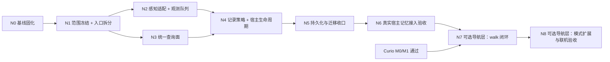

# 空间记忆库实现审计（纯记忆库定位，0.10.0 / HEAD `0737f30`）

> 审计日期：2026-11-06
> 代码基线：`0737f30`（2026-11-05），`package.json` 版本 `0.10.0`
> 文档基线：`docs/spatial-memory-library-design.md` 工作区版本（v0.5，未提交改动）
> 审计范围：本仓库源码、测试、文档和包入口；只读源码审计 + 基线命令验证
> 非审计范围：Curio 宿主仓库源码、真实 Minecraft Java 1.20.1 / mineflayer 联机运行

> **本版范围澄清（2026-11-06 第二稿）**
>
> 本库的目标定位是**纯记忆库**：只负责**记录**和**查询**空间事实，**不涉及任何身体操作、动作派发或路线执行**。
> LLM 选择技能，宿主执行器负责查询、规划、控制和执行；空间记忆库只保存事实并回答查询。
>
> 上一版审计按设计文档的完整目标（含导航/执行）评分约 62%。本版把**导航/执行层单列**，不计入纯记忆库完成度；纯记忆库按“记录 + 查询”重新评分。
>
> 当前包仍然是“记忆核心 + 可选导航/执行层”的混合体。本文既评估纯记忆库的完成度，也指出为落实该定位需要做的入口/模块拆分。

---

## 0. 范围与结论

### 0.1 纯记忆库的职责边界

| 属于纯记忆库 | 不属于纯记忆库 |
|---|---|
| 记录观测到的方块状态、证据、时间、会话 | 扫描世界、监听 `blockUpdate`、自动建图 |
| 记录历史路径、拓扑节点/边、传送证据、占用 | 选择目标、选择技能、选择岸边或载具 |
| 记录资源锚点、容器位置、可达证据 | 保存或推断容器内的物品数量 |
| 查询坐标、标签、名称、历史路线、当前证据 | 规划新路线、搜索路线、启动移动 |
| 持久化已记录事实，恢复原始时间和证据 | 控制身体、调用 `moveTo/swimTo/dig/place` |
| 返回结构化事实、缺口和“不能声称什么” | 自动救援、堵水、造船、挖放搭柱 |

三条硬边界：

1. **库不持有身体。** 没有 bot、按键、寻路器或执行器；不消费 `MoveExecutor`。
2. **库不派发动作。** 不调用 `navigateTo`/`WalkRouteExecutor` 这类动作编排入口，也不提供身体动作端口作为核心 API。
3. **库不自行观察。** 只接收宿主通过合法感知边界提供的 `Observation`/`ObservationBatch`；原始世界事件、墙后数据、声音线索都不能直接写入记忆。

### 0.2 纯记忆库完成度

| 口径 | 估算 | 说明 |
|---|---:|---|
| **纯记忆库（记录 + 查询 + 宿主适配 + 迁移 + 验收）** | **约 75%** | 本文主口径；区间 72%–78% |
| 记忆核心（不含宿主适配、迁移权威切换、真实验收） | 约 82% | 数据/证据、拓扑、记录、持久化、查询面 |
| 可选导航/执行层（不计入纯记忆库） | 约 45% | 仅同高 walk 可编排；其余模式未执行 |
| 若按完整设计（含导航/执行） | 约 62% | 上一版口径，保留用于对比 |

**一句话：** 纯记忆库的核心已经基本可用；当前包多了一层导航/执行编排，需要拆分；真正把它当作“地图记忆库”接入时，最缺的是**感知适配层、统一查询面、宿主记录策略和迁移收口**。

### 0.3 当前最小可用闭环

- 宿主把合法观测写入 `VoxelMap`。
- 宿主把走过的位置标记为 `traversed`，把历史路线保存为 `FragmentStore`。
- 宿主/执行器查询坐标、标签、历史路线、当前证据。
- 宿主显式 `checkpoint()` 写入 SQLite；重启后事实恢复为 `STALE`。

这个闭环**不需要库控制身体**，也不需要库规划路线。

---

## 1. 证据等级与判定规则

| 等级 | 含义 | 本文如何标注 |
|---|---|---|
| 已验证离线 | 源码存在，且离线测试/命令实际通过 | “已验证离线” |
| 已实现未验证 | 源码存在，逻辑可读，但没有真实游戏或宿主验收 | “已实现未验证” |
| 仅类型或声明 | 只有类型、接口或能力表，没有运行时入口 | “仅类型/声明” |
| 缺失 | 没有公开入口，也没有可替代的运行时路径 | “缺失” |
| 阻塞外部 | 需要 Curio/游戏先满足前置条件 | “阻塞外部” |

判定规则：

1. **源码存在 ≠ 可查询。** 只有公开入口、作用域校验和返回结构完整，才算“可查询”。
2. **`geometry_only` ≠ 可执行。** 陆地/水面验证器只回答几何事实，不控制身体。
3. **dry-run ≠ 迁移完成。** SQLite 旧数据迁移目前只有离线演练。
4. **查询不等于动作。** 纯函数验证、历史路线查询、锚点查询属于查询；搜索新路线、启动移动、驱动执行器属于导航/执行，不计入纯记忆库。
5. **单测通过 ≠ 真实世界通过。** 测试中的感知、身体、物理和流体规则都是 Fake/调用方注入。

---

## 2. 评分口径与结果（纯记忆库）

| 领域 | 权重 | 估算分 | 加权 | 置信度 | 主要依据 |
|---|---:|---:|---:|---|---|
| A 数据/证据 | 25 | 88 | 22.0 | 中 | Observation、CellEvidence、Palette、位图、revision、ChangeReport |
| B 拓扑/历史 | 15 | 85 | 12.75 | 中 | FragmentStore、边验证、portal、锚点、占用、合并拆分 |
| C 动态更新/记录 | 10 | 78 | 7.8 | 中 | 差分、局部失效、在途撤销、TTL；宿主接线与队列未闭环 |
| E 持久化/迁移 | 18 | 80 | 14.4 | 中 | 真 SQLite Worker、checkpoint、增量、驻留；迁移仅 dry-run |
| F 感知适配 | 10 | 30 | 3.0 | 低 | 有 `ObservationBatch` 契约；没有运行时感知适配器 |
| G 查询面/兼容 | 12 | 75 | 9.0 | 中 | 节点/图/历史路线/锚点可查；容器内容不在库内；查询入口分散 |
| H 记忆验收 | 10 | 60 | 6.0 | 低 | 离线测试强；真实宿主感知、会话、持久化验收未做 |
| **合计** | **100** |  | **74.95 ≈ 75** |  |  |

派生结论：

- **记忆核心（A+B+C+E+G）**：65.95 / 80 ≈ **82%**。
- **纯记忆库整体（A–H）**：**约 75%，报告为 72%–78% 区间**。
- **可选导航/执行层**：不在上述分母内；当前约 45%。如果把它也算进来，整体约 62%（上一版口径）。

评分的两个限制：

1. 分数是“实现证据等级”，不是测试覆盖率或发布门槛。
2. F/H 的置信度低，因为本库没有真实宿主感知和真实持久化生命周期验收。

---

## 3. 按“纯记忆库”要求的能力矩阵

| 能力要求 | 纯记忆库应提供 | 当前状态 | 现有入口 / 证据 | 主要差距 |
|---|---|---|---|---|
| **查询资源** | 按标签/名字查资源锚点、精确位置、观测时间、可达/历史连接证据 | 部分可用 | `TopologyStore.nodes({ tag, label })`；`SpatialMemoryStore.recordNode`/`graph`/`displayNodes`；`SpatialNode.tag` 含 `resource`/`base`/`danger` 等 | 没有自动资源发现；`SpatialMemoryStore` 没有专门的 `findResource`/`findByTag` 便捷方法 |
| **查询容器** | 容器位置锚点、最后确认存在、精确坐标、可达证据 | 部分可用 | 可把容器记为 `SpatialNode`（`label`/`metadata` 不透明）；`recordNode`/`graph` 可查 | **不保存容器内容/数量/空槽**；容器内容按设计与 `CLAUDE.md` 归宿主精确账本；`src/compat/legacy.ts` 的 chest 结构只用于迁移读取 |
| **查询可行路线** | 查历史路线、当前证据是否支持通行、路线是否被阻塞 | 部分可用 | `FragmentStore`、`TopologyStore.route`、`routeInspection`、`segments`、`components`、`edgeRuntime`；`evaluateWalkStep`/`TraversabilityCache` 作为派生查询 | 只覆盖同高 walk 的当前证据；历史 `route()` 不证明现在可走；没有通用三维/水陆路径查询 |
| **走过的地方存地图** | 宿主写入实际观测；库记录遍历历史、路径片段和持久化 | 机制有，未自动接线 | `observe`/`observeBatch`、`markTraversed`/`markModified`、`saveFragment`、`checkpoint` | 库不扫描、不跟随 bot；`navigateTo` 不自动写库；宿主必须在感知循环和实际走过后显式调用 |
| **不涉及动作** | 核心 API 不持有身体、不派发动作、不启动移动 | 当前包不满足 | 核心记忆 API 本身可独立使用；但包入口同时导出 `navigateTo`、`WalkRouteExecutor`、`MoveExecutor`、`WorldAdapter.moveTo/swimTo/dig/placeBlockAt` | 需要把导航/执行层拆到可选入口或独立包 |

---

## 4. 设计章节对照（按纯记忆库重新定界）

| 设计章节 | 对纯记忆库的意义 | 状态 | 说明 |
|---|---|---|---|
| §1 原则与边界 | 核心约束 | 已落实 | 库不选目标、不自动施工、不接管救援 |
| §2.1 `WorldAdapter` | 只应保留感知输入；身体/动作端口属于宿主 | 需拆分 | 当前 `WorldAdapter` 混合 `observeBatch/subscribe` 与 `moveTo/swimTo/dig/placeBlockAt`；纯记忆库只需前者 |
| §2.2 Curio 接口对照 | 宿主适配，不是库核心 | 阻塞外部 | 没有 Curio 桥；`SkillResult.data.nav`、动作注册、仲裁链不属于纯记忆库 |
| §3.1 历史几何 | 记录历史路径与遍历证据 | 已验证离线 | `FragmentStore`、`PathFragment`、traversal evidence |
| §3.2 当前观测状态 | 记录观测与证据 | 已验证离线 | `Observation`、`CellEvidence`、`ObservationGap`、严格校验 |
| §3.3 通行性 | 派生查询：当前证据是否支持一步通行 | 部分实现 | 四态、依赖、支撑/净空、hazard；只覆盖同高 walk |
| §3.4 水与岩浆 | 记录流体/含水/气泡柱事实；派生几何查询 | 部分实现 | `src/water/` 是几何验证，`geometry_only`、不可执行 |
| §4 稀疏存储 | 核心存储 | 已验证离线 | Section/Palette/位图/revision/LRU/Pin |
| §5 拓扑与垂直连接 | 核心记录/查询 | 已验证离线 | 节点/边/portal/占用/锚点/合并拆分；容器内容仍归宿主 |
| §6 动态更新 | 记录差分与局部失效 | 已实现未验证 | 差分、ChangeReport、在途撤销；`ObservationQueue` 未接入，宿主需手动转发 |
| §7 导航接口 | **不属于纯记忆库** | 可选/排除 | `navigateTo`、`WalkRouteSearch`、`WalkRouteExecutor` 属于可选导航层；`recall_route` 缺失 |
| §8 心智接缝 | 只读查询/稳定引用属于记忆库；动作结果映射属于宿主 | 部分实现 | `NavResult`/`ActionRecord` 存在，但动作注册与 `SkillResult` 映射不在纯记忆库 |
| §9 持久化 | 核心持久化 | 大部分实现 | SQLite Worker、checkpoint、增量、驻留；迁移仅 dry-run |
| §10 阶段 1–6 | 阶段 1–2、5 属于记忆库；阶段 3/6 的动作部分不属于 | 部分完成 | 感知接入未做；库内地图/持久化已做；导航/执行未闭环 |
| §11 必测场景 | 记忆相关场景属于本库；导航/联机执行属于宿主/可选层 | 部分覆盖 | 离线记忆测试较强；真实感知/宿主验收为零 |
| §12 范围取舍 | 纯记忆库进一步收窄 | 需修订 | 设计中的 L2 导航原语应标注为可选层或宿主职责 |

---

## 5. 已落地能力（纯记忆库核心）

### 5.1 观测与证据

`src/observation/` 已实现 `Observation` 的 `source`、`evidence`、`stateComplete`、`observedAt`、`worldId/dim/sessionId`、`originObservationId`、`sequence`、可选 `actionId`，以及 `ObservationGap` 的未观察原因。边界校验要求 `agent_action` 必须配 `confirmed_effect` 和 `actionId`。

已验证离线：来源/证据约束、gap、批次原子性、队列容量与字节上限、恢复后 STALE。

未闭环：`ObservationQueue` 未被 `VoxelMap` 消费；顺序按 `observedAt`，`sequence` 未参与写入排序。

### 5.2 稀疏体素地图

`src/voxel/voxel-map.ts` 已实现 Section/Palette/位打包、负坐标、`explored/traversed/stale/modified/risk` 位图、逐格 `CellEvidence`、内容 revision、局部 `ChangeReport`、会话隔离、过期判断、手动驻留、LRU/Pin。

已验证离线：负坐标、位宽扩容、已知空气与未知区分、重复确认只刷新时间、同名属性变化、历史位不推进内容 revision、恢复为 STALE。

未闭环：`risk` 位从未写入；`markStale` 是整维度粒度；没有自动 TTL 清扫器（查询时检查 `validUntil`）。

### 5.3 拓扑与历史

`src/topology/` 已实现 `FragmentStore`、`TopologyStore`、方向/模式分别验证的边、独立 portal 图、`TransientOccupancy`、碎片连通分量/合并、可达分量内的 surface/deepest 锚点、`recordNode`/`markGone`/`goneNear`。

关键边界已落实：堵塞只改当前验证，不删 fragment；A→B 与 B→A 分开；portal 不混入步行图；临时占用不写永久地形；合并必须有实际 traversal 证据。

未闭环：`SpatialEdge` 是 `TopologyEdge` 的有损投影；容器内容、床/熔炉/农田语义仍归宿主精确账本；自动锚点发现由宿主观察驱动。

### 5.4 查询面

当前可查询：

- `sectionAt` / `graph` / `displayNodes` / `fragments` / `edgesDetailed` / `edgeRuntime` / `portalEdges`。
- `TopologyStore.nodes({ dim, source, tag, label, after, limit })`，支持按资源/基地/危险等标签和名字分页过滤。
- `SpatialMemoryStore.route` / `routeInspection` / `segments` / `components` / `surfaceAnchor` / `deepestAnchor` / `fragmentation`。
- `evaluateWalkStep`/`TraversabilityCache` 作为当前通行证据的派生查询。
- `inspectRoute`/`inspectKnownRoute` 只读投影（如果保留可选导航层）。

未闭环：没有统一的 `findResource`/`findContainer`/`queryRoute` 便捷 API；容器内容不保存；查询入口分散在 `SpatialMemoryStore`、`TopologyStore` 和可选导航模块。

### 5.5 SQLite 持久化

- 单个 `better-sqlite3` Worker 独占连接，WAL、事务、短批量；`checkpoint()` 是唯一显式保存触发。
- 表覆盖 `spatial_sections`、`path_fragments`、`spatial_nodes`、`spatial_edges`、`spatial_events`、`action_records`、`placed_blocks`、`chunk_visits`、`portal_traversals`，并有 schema v1→v7 迁移。
- 体素载荷是 Palette + 位打包 + 位图 + 紧凑逐格元数据；增量 checkpoint 只写脏 Section；缺失 key 不会被当作删除。
- 恢复时保留原始观测时间，FRESH 证据恢复为 STALE；加载旧快照不能覆盖新观测。
- `WorkingSetManager` 支持按需加载、临时 pin 租约、只淘汰已提交/干净/未 pin 的 Section。
- 旧数据迁移只做离线 dry-run：保留 ID、字段、计数、顺序、原始时间和 LRU 序号；不做权威切换。

已验证离线：真实 SQLite Worker、checkpoint ACK、重启恢复、增量保存、驻留/淘汰、WorkingSet、ledger/journal、迁移演练。

未闭环：JSON→SQLite 权威切换、旧写入路径移除、landmark/travel endpoint 的正式迁移、Minecraft 游戏版本列、自动保存/宿主生命周期接线（当前策略是显式 checkpoint）。

### 5.6 打包与测试

- 包入口：`.`、`./storage/sqlite`、`./water`；ESM + 声明；`better-sqlite3` 为可选 peer。
- 本轮实际执行（2026-11-06）：
  - `npm run typecheck`：通过（build + `tsc --noEmit`）。
  - `npm test`：39 个 vitest 文件、**968 个用例全部通过**；退出码为 1，因为 3 个 `acceptance/*.test.mjs` 是 `node:test` 文件，vitest 报 “No test suite found”。
  - `node --test acceptance/provenance.test.mjs acceptance/run.test.mjs acceptance/consumer-close.test.mjs`：**32/32 通过**。
- 总计：**1000 项离线断言通过**。没有启动 Minecraft 服务器、mineflayer bot 或真实 Curio 宿主。

### 5.7 历史几何的统一抽象边界

**统一的是记录类型，不是把所有经历合并成同一种无差别事实。**

- `PathFragment` 用 `kind: 'dug' | 'walked' | 'bridge' | 'built'` 和 `geometrySource: 'traversal' | 'observed_structure' | 'legacy'` 统一矿道、走过、桥和建造几何；`FragmentStore` 不再为每种来源建立独立存储。
- `TraversalEvidence` 是单独的“实际走过”记录：保存 fragment 不等于走过，桥/建造几何也不会自动生成 traversal 证据。
- `SpatialNode`/`SpatialEdge` 统一地点与连接；`SpatialEdge.type` 覆盖 `HORIZONTAL`、`STAIRCASE`、`VERTICAL_SHAFT`、`LADDER`、`BRIDGE`、`DROP`、`CLIMB`、`SWIM`、`CAVE_PASSAGE`、`PORTAL`。
- 仍保留分层与来源：历史几何（fragment）、当前观测（`VoxelMap`）、派生通行性（traversability）分开，这是证据边界，不是重复存储。
- `placed_blocks` 仍是独立账本；容器内容归宿主精确账本；旧 JSON 的 passages/placed/travel 正式迁移仍只有 dry-run。
- 自动归纳“搭的桥”仍依赖宿主提供几何/动作证据；库不会仅凭放置记录生成亲历路线。

**结论：** 模型层已经统一到同一套 `PathFragment`/拓扑抽象，并用 `kind`/`geometrySource`/`basis` 保留来源；摄入与旧数据迁移层尚未完全统一。

---

## 6. 缺口清单（纯记忆库）

### 6.1 P0：影响“作为记忆库可用”的阻塞项

| # | 缺口 | 现状证据 | 影响 | 不能声称 |
|---|---|---|---|---|
| P0-1 | 没有运行时感知适配器 | `src/adapter/types.ts` 有 `observeBatch`/`subscribe` 契约；没有 mineflayer/Curio 实现 | 库无法自行获得观测；宿主必须自己写适配 | “已接入 mineflayer/Curio” |
| P0-2 | 核心入口混合了动作 API | `src/index.ts` 同时导出记忆、拓扑、`navigateTo`、`WalkRouteExecutor`、`MoveExecutor`、`WorldAdapter.moveTo/swimTo/dig/placeBlockAt` | 纯记忆库的边界不清晰，消费者容易误用动作编排 | “这是纯记忆库” |
| P0-3 | 没有统一的资源/容器/路线查询面 | 资源可用 `TopologyStore.nodes({tag,label})`，路线可用 `route`/`fragments`，但没有统一的记忆查询入口；容器内容不在库内 | 查询需要了解多个模块；容器内容无法从库获得 | “库能查询容器内容” |
| P0-4 | 迁移只有 dry-run | `src/compat/migration-dry-run.ts` 明确不切权威源、不删旧写入路径 | 旧 JSON 记忆不能正式迁入 SQLite | “SQLite 迁移完成” |
| P0-5 | “走过即存图”没有自动接线 | `observe`/`markTraversed`/`saveFragment` 都是显式调用；`navigateTo` 不自动写库 | 宿主必须自己接感知和遍历记录；否则地图不会自动增长 | “接入后自动建图” |

### 6.2 P1：影响记录正确性、查询可观测性或持久化的缺口

| # | 缺口 | 现状证据 | 影响 | 不能声称 |
|---|---|---|---|---|
| P1-1 | `ObservationQueue` 未接入 `VoxelMap` | 队列只被导出，没有运行时消费方 | 感知批次背压、字节预算和单次处理量没有形成闭环 | “有界感知管线已接通” |
| P1-2 | `risk` 位图从不写入 | `VoxelMap` 初始化/读取/持久化 `risk`，但没有写入路径 | 风险索引是空转位图；实际风险只走 `HazardFact` | “风险索引已生效” |
| P1-3 | `TransientOccupancy` 未组合进 store | 占用模块独立，查询不经过 store | 临时占位查询需要单独接线 | “玩家/实体占位已作为记忆查询的一部分” |
| P1-4 | `sequence` 未用于写入排序 | 校验存在，写入顺序按 `observedAt` | 同一时间戳的批次顺序语义不完整 | “接收顺序已严格保证” |
| P1-5 | 持久化载荷没有游戏版本列 | 载荷有 `v:2`，DB 有 schema 版本；没有 Minecraft 游戏版本 | 跨版本恢复/解释缺少显式标记 | “版本化载荷已覆盖游戏版本” |
| P1-6 | `markStale` 是整维度粒度 | `markStale(dim, reason)` 按维度失效 | 不能只让某个 Section/区域过期 | “支持逐 Section 会话失效” |

### 6.3 P2：文档、打包与次要语义问题

| # | 缺口 | 现状证据 | 影响 |
|---|---|---|---|
| P2-1 | 文档/版本漂移 | 设计头部仍说 SQLite 未完成；README 写 0.9.0，`package.json` 是 0.10.0；仓库内 tgz 是 0.7.4；acceptance runner 仍写 0.7.6 | 读者容易误判当前状态 |
| P2-2 | `compat` 未从包入口导出 | `package.json` exports 只有 `.`、`./storage/sqlite`、`./water`；`src/index.ts` 不导出 `src/compat/*` | README 宣称的迁移 dry-run 对包消费者不可达 |
| P2-3 | 打包验收可能受 LICENSE 影响 | `acceptance/run.mjs` 预期非 dist 入包项为 `package.json` + `README.md`；根目录已新增 `LICENSE` | 需要实际跑一次 pack 验收确认；本文未执行 |
| P2-4 | 源码注释过期 | `topology-store.ts` 仍称 PORTAL/cross-dimension 在本阶段被拒绝（实际是步行边 API 拒绝，独立 portal API 已支持）；`spatial-memory-store.ts` 仍称 `portalEdges` 不支持，但方法已实现 | 维护者容易被误导 |
| P2-5 | 水面预算语义与陆地不一致 | 水验证预算耗尽报 `UNSUPPORTED/budget_exceeded`，陆地为 `INCOMPLETE` | 调用方需要分别处理；不是世界事实 |
| P2-6 | 容器内容/资源语义没有明确的宿主接口 | 库只存锚点；宿主精确账本没有在本仓库定义查询契约 | 若 Agent 要查“箱子里有什么”，需要宿主提供单独接口 |

### 6.4 不属于纯记忆库的缺口（可选导航/执行层）

以下问题不计入纯记忆库完成度，只影响可选的导航/执行能力：

- 只执行同高、单轴、单格 walk；`jump/step/drop/ladder` 只有几何验证。
- `swim/boat` 只有几何验证，没有规划器/执行器。
- `near`/`reach_block`、`recall_route`、授权挖/放/搭柱/材料/`avoid`/frontier 未实现或显式拒绝。
- `navigateTo`/`WalkRouteExecutor`/`MoveExecutor` 会编排/驱动宿主动作；在纯记忆库中应移到可选层。
- 真实 mineflayer/Curio 身体接入与联机验收。

---

## 7. 纯记忆库的保证与不保证

### 7.1 可以保证

- **只记录有证据的格。** 未观察、遮挡、太暗、未加载、预算跳过都是缺口，不会写成空气。
- **历史与当前分开。** `traversed`/历史路径不因当前堵塞删除；历史经过不证明现在可走。
- **未知/过期不等于可通行。** `UNKNOWN`/`STALE` 不会被查询成 `OPEN`。
- **查询无副作用。** 只读查询不移动、不转头、不扫描、不刷新观测时间、不改变持久化。
- **作用域隔离。** `worldId`/`dim`/`sessionId` 在边界校验；旧会话证据不会污染新会话。
- **持久化语义明确。** 显式 `checkpoint()` 后才算保存；恢复的 FRESH 证据变为 STALE；加载旧快照不会覆盖新观测。
- **稳定 ID 与分页。** 节点/路径/边保留稳定 ID、坐标口径、分页和删除语义。

### 7.2 不能保证

- **完整世界覆盖。** 库只记录宿主给的观测，不保证知道没看见的区域。
- **容器内容/库存。** 容器内容按设计归宿主精确账本，库只存位置锚点和可达证据。
- **自动建图。** 库不扫描世界、不跟随 bot；需要宿主在感知循环中调用 `observe`。
- **自动记录遍历。** 库不会因为身体移动自动 `markTraversed`/`saveFragment`；宿主必须显式调用。
- **通用寻路。** 库不规划路线；可选导航层目前也只支持同高 walk。
- **真实游戏验收。** 没有在真实 Java 1.20.1/mineflayer 环境中验证感知、持久化和访问。

### 7.3 记录策略：`explored` 与 `traversed`

- `explored`：本轮实际观察到的格，带方块状态和证据。
- `traversed`：Agent 实际走过的格，只证明“经过”，不证明“那里是什么方块”。
- `markModified`：只来自已确认的自身动作，且必须带 `actionId`。
- 走过一个地方但没有观察到方块状态，不能据此重建地图；必须由宿主补充观测。
- 记录“走过”的函数本身不是世界动作，但它的输入必须由宿主确认；库不会根据时间接近或位置变化猜归属。

---

## 8. Curio 依赖（按纯记忆库重新定位）

### 8.1 纯记忆库需要 Curio 提供什么

纯记忆库**不需要**身体控制、游泳/划船控制器、挖放授权或动作仲裁。它需要宿主提供：

- 合法观测批次：`observeBatch` 只包含实际看见/接触的格和明确的未观察原因。
- 会话与作用域：`worldId`、`dim`、`sessionId`、真实观测时间。
- 实测位置/遍历事件：宿主确认走过哪些脚格，用于 `markTraversed`；不能用计划坐标或时间接近代替实测。
- 生命周期：连接、断开、暂停、死亡、换维、重连；库据此隔离会话和标记 STALE。
- 持久化调用：在合适时机调用 `checkpoint()`/`flush()`/`close()`。

**结论：** 纯记忆库可以先于完整移动能力接入；但“走过路径”的记录必须等到 Curio 能稳定报告实测位置和动作归属，否则会写入错误的 traversed 证据。

### 8.2 可选导航/执行层需要什么

如果以后还要使用库内的 `navigateTo`/`WalkRouteExecutor`，则需要设计 §10.3 的门槛：

- **M0**：原请求/解析目标/完成条件/父期限；取消/超时保留最后位置和部分效果；父/段取消组合；新 taskId 不重置进展、耗材和时间。
- **M1**：绝对/相对目标语义；支撑顶面与净空；绝对 dig 不被重解释；错物放置修正；纯 step 不默认耗材；上下台阶/下降正确；无授权零耗材；显式挖放仍可组合。
- **M2**：经仲裁的窄 `MoveExecutor`、实测采样、动作归属、单段范围、取消/限时；不转调无约束旧寻路。

这些是**可选导航层**的门槛，不是纯记忆库的 P0。

---

## 9. 下一步路线图（memory-first）

### 9.1 依赖关系



### 9.2 批次表

| 批次 | 目标 | 依赖 | 主要交付 | 退出条件 |
|---|---|---|---|---|
| N0 | 固化基线 | 无 | 记录 HEAD/版本、真实测试结果、已知环境噪声 | 本文已记录；后续沿用同一口径 |
| N1 | 范围冻结 + 入口拆分 | N0 | 明确纯记忆库 API；拆分 `memory` 核心与可选 `navigation` 入口；拆分 `ObservationSource` 与 `BodyAdapter` | 核心入口不导出动作 API；可选层通过独立入口导出；类型/测试通过 |
| N2 | 感知适配 + 观测队列 | N1 | `ObservationSource` 运行时适配；`ObservationQueue`→`VoxelMap`；ChangeReport 失效链路 | 只写入实际观测；墙后变化不污染；缺口/空气证据完整 |
| N3 | 统一查询面 | N1 | 资源按 tag/label、容器位置、历史路线、当前证据、锚点查询；稳定 ID/分页/只读 | 查询不扫描、不移动、不改状态；资源/容器位置可查；容器内容明确不在本库 |
| N4 | 记录策略 + 宿主生命周期 | N2/N3 | `observe` + `markTraversed` + `saveFragment` + `checkpoint` 的宿主接线；explored/traversed 测试 | 走过路径可保存；未观察不伪造；保存/关闭有界；旧会话隔离 |
| N5 | 持久化与迁移收口 | N4 | 权威源切换门禁、游戏版本列、重启/杀进程测试、迁移 dry-run 对等 | 已观测与已保存可区分；重启不复用 OPEN；旧 ID/字段/计数不变 |
| N6 | 真实宿主记忆接入验收 | N5 | Curio 感知/会话/遍历事件接入；真实服务器观测、重连、持久化 | 真实环境只记录合法观测；遍历由实测确认；重启后证据 STALE |
| N7 | 可选导航层：walk 闭环 | N6 + Curio M0/M1 | `WalkRouteSearch`/`navigateTo`/`WalkRouteExecutor` 独立入口 | 短同高 walk 闭环；实测到达；在途失效；旧回调隔离 |
| N8 | 可选导航层：模式扩展与联机验收 | N7 | step/drop/jump/ladder，再 swim/boat；真实联机 | 每个模式有几何 + 真实身体双验收 |

### 9.3 顺序建议

1. **N1 先做**：不拆入口，纯记忆库和动作 API 会一直混在一起。
2. **N2/N3 可并行**：一个是“怎么把观测写进来”，一个是“怎么把事实查出来”。
3. **N4/N5 随后**：记录策略和持久化必须一起验收，否则“走过就保存”不可靠。
4. **N6 是纯记忆库的真实接入验收**：不需要等完整移动能力，但需要 Curio 提供合法观测和实测位置。
5. **N7/N8 是可选导航层**：必须等 Curio M0/M1；不计入纯记忆库完成度。

### 9.4 每批完成定义

- 代码通过 `npm run typecheck` 和 `npm test`；不接受“测试文件加载噪声”被当成通过。
- 新增/修改行为有对应离线用例；真实宿主行为另做联机验收或明确标“未验证”。
- 查询只读、无副作用；记录只接受有证据的输入。
- 不新增隐式扫描、隐式动作、隐式救援或超出委托的目标改写。

---

## 10. 风险与过度声称

### 10.1 必须避免的表述

- 把 `src/adapter/types.ts` 的类型存在写成“已接入 mineflayer”。
- 把 `TopologyStore.nodes` 的锚点查询写成“自动发现资源”。
- 把容器位置锚点写成“能查询容器内容/库存”。
- 把历史 `route()` 写成“当前可走路线”。
- 把 `evaluateWalkStep`/`evaluateWaterRoute` 的几何结果写成“可执行”。
- 把 `navigateTo`/`WalkRouteExecutor` 写成纯记忆库功能。
- 把 SQLite 表/Worker/checkpoint 的存在写成“迁移完成”。
- 把离线 1000 项断言写成“真实游戏验收通过”。

### 10.2 当前未验证项

- 真实 Java 1.20.1 / mineflayer 的感知输入、位置采样和会话生命周期。
- 真实多人环境的墙后改动、区块卸载/加载、重连和换维。
- 杀进程、写满磁盘、SQLite 失败/超时后的恢复边界。
- 真实容器账本与空间锚点的联合查询（本库不保存容器内容）。
- 迁移权威切换后的旧查询/旧技能回归。
- 可选导航层的真实身体执行、落脚、支撑、头部净空和服务器位置纠正。

### 10.3 文档/制品漂移

| 位置 | 当前内容 | 与代码/制品的关系 |
|---|---|---|
| `docs/spatial-memory-library-design.md` 头部 | 称 SQLite 持久化尚未完成 | 落后于 0.9.0/0.10.0 的 SQLite 实现 |
| `docs/design-progress-0.9.0.md` | 记录 955/959 项测试（同文两处不一致）、§3–§9 约 90% | 历史记录；本轮实际为 968 vitest + 32 node |
| `README.md` | 0.9.0、安装 `0.9.0.tgz` | `package.json` 已是 0.10.0；仓库 tgz 是 0.7.4 |
| `README.md` 功能列表 | 包含 migration dry-run | `src/compat/*` 未从包入口导出 |
| `acceptance/run.mjs` | 版本 0.7.6、非 dist 入包项预期 | 新增 `LICENSE` 后需实际跑一次 pack 验收确认 |
| 源码注释 | 部分 portal/迁移注释已过期 | 以当前导出与测试为准 |

### 10.4 设计文档需要同步的范围修订

本文不改设计文档工作区改动。若确认“纯记忆库”定位，设计文档至少需要：

1. 把 §7 的 `navigate_to`/`follow_known_path`/`inspect_route`/`frontier_candidates` 标注为**可选导航层或宿主职责**，不列入纯记忆库核心。
2. 把 §2.1 的 `WorldAdapter` 拆成**感知输入**（记忆库）和**身体动作**（宿主/可选层）。
3. 把 §10.3 的 M2–M5 明确为可选导航层的门槛。
4. 在 §9/§11 中把“容器内容、自动建图、自动记录遍历”写成宿主职责或明确的非目标。

---

## 11. 复杂度与性能风险（仅记录，未优化）

> 本节是静态只读审计结果：**本轮不修改代码，也不声称已做基准测试**。严重度按“渐进复杂度 × 调用频率 × 现有上限”综合判断；“高”表示在默认上限或常见规模下可能成为主线程/内存热点。实际优先级应以真实容量基准测试为准。

### 11.1 高风险

| # | 位置 | 问题与复杂度 | 触发与规模 | 现有缓解 | 后续优化候选（仅记录） |
|---|---|---|---|---|---|
| H1 | `src/voxel/voxel-map.ts` 的 `sectionAt`/`snapshotSection`；调用方 `step.ts`、`land-transition.ts`、`water/verify.ts`、`walk-search.ts` | 每次读取都深拷贝整个 Section（5 个位图、cells、palette、evidence Map）：O(4096 + 已观测格) | 每次 walk step 评估在 section cache miss 时调用；一次搜索最多 8192 条边，可能产生数万次全 Section 拷贝 | 单次评估内有 section cache | 为受信任评估器增加内部非拷贝 `sectionRef/readSection`；公共 `sectionAt` 保留防御性拷贝 |
| H2 | `src/topology/topology-store.ts` 的 `nodes`/`edges`，`fragment-store.ts` 的 `fragments`/`traversals`；`spatial-memory-store.ts` 的 `drain*` | 每页都 `filter+sort` 全部记录，`total` 重新计数；内部分页 drain 变成 O(N² log N) | 2 万节点/边、每页 100 时，一次全量 drain 约 5.7e7 次字符串比较；`findNodeNear` 每次路线查询 O(N) | 有页大小和查询 budget 上限 | 按 dim/tag/label/from/to 建有序索引；提供一次物化的 `listAll`/迭代器；缓存 total |
| H3 | `src/topology/topology-store.ts` 的 `components()`/`invalidateNodeComponent` | 每次重建全部邻接并排序；每次边写入失效扫描全部组件缓存，批量导入接近 O(E·V) | 2 万边批量加载 | 组件 BFS 有缓存，但邻接重建/失效仍全量 | 增量邻接表 + 按组件 ID 失效；按 `mutationRevision` 记忆化整个报告 |
| H4 | `src/topology/topology-store.ts` 的 `fragmentation()` + `connectivity.ts` | 每次调用 drain 全部 fragments/traversals 并深拷贝，再跑 union-find；无 revision 缓存 | 默认上限 1000 fragments × 4096 点，理论可达数百万点 | 有 fragment/traversal 数量上限 | 按 `fragmentStore.revision` 记忆化；提供不克隆 polyline 的轻量迭代器 |
| H5 | `src/traversability/route.ts`、`src/execution/walk-route-executor.ts`、`src/traversability/land-route.ts` | 每走一步都对整条路线做 snapshot/克隆/排序；O(n²) | 正常逐点执行；路线上限 1024 点 | 单步只验证本段 | 内部 `stepAt(i)` 访问器；紧凑状态；按 revision 记忆化；pending 游标代替每次排序 |
| H6 | `src/storage/sqlite/spatial.ts`、`ledger.ts`、`worker.ts` | 仅体素增量；history/topology/ledger 每次 checkpoint 全量复制、解构、删表重插 | 20 万 chunk visits、5 万 placed、8 MB ledger | 有各域容量上限 | 按域 revision 只发送脏域；ledger 增量 upsert；字节统计放回 Worker |

### 11.2 中风险

| 位置 | 问题 | 触发与影响 |
|---|---|---|
| `voxel-map.ts` 的 `markStale`/`beginSession` | 遍历所有 Section/evidence，逐格生成 `CellChange` 和克隆位置，可能一次产生百万级对象 | 断线/换会话；同步 `onChange` |
| `voxel-map.ts` 的 `observeBatch` | 没有 batch 大小/字节上限；大扫描一次性分配 | 宿主一次提交大量观测 |
| `voxel-map.ts` 手动驻留字节估算 | 每批对每个触及 Section 扫描全部 evidence 和字符串长度 | 手动驻留 + 频繁小批次 |
| `voxel/serialization.ts` | 每个已观测格重复 `sessionId/source/evidence` 等字段；全观测 Section 约 0.8–1.2 MB | 大世界持久化体积、JSON/structured clone 峰值 |
| `voxel-map.ts` 的 `writePalette` | `palette.indexOf` 线性查找；palette 不压缩 | 方块类型多或频繁变化 |
| `traversability/cache.ts` | `entries` 没有容量上限/过期清扫；长生命周期校验器持续累积 | 长时间/多会话运行 |
| `navigation/navigate.ts` | `trace = trace.concat(copyTrace(...))` 每段复制前缀；O(段数²) | 多段委托；受 20s deadline 限制 |
| `topology-store.ts` 的 `saveNode` | 每次插入扫描全部节点计数，批量 O(N²) | 2 万节点导入 |
| `topology-store.ts` 锚点查询 | O(N) 扫描 + 两次 BFS；默认 1000 节点 budget，大组件可能直接返回 null | 大图/大组件 |
| `topology-store.ts` 的 `segments()` | 每次扫描全部边，cut 去重是线性 `some` | 大量 blocked 边 |
| `topology-store.ts` BFS | 先解析证据再查 visited，重复消耗 query budget | 大图查询 |
| `voxel-map.ts` 的 `commitDirectory` | 每次 save ACK 展开整个 directory 求 max | 长期运行、目录条目多 |

### 11.3 低风险

- `src/observation/queue.ts`：`drain` 用 `splice(0, take)`，频繁小批量 drain 会搬移剩余队列；入队字节估算两次。
- `src/voxel/lru.ts` 本身 O(1)，但 `WorkingSetManager.reconcile`/`residentSectionKeys` 在比较器里用 `JSON.stringify` 生成 key 并多次复制。
- 增量体素保存仍会扫描全部驻留 Section/directory 计数；Worker 每次增量 checkpoint 跑全表 SQL 聚合。
- `TraversabilityCache` 的 key 每步 `JSON.stringify`（并排序 `avoid`）。
- `src/water/verify.ts` 的 box sweep 每次分配 `[min,max]` 数组，最多约 13 万次。
- `src/store/spatial-memory-store.ts:583-676` 有一段私有的 O(P²) 两两 proximity 代码，当前未被调用；建议删除以免未来误接。
- `portalEdges` 未分页，返回全部 portal 边和 traversal（有 1000×32 上限）。
- `TransientOccupancy` 有 256 条上限，读取时惰性清扫，暂不需要优化。

### 11.4 已检查、暂未发现明显问题

- `WalkRouteSearch.advance/status`：使用增量游标，边预算有上限；没有整图克隆、`shift`/`splice` 或重复排序。
- 水面路线验证有 `maxCandidateCells`/`maxReadCells`/`maxNeighborReads`/`maxShapeChecks` 上限，没有 O(volume²)。
- `WalkRouteExecutor` 的样本处理是 O(1)，只保留最后样本/位置，没有逐样本 `filter/find`。
- `WorkingSetManager` 淘汰使用一次 LRU 快照 + 游标，复杂度受驻留上限约束。
- `VoxelMap.cellAt`/`historyAt` 只克隆单条证据或返回标志对象，适合在循环中调用。

### 11.5 后续验证建议（不在本轮）

- 用 1 万 Sections、2 万节点/边、1000 fragments、1024 点路线做基准测试。
- 重点测量：walk 搜索耗时与 GC、路线执行每步耗时、checkpoint 时间、fragmentation 时间、分页查询延迟、手动驻留批次的内存峰值。
- 先修 H1/H2/H5/H6（热路径），再根据实测决定 H3/H4 和中等项；不要在没有基准的情况下做大规模重构。

---

## 12. 附录

### A. 关键证据索引

| 主题 | 文件 |
|---|---|
| 观测/证据 | `src/observation/types.ts`、`src/observation/validate.ts`、`src/observation/queue.ts` |
| 体素地图 | `src/voxel/voxel-map.ts`、`src/voxel/section.ts`、`src/voxel/palette.ts`、`src/voxel/serialization.ts`、`src/voxel/snapshot.ts` |
| 拓扑/历史 | `src/topology/fragment-store.ts`、`src/topology/topology-store.ts`、`src/topology/edge-runtime.ts`、`src/topology/portal.ts`、`src/topology/occupancy.ts` |
| 查询/store | `src/store/spatial-memory-store.ts` |
| 派生通行查询 | `src/traversability/step.ts`、`src/traversability/cache.ts`、`src/water/verify.ts` |
| 持久化 | `src/storage/sqlite/worker.ts`、`src/storage/sqlite/spatial.ts`、`src/storage/sqlite/working-set.ts`、`src/storage/sqlite/journal.ts`、`src/storage/sqlite/ledger.ts` |
| 迁移/兼容 | `src/compat/legacy.ts`、`src/compat/migration-dry-run.ts` |
| 可选导航/执行（不在纯记忆库核心） | `src/navigation/*`、`src/execution/*`、`src/adapter/types.ts` |
| 公开入口 | `src/index.ts`、`package.json` |

### B. 本轮验证命令与结果

```text
npm run typecheck
-> exit 0（build + tsc --noEmit）

npm test
-> 39 vitest 文件通过；968 个用例通过
-> 3 个 acceptance/*.test.mjs 非 vitest suite，报 "No test suite found"
-> 进程退出码 1，原因是上述 3 个加载项，不是库内用例失败

node --test acceptance/provenance.test.mjs acceptance/run.test.mjs acceptance/consumer-close.test.mjs
-> 32/32 通过
```

未执行：真实 Minecraft 服务器、mineflayer bot、Curio 宿主、`acceptance/run.mjs` 的完整 pack/install 流程。

### C. 相关文档

- [设计文档](./spatial-memory-library-design.md)
- [Agent/宿主接口契约](./memory-host-interface-contract.md)
- [0.9.0 实现进度（历史）](./design-progress-0.9.0.md)
- [导航 API 状态](./navigation-api-status.md)
- [运行时 store 组合](./spatial-memory-store.md)
- [陆地路线验证](./land-route-validation.md)
- [水面验证](./water-validation.md)
- [事件与动作 journal](./event-persistence.md)
- [共享会话生命周期](./shared-session-lifecycle-b1.md)

---

## 13. 结论

按“纯记忆库”定位，当前实现已经具备可用的核心：它能记录宿主提供的合法观测，保留历史路径和拓扑，按证据回答“这里观察到什么、哪些路线曾走过、锚点在哪里、当前证据是否支持通行”，并能通过 SQLite 持久化。

但它还不是一个边界清晰的纯记忆库产品：

- 公开入口同时包含记忆和动作编排；
- 没有运行时感知适配器；
- 资源/容器/路线的查询面分散，容器内容不在库内；
- “走过即存图”需要宿主显式接线；
- 迁移权威切换和真实宿主验收未完成。

**下一步应先把“memory core”和“optional navigation”拆开，优先完成感知适配、统一查询面、宿主记录策略和持久化收口；导航/执行层作为独立可选层，等 Curio 基础移动修复后再接。**
