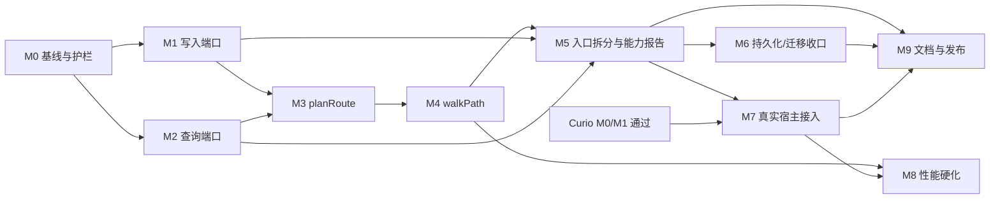

# 空间记忆库 ↔ Agent 宿主接口实现计划与代码审计要求

> 文档状态：v0.1（2026-11-06）
> 代码基线：`df4be98`（包版本 `0.10.0`）
> 契约基线：[Agent/宿主接口契约](./memory-host-interface-contract.md)（提交 `bb1444a`，契约版本 `memory-host-contract/1`）
> 审计基线：[实现审计](./implementation-audit-0.10.0.md)
> 宿主参考：`E:\Repos\MinecraftLLM\docs\movement-primitives-refactor-plan-20261106.md`
> 分支：`integration/memory-host-20261106`

> 本文只规定**实现顺序、文件级任务、测试、退出条件和代码审计要求**，不代表接口已经实现。所有“已实现/待实现”状态以接口契约 §15 和实际代码为准。

---

## 0. 目标与非目标

### 0.1 目标

把接口契约落成可交付代码，使 Agent 宿主能够：

1. 写入合法观测、实际遍历和已确认动作效果；
2. 只读查询资源锚点、容器位置、历史路线和当前证据；
3. 可选地调用只读 `planRoute`，拿到可检查、带 `routeId` 的路线；
4. 可选地调用 `walkPath(routeId)`，逐段有界执行并如实回执；
5. 在观测变化、取消/超时、会话变化和持久化边界上保持证据语义。

### 0.2 非目标

- 不实现 Curio 的 L1 元语（`move_step`/`mine_cell`/`place_cell`/`place_support`/`pillar_one`）。
- 不实现 pathfinder 或替代宿主寻路器。
- 不在空间库保存容器内容/库存。
- v1 不实现水面/船执行；只保留几何验证。
- 不在本轮做 JSON→SQLite 权威切换，除非 M6 的迁移门禁全部满足。
- 不把“文档完成”写成“代码完成”。

### 0.3 交付原则

- **契约优先**：先落类型和接口，再落实现；实现偏离契约必须改契约或明确记录。
- **增量兼容**：保留现有 `SpatialMemoryStore`、`navigateTo`、`WalkRouteExecutor` 等入口；新接口优先新增子入口。
- **纯记忆核心**：memory 核心不得依赖导航/执行/身体端口。
- **证据优先**：没有观测/实测证据，不写状态、不声称 OPEN/ARRIVED。
- **测试先行**：每个任务先定义可观察契约和故障边界，再实现。
- **不做未测优化**：性能优化必须先有基准和回归阈值。

---

## 1. 当前基线

### 1.1 已验证

- `npm run typecheck`：通过（build + `tsc --noEmit`）。
- `npm test`：39 个 vitest 文件、968 个用例通过；3 个 `acceptance/*.test.mjs` 不是 vitest suite，退出码 1 属已知加载噪声。
- `node --test acceptance/provenance.test.mjs acceptance/run.test.mjs acceptance/consumer-close.test.mjs`：32/32 通过。
- 真实 SQLite Worker、checkpoint、WorkingSet、ledger/journal 有离线测试。
- 未启动 Minecraft/mineflayer，真实联机验收为零。

### 1.2 当前 P0 缺口

| 缺口 | 现状 | 目标任务 |
|---|---|---|
| `SpatialMemoryStore.observeBatch` 丢 `BatchChangeReport` | store wrapper 返回 `void` | M1.1 |
| `SpatialMemoryStore.addTraversal` 未暴露 | `FragmentStore.addTraversal` 已有 | M1.3 |
| 无统一 `MemoryIngest` | 方法分散在多个 store | M1.4 |
| `WorldAdapter` 混合感知与身体 | 单接口同时含 `observeBatch` 与 `moveTo/swimTo/dig/place` | M1.5 |
| 无统一 `SpatialQueryPort` | 查询入口分散 | M2 |
| 无 `planRoute`/`RoutePlan`/`RoutePlanRegistry` | 只有 `WalkRouteSearch`/`navigateTo` | M3 |
| 无 `walkPath(routeId)` | 只有 `WalkRouteExecutor` + 点列 | M4 |
| `NavOutcome` 无 `INVALIDATED` | 只有 `route_invalidated` problem | M4.7 |
| 无 `memory`/`navigation` 包入口 | 根入口混合导出 | M5 |
| 迁移仅 dry-run | 无权威切换 | M6.3 |
| 真实宿主/游戏未接入 | adapter 只有类型 | M7 |

---

## 2. 实施总览

### 2.1 里程碑依赖



### 2.2 推荐并行

- M1（写入）与 M2（查询）可在 M0 后并行；两者不要同时改同一文件。
- M3 需要 `WalkRouteSearch` 和 `SpatialQueryPort` 的只读能力；可与 M2 后半段并行。
- M6 可在 M4 后与 M5/M7 部分并行，但不要同时改 `src/storage/sqlite/*`。
- M8 只能在 M4/M7 有基准后开始；不要在 M1–M4 期间做未测优化。

### 2.3 阶段门禁

| 门禁 | 必须满足 |
|---|---|
| G1 契约冻结 | M1/M2 类型与契约文档一致；未知字段拒绝 |
| G2 规划可审 | M3 `planRoute` 只读、返回 `routeId`、无移动/写库 |
| G3 执行可控 | M4 `walkPath` 不搜索、不施工、失效即停、grounded 到达 |
| G4 入口隔离 | M5 `memory` 入口不导入动作/执行/身体端口 |
| G5 持久化可信 | M6 已观测 vs 已保存、恢复 STALE、迁移门禁 |
| G6 真实联调 | M7 依赖 Curio M0/M1，真实验收通过前不得声称完成 |

---

## 3. 详细任务

> 每个任务包含：**目标 / 依赖 / 修改文件 / 交付 / 测试 / 退出条件 / 审计证据**。  
> 文件路径均为本仓库相对路径；跨仓库工作标注“Curio”。

### M0 基线与护栏

#### M0.1 固化基线

- 目标：记录当前 HEAD、包版本、测试结果、已知噪声。
- 依赖：无。
- 修改文件：无（只记录）。
- 交付：实现计划、审计文档、契约文档。
- 测试：`npm run typecheck`、`npm test`、`node --test acceptance/...`。
- 退出条件：测试结果可复现；已知失败/噪声列出。
- 审计证据：命令、退出码、测试文件/用例数、未执行项。

#### M0.2 确认分支与保护

- 目标：在 `integration/memory-host-20261106` 上工作；保留 `docs/spatial-memory-library-design.md` 的未提交改动。
- 依赖：M0.1。
- 修改文件：无。
- 交付：分支状态、未提交文件清单。
- 测试：`git status --short`。
- 退出条件：清楚哪些文件属于本任务、哪些是用户未提交改动。
- 审计证据：提交前检查暂存区，不使用整仓恢复/硬重置。

### M1 写入端口（memory core）

#### M1.1 `observeBatch` 报告透传

- 目标：`SpatialMemoryStore.observeBatch` 返回 `BatchChangeReport`，宿主能拿到本次差分/gap。
- 依赖：M0。
- 修改文件：
  - `src/store/store.ts`
  - `src/store/spatial-memory-store.ts`
  - `src/index.ts`（类型导出，如需要）
  - `tests/spatial-memory-store.test.ts`
- 变更：
  - 接口新增返回值；
  - 实现直接返回 `this.voxel.observeBatch(batch)`；
  - 保持整批原子性；
  - 不改变现有 `observe` 行为。
- 测试：
  - 返回值包含受影响 Section 与 gap；
  - 非法批整批拒绝且无部分写入；
  - 作用域不匹配返回/抛出结构化错误；
  - 调用方旧代码仍可忽略返回值。
- 退出条件：宿主无需绕过 store 直接访问 `VoxelMap` 即可获得报告。
- 审计证据：调用链 `observeBatch → VoxelMap.observeBatch`；测试覆盖 gap/原子性。

#### M1.2 生命周期端口

- 目标：在 `SpatialMemoryStore` 上暴露 `beginSession(sessionId)` / `markStale(dim, reason)`，返回 `ChangeReport`。
- 依赖：M1.1。
- 修改文件：
  - `src/store/store.ts`
  - `src/store/spatial-memory-store.ts`
  - `src/store/index.ts`
  - `tests/spatial-memory-store.test.ts`
- 变更：
  - 委托 `VoxelMap.beginSession/markStale`；
  - 作用域检查；
  - 不把旧会话证据续签。
- 测试：断线/重连、旧会话拒绝、STALE 报告、历史不删除。
- 退出条件：宿主可通过统一 store 管理会话，不必直接操作 `VoxelMap`。
- 审计证据：会话隔离测试；旧会话写入拒绝；报告可转发给 verifier/executor。

#### M1.3 暴露 `addTraversal`

- 目标：`SpatialMemoryStore.addTraversal(evidence)` 委托 `FragmentStore.addTraversal`。
- 依赖：M0。
- 修改文件：
  - `src/store/store.ts`
  - `src/store/spatial-memory-store.ts`
  - `tests/spatial-memory-store.test.ts`
  - `tests/fragment-store.test.ts`（如需补跨 store 用例）
- 变更：
  - 作用域检查；
  - fragment 必须存在；
  - 幂等/冲突/容量语义与 FragmentStore 一致；
  - 不自动生成 fragment 或反向边。
- 测试：未知 fragment 拒绝；跨世界拒绝；同 id 同内容幂等；同 id 不同内容冲突；容量拒绝。
- 退出条件：宿主可通过 memory store 记录实际遍历。
- 审计证据：`addTraversal` 委托路径；不修改 fragment 时间/uses；不生成当前通行结论。

#### M1.4 统一 `MemoryIngest` 端口

- 目标：定义并实现 `MemoryIngest`（契约 §4.1），作为宿主写入的唯一入口。
- 依赖：M1.1–M1.3。
- 修改文件：
  - `src/memory/ingest.ts`（新建）
  - `src/memory/index.ts`（新建）
  - `src/store/spatial-memory-store.ts`（实现或适配）
  - `src/index.ts`（兼容导出）
  - `tests/memory-ingest.test.ts`（新建）
- 变更：
  - 方法签名严格按契约；
  - 作用域/会话/原子性校验；
  - 返回 `ChangeReport`/`BatchChangeReport`；
  - 不暴露动作 API。
- 测试：契约 §4.2/§4.3/§4.4 的每条硬规则至少一个用例；所有方法的作用域测试。
- 退出条件：宿主只依赖 `MemoryIngest` 即可完成写入。
- 审计证据：接口不依赖 `src/navigation/*`、`src/execution/*`、`src/adapter/types.ts` 的身体端口。

#### M1.5 拆分 `ObservationSource` 与 `BodyAdapter`

- 目标：把当前 `WorldAdapter` 拆成感知输入（memory 核心需要）与身体动作（宿主/导航层）。
- 依赖：M1.4。
- 修改文件：
  - `src/adapter/types.ts`
  - `src/adapter/index.ts`
  - `src/index.ts`
  - `tests/adapter-contract.test.ts`（新建或扩展）
- 变更：
  - `ObservationSource`：`state` 的感知子集、`observeBatch`、`capabilities`、`subscribe`；实现中命名为 `PerceptionSource`，避免与既有证据来源联合类型 `ObservationSource` 冲突（见契约 §15）；
  - `BodyAdapter`：`moveTo`、`swimTo`、`stopAll`、`dig`、`placeBlockAt`、`recentDug`/`recentPlaced`；
  - `WorldAdapter` 保留为兼容交叉类型（或组合），但 memory 核心只导入 `ObservationSource`；
  - `PerceptionEvent`/`EventContext` 保持在感知侧。
- 测试：类型测试；memory 入口不引用 `BodyAdapter`；旧 `WorldAdapter` 兼容。
- 退出条件：纯记忆库编译路径不需要身体动作类型。
- 审计证据：导入图检查；`src/memory/*` 不得导入 `BodyAdapter`/`MoveExecutor`。

#### M1.6 ChangeReport 转发

- 目标：提供明确的 `ChangeReportSink`/`subscribeChanges`，把写入报告送到活跃 verifier/executor。
- 依赖：M1.1/M1.2。
- 修改文件：
  - `src/voxel/voxel-map.ts`（如需暴露订阅）
  - `src/store/spatial-memory-store.ts`
  - `src/execution/walk-route-executor.ts`（已有 `observe`，确认）
  - `tests/event-integration.test.ts`（新建或扩展现有）
- 变更：
  - 写入后报告可用；
  - 不改变“观测→差分→失效”的同步顺序；
  - 不引入后台自动重扫。
- 测试：observe → report → executor 收到并撤销在途段；无关 Section 不打断；旧报告不覆盖新证据。
- 退出条件：宿主能按契约 §8.1 转发。
- 审计证据：时序测试；报告内容只含受影响 Section。

### M2 查询端口（memory core）

#### M2.1 定义 `SpatialQueryPort` 类型

- 目标：按契约 §5 定义 `SpatialQueryRequest`、`SpatialQueryResult`、`SpatialQueryData`、`CellQueryView`、`SpatialQueryProblem`。
- 依赖：M0。
- 修改文件：`src/query/types.ts`（新建）、`src/query/index.ts`（新建）、`src/index.ts`。
- 测试：类型导出测试；unknown kind 拒绝。
- 退出条件：类型与契约一致，未知字段拒绝。

#### M2.2 实现 cells 查询

- 目标：按位置返回 state/evidence/freshness/gap；未驻留/未观察区分。
- 依赖：M2.1、M1.2。
- 修改文件：`src/query/cells.ts`（新建）、`src/query/index.ts`、`tests/query-cells.test.ts`。
- 测试：已知空气、未知、未驻留、过期、gap、负坐标。
- 退出条件：查询只读；不刷新时间；不返回“未返回=空气”。
- 审计证据：revision/pin/save 前后不变；未驻留返回 `not_resident`/gap。

#### M2.3 实现碎片/traversal/nodes/edges 分页查询

- 目标：包装 `FragmentStore`/`TopologyStore` 的只读查询；稳定 ID、游标、total。
- 依赖：M2.1。
- 修改文件：`src/query/topology.ts`（新建）、`src/query/index.ts`、`tests/query-topology.test.ts`。
- 测试：分页、`after`、limit 上限、作用域、空结果、total。
- 退出条件：无全量不可避免的 drain；分页不重复/不丢。
- 审计证据：读路径不修改 revision/uses/时间；不 pin。

#### M2.4 历史路线/锚点/分量/portal 查询

- 目标：包装 `route`/`routeInspection`/`surfaceAnchor`/`deepestAnchor`/`components`/`segments`/`portalEdges`。
- 依赖：M2.3。
- 修改文件：`src/query/history.ts`（新建）、`src/query/index.ts`、`tests/query-history.test.ts`。
- 测试：历史不可执行；锚点限定在可达分量；portal 独立；空/未找到语义。
- 退出条件：结果明确 `historicalGeometry`/`executable:false`/`currentPassability:'UNKNOWN'`。
- 审计证据：查询不启动移动、不写库、不刷新证据。

#### M2.5 资源/容器位置查询

- 目标：`resourceAnchors`/`containerAnchors` 按 tag/label/位置返回锚点和可达证据；容器内容返回 `host_ledger`。
- 依赖：M2.3。
- 修改文件：`src/query/anchors.ts`（新建）、`src/query/index.ts`、`tests/query-anchors.test.ts`。
- 测试：按 tag/label 过滤；精确/区域；容器内容 unsupported；不返回空箱。
- 退出条件：资源/容器位置可查；内容明确不支持。
- 审计证据：容器内容查询返回 `host_ledger`；不推断物品数量。

#### M2.6 能力报告与边界

- 目标：`query.capabilities` 返回各查询 kind 的可用性。
- 依赖：M2.1–M2.5。
- 修改文件：`src/query/capabilities.ts`（新建）、`src/query/index.ts`。
- 测试：缺失/部分实现的 kind 返回 `unsupported`，不静默。
- 退出条件：宿主可精确判断查询能力。

### M3 `planRoute` 与路线句柄（可选导航）

#### M3.1 定义规划类型

- 目标：`RoutePlanRequest`/`RoutePlan`/`RouteSegment`/`RouteBoundary`/`RouteUnsupported`/`RouteEvidence`/`RoutePlanResult`/`RoutePlanSource`。
- 依赖：M0。
- 修改文件：`src/navigation/route-plan-types.ts`（新建）、`src/navigation/index.ts`、`src/index.ts`。
- 测试：类型导出；未知字段拒绝；枚举穷尽。
- 退出条件：契约 §6.2/§6.4 字段齐全。

#### M3.2 搜索源适配

- 目标：将 `WalkRouteSearch` 适配为 `RouteSearchSource`。
- 依赖：M3.1。
- 修改文件：`src/navigation/route-search.ts`（新建）、`tests/route-search.test.ts`。
- 测试：start/advance/snapshot/cancel；预算切片；状态映射。
- 退出条件：不复制整套搜索状态；advance 有界。

#### M3.3 `source:'search'` 规划

- 目标：实测起点 → 有界搜索 → `RouteVerifier` 复验 → `RoutePlan`。
- 依赖：M3.1/M3.2、M2.2。
- 修改文件：
  - `src/navigation/route-plan.ts`（新建）
  - `src/navigation/index.ts`
  - `tests/route-plan-search.test.ts`
- 变更：
  - `sample()` 必须实测；
  - 目标不取整/不替换；
  - 候选验证后 `confidence:'verified'`；
  - 生成 boundaries/unsupported；
  - 不移动、不写记忆。
- 测试：FOUND/NO_VERIFIED_PATH/INSUFFICIENT_EVIDENCE/UNSUPPORTED/BUDGET_EXHAUSTED；零边；作用域；证据过期；非 walk/near/avoid 拒绝。
- 退出条件：`executable` 只对 verified 为 true；规划前后地图/历史 revision 不变。
- 审计证据：无 `MoveExecutor`/`navigateTo` 调用；无 `VoxelMap.observe`/`saveFragment` 写入。

#### M3.4 `source:'history'` 规划

- 目标：显式 `pathId` 读出历史折线，验证当前 walk 通行，返回 `kind`/`pathId`/`verdict`。
- 依赖：M3.1、M2.4。
- 修改文件：`src/navigation/route-plan-history.ts`（新建）、`tests/route-plan-history.test.ts`。
- 变更：
  - 不调用会启动执行的 `startKnownWalkRoute`；
  - 新增 plan-only 历史读取/验证；
  - 终点与 `resolvedTarget` 分开；
  - 历史几何不因当前阻塞删除。
- 测试：不存在 pathId、歧义、几何不支持、当前阻塞、当前 OPEN、历史端点略近。
- 退出条件：历史计划只读；不修改 fragment uses/时间。
- 审计证据：FragmentStore 快照前后一致；不启动 `WalkRouteExecutor`。

#### M3.5 `source:'auto'`

- 目标：有 pathId 时 history 优先，否则 search；不做无限历史召回。
- 依赖：M3.3/M3.4。
- 修改文件：`src/navigation/route-plan.ts`、`tests/route-plan-auto.test.ts`。
- 测试：history 成功/失败回退 search；无 pathId 直接 search；不得把“无历史”写成“无路”。
- 退出条件：来源在 `RoutePlan.source` 如实报告。

#### M3.6 `RoutePlanRegistry`

- 目标：有界、TTL、单次使用、作用域绑定、执行中 pin。
- 依赖：M3.1。
- 修改文件：`src/navigation/route-plan-registry.ts`（新建）、`tests/route-plan-registry.test.ts`。
- 变更：
  - `register/consume/release`；
  - 消费即失效；
  - 过期/作用域/不存在/不可执行分别返回；
  - 容量上限、淘汰策略、执行中不淘汰。
- 测试：单次使用、并发消费、过期、作用域、容量、release。
- 退出条件：`walkPath` 只能消费注册表发出的 routeId。
- 审计证据：没有跨进程持久化；没有伪 routeId。

#### M3.7 规划能力报告

- 目标：`planRoute` 能力表：walkSearch/walkHistory/walkAuto/near/reachBlock/digPlace/swim/boat。
- 依赖：M3.3–M3.6。
- 修改文件：`src/navigation/capabilities.ts`、`tests/navigation-capabilities.test.ts`。
- 测试：未实现能力返回 false；`planRoute` 对未实现能力返回结构化 unsupported。
- 退出条件：宿主可精确判断。

### M4 `walkPath`（可选导航/宿主）

#### M4.1 定义执行类型

- 目标：`WalkPathRequest`/`WalkPathResult`/`WalkPathOutcome`/`WalkPathEnvironment`/`WalkBodyPort`/`ChangeReportSource`。
- 依赖：M3.1。
- 修改文件：`src/navigation/walk-path-types.ts`（新建）、`src/navigation/index.ts`、`src/index.ts`。
- 测试：类型导出；outcome 穷尽；`INVALIDATED` 独立。
- 退出条件：契约 §7.2–§7.4 字段齐全。

#### M4.2 消费 routeId

- 目标：`walkPath` 入口消费注册表；复核作用域、过期、`executable`、起点。
- 依赖：M3.6、M4.1。
- 修改文件：`src/navigation/walk-path.ts`（新建）、`tests/walk-path-start.test.ts`。
- 变更：
  - 单次使用；
  - 错误分类：`route_not_found`/`route_consumed`/`route_expired`/`scope_mismatch`/`route_not_executable`/`route_start_changed`；
  - 起点欧氏距离 > 0.05 拒绝。
- 测试：每条错误路径；不执行任何 move；消费后不可复用。
- 退出条件：预检失败无身体动作、无记忆写入。

#### M4.3 绑定 `WalkRouteExecutor`

- 目标：由 route plan 构造 `WalkRouteRequest`，使用 `WalkRouteExecutor` 执行；不使用 `navigateTo`。
- 依赖：M4.2。
- 修改文件：`src/navigation/walk-path.ts`、`tests/walk-path-execution.test.ts`。
- 变更：
  - 传入 points/body/shapeProvider/deadline/bodyArrival；
  - 不搜索、不换路；
  - `maxRouteLength` 约束；
  - 测量样本 association。
- 测试：逐段 OPEN、到达、无重规划、长路线预算。
- 退出条件：执行路径无 `WalkRouteSearch`/pathfinder 调用。
- 审计证据：调用图/测试断言；`WalkRouteExecutor.start` 只被调用一次。

#### M4.4 失效与结果映射

- 目标：`ChangeReport` → 在途段失效 → `INVALIDATED`；保留最后位置/段/剩余点。
- 依赖：M4.3、M1.6。
- 修改文件：`src/navigation/walk-path.ts`、`tests/walk-path-invalidation.test.ts`。
- 测试：当前段失效、后续段失效、无关变化不打断、旧报告不覆盖新证据。
- 退出条件：`INVALIDATED` 不被折叠成 `BLOCKED`/`NO_PATH`/`FAILED`。
- 审计证据：报告内容、段索引、最后位置。

#### M4.5 grounded 到达

- 目标：`ARRIVED` 只由实测接地/支撑/稳定样本确认；`confirmed:true`。
- 依赖：M4.3。
- 修改文件：`src/navigation/walk-path.ts`、`tests/walk-path-arrival.test.ts`。
- 测试：`bodyArrival` 默认/自定义；差一点不算到；Promise resolve 不算；`nextPointIndex` 不算；旧回调不算。
- 退出条件：`ARRIVED` 必有 `lastPosition`/`lastObservation`；否则 `unconfirmed_arrival`。
- 审计证据：测试覆盖假到达；无 1e-6 替代。

#### M4.6 取消/超时/部分效果

- 目标：保留已确认位移、trace、最后观测、部分效果。
- 依赖：M4.3。
- 修改文件：`src/navigation/walk-path.ts`、`tests/walk-path-cancel.test.ts`。
- 测试：signal、deadline、父取消、旧 stop 不影响新执行。
- 退出条件：取消/超时结果不伪造成成功，不清空已确认效果。

#### M4.7 `INVALIDATED` outcome

- 目标：在 `WalkPathOutcome` 中加入独立 `INVALIDATED`；必要时扩展 `NavOutcome` 或仅在 walkPath 结果中表达。
- 依赖：M4.4。
- 修改文件：`src/navigation/walk-path-types.ts`、`src/navigation/types.ts`（如扩展）、`tests/nav-result.test.ts`。
- 测试：映射、宿主外壳、日志字段。
- 退出条件：不把 `INVALIDATED` 写成 `PATH_NOT_FOUND`。

#### M4.8 身体端口契约测试

- 目标：`WalkBodyPort` 的 `ExecutableMove`/`BodySample`/`stop` 语义有契约测试。
- 依赖：M4.3。
- 修改文件：`tests/walk-body-port-contract.test.ts`（新建）。
- 测试：executionId/sequence 关联；重放样本拒绝；旧回调隔离；单步目标不被改写；无挖放。
- 退出条件：宿主实现可对照测试。

### M5 入口拆分与能力报告

#### M5.1 新增 `memory` 入口

- 目标：纯记忆核心导出，不包含动作/执行/身体端口。
- 依赖：M1/M2。
- 修改文件：`src/memory/index.ts`（新建）、`package.json`、`tests/entrypoints.test.ts`。
- 变更：导出 `MemoryIngest`、`SpatialQueryPort`、`Observation`、`VoxelMap`、`SpatialMemoryStore` 等；不含 `navigateTo`/`walkPath`/`MoveExecutor`。
- 测试：编译期/运行期导入检查；`memory` 入口的依赖图不含 `src/navigation/*`/`src/execution/*`。
- 退出条件：纯记忆库消费者可只依赖 `./memory`。

#### M5.2 新增 `navigation` 入口

- 目标：导出 `planRoute`/`walkPath`/`RoutePlanRegistry`/能力表。
- 依赖：M3/M4。
- 修改文件：`src/navigation/index.ts`、`package.json`、`tests/entrypoints.test.ts`。
- 测试：`./navigation` 导入；不导出 L1 动作。
- 退出条件：可选导航能力可独立安装/导入。

#### M5.3 根入口兼容

- 目标：根入口保留旧导出；新宿主使用子入口。
- 依赖：M5.1/M5.2。
- 修改文件：`src/index.ts`、`README.md`（如需）、`tests/entrypoints.test.ts`。
- 测试：旧导入不破坏；根入口不导致 memory 入口导入导航/执行。
- 退出条件：无循环依赖；类型/运行时导入通过。

#### M5.4 `MemoryHostCapabilities`

- 目标：实现契约 §2.3 的能力报告。
- 依赖：M5.1–M5.3。
- 修改文件：`src/memory/capabilities.ts`（新建）、`src/navigation/capabilities.ts`、`tests/capabilities.test.ts`。
- 测试：每项与实现一致；未实现为 false；契约版本正确。
- 退出条件：宿主可精确协商。

### M6 持久化与迁移收口

#### M6.1 游戏版本列

- 目标：体素载荷/DB 记录明确 Minecraft 游戏版本。
- 依赖：M0。
- 修改文件：`src/voxel/serialization.ts`、`src/storage/sqlite/worker.ts`、`src/storage/sqlite/types.ts`、`tests/schema-v8.test.ts`（新建）。
- 测试：旧 v1/v2 载荷迁移；新载荷读取；版本缺失拒绝/标记。
- 退出条件：跨版本恢复可解释；不伪造版本。

#### M6.2 ActionRecord 持久化钩子

- 目标：`planRoute`/`walkPath` 产生 `ActionRecord`；提供宿主保存钩子/示例。
- 依赖：M3/M4、M1.4。
- 修改文件：`src/navigation/route-plan.ts`、`src/navigation/walk-path.ts`、`src/storage/sqlite/journal.ts`、`tests/event-persistence.test.ts`。
- 测试：成功/失败/取消/失效均保留记录；保存失败不改身体效果。
- 退出条件：宿主能按契约 §9.3 落库。

#### M6.3 迁移权威源门禁

- 目标：定义并测试 JSON→SQLite 切换门禁；不默认启用。
- 依赖：M6.1。
- 修改文件：`src/compat/migration-dry-run.ts`（只读/门禁报告）、`docs/*`、`tests/migration-batch.test.ts`。
- 测试：ID/字段/计数/删除语义；回滚；不回退 JSON 复活删除。
- 退出条件：切换条件明确；未满足时继续 dry-run。
- 审计证据：无自动切换；无双写；无“缺记录回退 JSON”。

#### M6.4 重启/checkpoint 回归

- 目标：已观测 vs 已保存、恢复 STALE、routeId 失效、不恢复 OPEN。
- 依赖：M6.1/M6.2。
- 修改文件：`tests/spatial-checkpoint.test.ts`、`tests/storage-checkpoint.test.ts`。
- 测试：checkpoint 确认、跳过 checkpoint、重启、杀进程边界（可注入）。
- 退出条件：语义与契约 §8.3 一致。

### M7 真实宿主接入（Curio）

> 前置：Curio M0/M1 通过；真实 `walkPath` 联调前必须完成 M4/M5/M6 的对应项。本 milestone 的代码主要在其他仓库；本仓库只提供契约、类型和库侧支持。

#### M7.1 锁定 Curio 版本与适配骨架

- 目标：固定 Curio 版本、映射 `BodySample/ExecutableMove/NavResult`，建立 `ObservationSource`/`BodyAdapter` 实现骨架。
- 依赖：M1.5、M5.4、Curio M0/M1。
- 修改文件：Curio 侧适配层；本仓库类型/契约文档。
- 测试：跨仓库类型检查；Fake 宿主 conformance。
- 退出条件：能编译并跑 Fake；不声称真实通过。

#### M7.2 感知与遍历接入

- 目标：视锥/接触扫描 → `observeBatch`；实测移动 → `markTraversed`/`addTraversal`；ChangeReport 转发。
- 依赖：M7.1。
- 测试：真实服务器观测、墙后事件不污染、会话重连、断线 STALE。
- 退出条件：只记录合法观测；无墙后数据；旧会话拒绝。

#### M7.3 `plan_route`/`walk_path` 动作接线

- 目标：Curio 注册 `plan_route`/`walk_path`（或薄组合）并透传 `data.nav`。
- 依赖：M7.2、M3/M4。
- 测试：参数校验、授权、取消、嵌套、恢复；routeId 单次使用；不静默回退 pathfinder。
- 退出条件：契约 §13/§14 的验收项通过。

#### M7.4 真实 Java 1.20.1 验收

- 目标：短同高 walk、起点变化、证据失效、取消/超时、重连/持久化。
- 依赖：M7.3。
- 测试：设计 §14.2 场景；真实服务器。
- 退出条件：每项有实测证据；未通过项明确标注。

### M8 性能硬化（基准后）

> 只做已测热点；参考 [实现审计 §11](./implementation-audit-0.10.0.md)。

#### M8.1 基准与阈值

- 目标：1 万 Sections、2 万节点/边、1000 fragments、1024 点路线。
- 修改文件：`benchmarks/*`（新建，按仓库习惯）。
- 测试：walk 搜索、路线执行、checkpoint、fragmentation、分页查询、内存峰值。
- 退出条件：基线数据可复现；阈值记录。

#### M8.2 H1：非拷贝 Section 读取

- 目标：评估器/搜索内部使用非拷贝 `sectionRef/readSection`；公共 `sectionAt` 保持防御性拷贝。
- 依赖：M8.1。
- 修改文件：`src/voxel/voxel-map.ts`、`src/traversability/step.ts`、`src/navigation/walk-search.ts`、`tests/voxel-map.test.ts`。
- 测试：只读不越界；公共 API 不变；walk 搜索耗时/分配下降。
- 退出条件：基准证明改善；无证据语义变化。

#### M8.3 H2/H5/H6

- H2：拓扑索引/物化 list/缓存 total。
- H5：RouteVerifier/Executor 内部 `stepAt`/紧凑状态/记忆化。
- H6：checkpoint 分域 revision/增量 ledger。
- 依赖：M8.1。
- 测试：分页、逐点执行、checkpoint；基准回归。
- 退出条件：每项有前后对比；不改变契约语义。

#### M8.4 H3/H4/中低项

- 仅在基准显示必要且用户认可后处理；不得未测大规模重构。

### M9 文档与发布

#### M9.1 更新状态表

- 更新契约 §15、审计文档、README/README_ZH、docs/design-progress。
- 测试：链接/差异检查。
- 退出条件：实现状态与代码一致；未实现项明确。

#### M9.2 发布检查

- `npm run typecheck`、`npm test`、`node --test acceptance/...`、`npm run build`、`npm pack`/独立消费者。
- 检查版本、tgz、exports、类型声明。
- 退出条件：可安装、可导入、无未说明失败。

---

## 4. 代码审计要求

### 4.1 审计角色与证据

| 角色 | 职责 | 必须提供 |
|---|---|---|
| 作者 | 实现、测试、文档、自审 | 变更说明、测试命令/结果、未验证项 |
| 审计者 | 独立核对契约/证据/边界 | 逐项审计结论、阻断项 |
| 协调者 | 合并/发布门禁 | 暂存区检查、版本/产物、未提交改动隔离 |

硬规则：

- **审计者不得只看提交信息或类型声明。** 必须读源码、测试和调用链。
- **“实现完成”必须有公开入口 + 测试 + 文档状态同步。**
- **“真实联机通过”必须有真实服务器证据**；Fake/单测不能替代。
- 审计结论必须区分：`通过` / `有条件通过` / `阻断`。

### 4.2 架构与边界审计

- [ ] `src/memory/*` 不导入 `src/navigation/*`、`src/execution/*`、`BodyAdapter`、`MoveExecutor`。
- [ ] memory 核心不持有 bot/按键/寻路器；不调用 `moveTo`/`dig`/`place`/`swimTo`。
- [ ] 可选导航层通过注入端口工作；不自建全局身体。
- [ ] 不导入 Curio 源码、全局配置、提示词、技能注册表或私有记忆对象。
- [ ] 不新增 L1 元语封装；不把动作目录搬进库。
- [ ] 不把原始 `blockUpdate`/区块事件/墙后数据作为记忆入口。
- [ ] 不把容器内容/库存复制进空间库。
- [ ] 一次导航委托只有一个规划后端；不静默回退 pathfinder。

### 4.3 类型与 API 审计

- [ ] 公开类型与契约一致；字段可选性/缺省语义明确。
- [ ] 请求未知字段拒绝；响应新增字段可忽略但记录。
- [ ] `worldId`/`dim`/`sessionId` 在边界校验；不跨作用域。
- [ ] 稳定 ID、分页、游标、`total`、删除语义保留。
- [ ] 不使用 `any` 逃避推断；跨 Worker/包边界有明确类型。
- [ ] 不重复校验已由 schema/构造器保证的值；未知值只在拥有它的边界校验一次。
- [ ] 公开入口最小且明确；包入口/子入口与实际消费者验证。
- [ ] 新增枚举值/收窄字段 = 契约版本变更。

### 4.4 证据与正确性审计

- [ ] 只写实际观察/接触/确认效果的格；未观察、遮挡、太暗、未加载、预算跳过不写成空气。
- [ ] `agent_action` 必须有 `confirmed_effect` 和 `actionId`。
- [ ] 接触证据不填未看见的方块名。
- [ ] 旧会话/旧 `observedAt`/旧 `sequence` 不覆盖新证据。
- [ ] 同状态复验只刷新证据时间，不推进内容 revision。
- [ ] 历史/当前/派生三层分离；堵塞不删历史；历史不证明当前可走。
- [ ] `UNKNOWN`/`STALE` 绝不当 `OPEN`。
- [ ] 只重新观察一格不刷新邻格；无关变化不全图失效。
- [ ] 恢复快照不覆盖新观测；恢复 FRESH 为 STALE。
- [ ] 区域中心不冒充精确交互目标；声音线索不产生精确坐标。

### 4.5 规划/执行审计

- [ ] `planRoute` 只读：不移动、不写记忆、不消耗材料。
- [ ] 起点来自实测样本；不从请求坐标伪造。
- [ ] `backend:'spatial_library'`；不冒充 pathfinder。
- [ ] `confidence:'verified'` 有完整复验；`candidate` 不可执行。
- [ ] `boundaries`/`unsupported` 分类正确；不把“未找到”写成“无路”。
- [ ] `routeId` 有界、TTL、作用域绑定、单次使用；执行中 pin。
- [ ] `walkPath` 不搜索、不换路、不施工；逐段当前 OPEN。
- [ ] 起点 >0.05 拒绝；证据/会话/过期 `INVALIDATED`。
- [ ] `ARRIVED` 有实测 `lastPosition`/`lastObservation`/接地稳定；不用 1e-6/Promise/nextPointIndex 代替。
- [ ] 取消/超时保留最后位置/部分效果；迟到回调不复活旧执行。
- [ ] 失败不自动重试/救援/改目标；由 Agent 决定。

### 4.6 持久化与生命周期审计

- [ ] 已观测 ≠ 已保存；`checkpoint` 确认后才算保存。
- [ ] 保存失败不回滚身体效果；`memoryWrite` 如实报告。
- [ ] 重启恢复保留原始时间/来源/证据精度；当前通行重新建立。
- [ ] 不恢复可执行 `OPEN`/`routeId`。
- [ ] 手动驻留 pin/释放正确；加载不覆盖新观测。
- [ ] 迁移单一权威源；不回退 JSON 复活删除；切换前核对/备份。
- [ ] 正常关闭有界 flush/close；异常退出只保证已提交数据。
- [ ] 不把同步 SQL 包 Promise 放控制线程。

### 4.7 错误与结果审计

- [ ] 失败同时有 `message` + 结构化 `problem`。
- [ ] 未知/未观测/能力/授权/预算/真实障碍分开。
- [ ] 不把 `unsupported` 映射成 `PATH_NOT_FOUND`。
- [ ] `INVALIDATED` 不折叠成 `BLOCKED`/`NO_PATH`/`FAILED`。
- [ ] `ARRIVED`/`succeeded` 不因 Promise resolve 或规划成功而成立。
- [ ] 取消结果包含发起者/最后证据/原作用域；不用新计划文字补观测。
- [ ] 诊断猜测不写成世界事实；半砖等合法形状不是天然失败。

### 4.8 性能与复杂度审计

- [ ] 新查询有分页/预算；不在控制循环做无界全量 drain。
- [ ] 新算法说明时间复杂度/空间复杂度；热点路径有测试或基准。
- [ ] 不新增未测的 O(n²)/整图克隆/重复深拷贝。
- [ ] 参考审计 §11 的 H1/H2/H5/H6；若新增热点，必须记录。
- [ ] 先测量再优化；优化不改变证据/授权语义。
- [ ] 单次同步工作有预算；Worker/主线程边界不被阻塞。

### 4.9 测试与验证审计

- [ ] 每个公开行为有正例 + 负例；失效/取消/超时/作用域/旧会话有测试。
- [ ] 核心覆盖：负坐标、状态属性变化、空气/未知、证据时间、会话隔离、局部失效、旧快照、保存确认。
- [ ] 感知测试：墙后变化不污染、移动中更新；流体/实体占位不永固化。
- [ ] 导航测试：原目标、真实到达、授权、部分效果、取消归属。
- [ ] 持久化测试：失败/积压、重启、删除、迁移。
- [ ] 包测试：独立安装/构建/类型导出/宿主旧入口兼容。
- [ ] Fake 测试明确标为非真实游戏验证；真实集成未跑时明确说明。
- [ ] `npm test` 的 3 个 acceptance `.mjs` 加载噪声与真实失败分开记录。

### 4.10 文档与过度声称审计

- [ ] 契约 §15 状态表同步更新；未实现项保持 `待实现`。
- [ ] README/README_ZH/设计文档不把计划写成已实现。
- [ ] 不把类型/单测/构建/打包写成真实游戏验收。
- [ ] 文档中的文件路径/行号/接口名可核对。
- [ ] 提交信息使用 Conventional Commits；主题英文、小写、祈使句。
- [ ] **禁止添加工具/模型署名或 `Co-Authored-By` 标记。**
- [ ] README 英文、README_ZH 中文；新增文档语言与仓库习惯一致。

### 4.11 提交与协作审计

- [ ] 开工检查 `git status`/diff；不覆盖他人未提交改动。
- [ ] 只暂存本任务文件；提交前检查暂存区。
- [ ] 不使用整仓恢复、硬重置等破坏性清理。
- [ ] 不推送/合并/改写既有提交，除非用户明确要求。
- [ ] 并行冲突时使用独立 worktree/分支；按授权整合。

### 4.12 审计阻断项

以下任一项存在即 **阻断合并**：

1. memory 核心依赖身体/动作/导航执行。
2. 伪造观测/OPEN/ARRIVED/保存确认。
3. 旧会话或墙后数据改变记忆/通行/路线。
4. `walkPath` 重新规划、自动施工、自动救援或改目标。
5. 容器内容被复制进空间库或返回空箱冒充。
6. 迁移缺记录回退 JSON 复活删除。
7. 未实现能力被静默回退到权限更宽的后端。
8. 未跑测试/未说明失败却声称完成。
9. 文档/提交包含工具/模型署名。
10. 覆盖或提交用户未提交的设计文档改动。

---

## 5. 测试矩阵

| 里程碑 | 必跑命令 | 关键用例 | 门禁 |
|---|---|---|---|
| M1 | `npm run typecheck`、`npm test`、定向 `vitest` | 批量原子、报告、旧会话、addTraversal、adapter 拆分 | 写入端口契约通过 |
| M2 | 同上 | 只读、分页、cells/gap、资源/容器、作用域 | 查询契约通过 |
| M3 | 同上 | search/history/auto、零边、candidate、预算、routeId | 规划只读且可审 |
| M4 | 同上 + Fake body | 起点、逐段 OPEN、INVALIDATED、取消/超时、grounded 到达 | 执行契约通过 |
| M5 | 同上 + `npm run build` + 包导入测试 | memory/navigation 入口隔离、旧根入口兼容 | 入口隔离 |
| M6 | 同上 + 真实 SQLite | 游戏版本、checkpoint、重启、迁移 dry-run 对等 | 持久化语义 |
| M7 | 同上 + 真实 Java 1.20.1 | 感知/遍历/walk/重连/取消/失效 | 真实联调 |
| M8 | 基准脚本 | 搜索/执行/checkpoint/分页/内存 | 基准改善 |
| M9 | 全部 + `npm pack`/消费者 | 独立安装/类型/产物 | 可发布 |

### 5.1 已知噪声

- `npm test` 退出码 1 可能只因 3 个 `acceptance/*.test.mjs` 不是 vitest suite；必须单独用 `node --test` 验证，不得笼统写成“测试通过”。
- Windows 临时目录/`EPERM` 等环境失败要记录，不得隐藏。
- Fake 测试通过不代表真实 mineflayer/Curio 通过。

### 5.2 性能基准门槛（建议）

- walk 搜索：在 1 万 Sections、8192 边预算下，记录 P50/P95、峰值内存。
- 路线执行：1024 点路线逐点执行，记录每步耗时/分配。
- checkpoint：20 万 chunk visits、5 万 placed、8 MB ledger，记录耗时/峰值。
- 分页查询：2 万节点/边，记录首页/末页/全量 drain。
- 阈值由项目根据实际控制循环确定；未达门槛不得宣称优化完成。

---

## 6. 风险登记

| 风险 | 影响 | 缓解 |
|---|---|---|
| Curio M0/M1 未通过 | 真实 walk 联调阻塞 | 先做 M1–M6；M7 严格门禁 |
| 契约与实现漂移 | 宿主接线错误 | 契约 §15 状态表；每批更新 |
| 过度声称 | 误判可用性 | 审计 §4.10；未验证项单列 |
| 性能热点 | 搜索/执行/保存卡顿 | M8 基准驱动；不在功能批中未测重构 |
| 迁移风险 | 旧记录丢失/复活 | 单一权威源、备份、核对、门禁 |
| 包拆分破坏旧消费者 | 兼容回归 | 根入口保留；消费者验收 |
| Fake 通过但真实失败 | 联调返工 | M7 真实场景；明确未验证 |
| Windows/CI 噪声 | 误判测试失败 | 分离 acceptance node 测试；记录环境 |

---

## 7. 未决决策（建议）

| 决策 | 建议 | 影响 |
|---|---|---|
| `routeId` 单次使用 | 是 | 避免陈旧路线；失败重新规划 |
| `INVALIDATED` 独立 outcome | 是 | 不与 BLOCKED/NO_PATH 混淆 |
| `walkPath` 归属 | 可选 `navigation` 入口；宿主也可按契约实现 | 保持 memory 核心纯净 |
| 容器内容 | 永久宿主账本 | 不复制库存 |
| 水面/船执行 | v1 不做；只保留几何验证 | 不伪造能力 |
| 迁移权威切换 | 门禁通过后单独批次 | 防止旧数据丢失 |
| 根入口拆分 | 新增 `./memory`/`./navigation`，根入口兼容 | 渐进迁移 |

---

## 8. 附录

### A. 文件级改动地图

| 领域 | 现有文件 | 新增/目标 |
|---|---|---|
| 观测/写入 | `src/observation/*`、`src/voxel/voxel-map.ts` | `src/memory/ingest.ts`、`src/memory/index.ts` |
| 查询 | `src/store/*`、`src/topology/*` | `src/query/*` |
| 规划 | `src/navigation/walk-search.ts`、`known-walk-route.ts` | `src/navigation/route-plan*.ts` |
| 执行 | `src/execution/*` | `src/navigation/walk-path*.ts` |
| 适配 | `src/adapter/types.ts` | `ObservationSource`/`BodyAdapter` 拆分 |
| 持久化 | `src/storage/sqlite/*` | 游戏版本列、迁移门禁 |
| 入口 | `src/index.ts`、`package.json` | `./memory`、`./navigation` |
| 测试 | `tests/*` | 契约/查询/规划/执行/入口测试 |
| 文档 | `docs/*` | 契约、审计、实现计划 |

### B. 契约到任务映射

| 契约章节 | 任务 |
|---|---|
| §2 能力协商 | M5.4 |
| §4 写入 | M1.1–M1.6 |
| §5 查询 | M2.1–M2.6 |
| §6 规划 | M3.1–M3.7 |
| §7 执行 | M4.1–M4.8 |
| §8 失效/生命周期 | M1.6、M4.4、M6.4 |
| §9 错误/结果 | M4.4、M4.7、M9.1 |
| §11 性能 | M8 |
| §14 验收 | 全部里程碑 |
| §15 状态表 | M9.1 |

### C. 审计者检查清单（可复制）

```text
[ ] 代码属于本任务，未夹带无关修改
[ ] memory 核心不导入动作/执行/身体端口
[ ] 请求未知字段拒绝；作用域校验
[ ] 证据来源/完整性/时间/会话正确
[ ] 未知/过期不等 OPEN；历史不证明当前
[ ] planRoute 只读；routeId 有界/TTL/单次
[ ] walkPath 不搜索/不施工/不救援
[ ] 起点/证据/会话失效返回 INVALIDATED
[ ] ARRIVED 有实测 lastPosition/lastObservation
[ ] 取消/超时保留部分效果
[ ] 已观测 vs 已保存区分；恢复 STALE
[ ] 容器内容未进入空间库
[ ] 测试含正例/负例/边界；未跑项已说明
[ ] 文档/状态表同步；无过度声称
[ ] 无工具/模型署名/Co-Authored-By
[ ] 只暂存本任务文件；未覆盖用户改动
```

### D. 提交与证据模板

```text
变更：
- ...

验证：
- npm run typecheck -> exit 0
- npm test -> 39 vitest 文件 / 968 用例通过；3 个 acceptance .mjs 非 vitest suite（已单独 node --test 32/32）
- 定向测试：...
- 未执行：真实 Minecraft/mineflayer/Curio（明确）

限制/未验证：
- ...

提交：
- 仅暂存：<files>
- 未包含：docs/spatial-memory-library-design.md（用户未提交改动）
```

### E. 终止条件

本计划完成的标准不是“所有类型都存在”，而是：

1. M1–M6 的契约测试通过；
2. M7 的真实 Java 1.20.1 场景有实测证据；
3. M8 的关键热点有基准前后对比；
4. 契约 §15 状态表与代码一致；
5. 未实现/未验证项明确可见；
6. 旧消费者、旧入口和用户未提交改动未被破坏。
