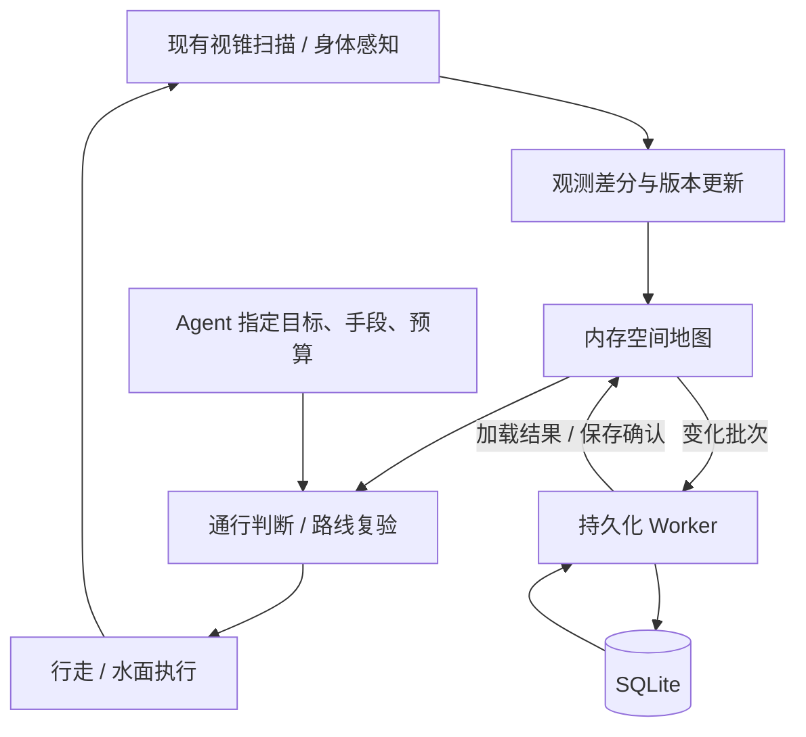

# 空间记忆与导航库设计（陆地行走与水面移动，mineflayer 接入）

> 状态：设计稿 v0.4（2026-11-02 核对 Curio 调用契约与精确容器账本，空间库尚未实现）
> 来源：`minecraft_agent_spatial_navigation_design.md`（一份通用空间导航设计）+ 本项目现有实现（`src/memory`、`src/travel`、`src/perception`、`src/adapter`）+ 历次排查沉淀（`docs/problems-log.md`、`docs/agent-dev-lessons.md`）。
> 目标：把「空间导航记忆」从当前单体的 `WorldMemory`（JSON）中收敛成一个**独立、可复用、可测试**的库，接入基于 mineflayer 的 Agent（本仓库与 knowledge 里把 mineflayer 写作 mineflyer，本文用包名 mineflayer）。
> 范围：陆地行走及必要的跳跃、台阶/梯子和下落衔接；水面游泳、已乘船移动及上下岸衔接。**不包含飞行、鞘翅、起降、空中航路或火箭预算。** 水下三维导航不作为本轮能力目标；浸水、氧气、水流和岩浆作为实际环境/身体事实反馈。

本轮审核保留「历史几何 / 最近观测状态 / 派生通行性」三层设计，修正以下实施前提：

- 世界会被其他玩家、实体和游戏机制持续改变；私有地图也必须消费外部变化，但只能保证**感知范围内、截至最近观测**的状态，不能承诺全世界实时同步。
- 变化在 Agent 移动过程中的现有视锥扫描、接触与其他合法感知里发现，再与上次观测比较并更新记忆。原始区块事件不能越过感知边界改变记忆或路线。
- 水、岩浆的状态、碰撞、风险、执行能力与授权分别表达；删除「水必堵、游泳必通、岩浆永久禁止」和第五种通行状态 `HAZARD`。
- 补齐逐格新鲜度、跨 Section 依赖、重载/离线失效、运行中路线复验及验收场景；修正会丢失放置/访问记录的迁移映射。

本文中的接口是**目标契约**，不是 Curio 当前可直接调用的 API；§2.2 对照仓库 `ef1aadd` 的实际接口，§10 列出落地顺序。容器账本以现行精确记忆实现和 [`precise-inventory.md`](precise-inventory.md) 的原则为准，不继承旧的时间遗忘/坐标模糊化。本次仅修订设计，不启动整库或 SQLite 迁移。

---

## 0. 为什么要单独成库

当前空间记忆散在几处，且职责互相渗透：

| 现位置 | 职责 | 问题 |
|---|---|---|
| `WorldMemory.passages` + `src/memory/passages.ts` | 历史矿道几何（path / links / entrances） | 只记「曾经走过」，不记「现在是什么」 |
| `WorldMemory` 的放置记录（`placedByPos`，落盘 `.placed`） | 自己放置的方块（LRU + 空间哈希） | 已能归纳 `bridge`，但建设几何、亲历路线和当前可通行性尚未充分分开 |
| `src/travel/store.ts` | 传送门端点 + 跨维度穿越 | 独立的第二个 JSON 文件，与 WorldMemory 分家 |
| `src/perception/surroundings.ts` | 通行判断（脚下/头顶/四面/落差） | 每次现场 `blockAt` 现算，结果不落库、无版本 |
| `WorldMemory.landmarks / hazards / visitedChunks` | 地点、危险区、区块访问计数 | 与「导航记忆」混在同一个 JSON 根对象里 |

**根本缺口**：现在只有「历史几何」和「现场通行判断」两层，缺了下载文档第 3 章强调的**「当前世界状态的版本化缓存」**这一层。于是每次判断通行都要重新 `blockAt`，且分不清「没看清」和「真的堵了」（正是 `1e580c2` 修的那个三合一问题）。

单独成库的价值：

1. **边界清晰**：库只回答空间事实（这里是什么、曾经怎么经过、现在能不能走、哪段堵了、边界在哪），**不替 Agent 选目标、选手段、选资源支出**。
2. **可测试**：抽象一个 `WorldAdapter` 接口（mineflayer 之外可注入 Fake），几何/拓扑/通行性/更新逻辑全部离线可测——这正是当前 `src/adapter/types.ts` 里 `GameAdapter` 已经搭好的抽象，库沿用同一思路。
3. **可复用**：换适配器（mineflayer → Create/服务端 mod）、换世界，上层心智代码不动。

---

## 1. 核心原则（以 AGENTS.md 为设计依据）

本仓库 [`AGENTS.md`](../AGENTS.md) 是本设计的理念与能力边界依据。外部导航方案、历史事故和现有代码用于核对机制与兼容性；它们不构成新增硬编码策略的先例，与 `AGENTS.md` 冲突时应修正本设计。

1. **开发者提供可靠身体 + 准确反馈 + 通用执行辅助；目标、策略、技能、资源取舍由 Agent 自己形成。** 库是 L2 导航辅助，不是 L3 决策者。
2. **三类数据分离落实 `AGENTS.md` 的证据与经历边界**：
   - **历史几何**：曾经观测、走过、挖掘、建造过的空间——当前堵塞**不得**删除历史。
   - **当前世界状态**：最近一次实际观测到的方块状态，含作用域、证据、新鲜度和版本；「最近观测」不等于全知的实时真值。
   - **通行性**：按当前世界状态 + Agent 身体 + 移动模式**派生**的缓存，可失效。
3. **通行状态只有四种**：`OPEN / BLOCKED / UNKNOWN / STALE`。`UNKNOWN` 与 `STALE` **绝不**当 `OPEN`。历史矿道仍在 ≠ 现在能走。
4. **反馈准确性优先于一切**（`agent-dev-lessons.md` #1）。每条空间事实追溯到 `vision`（现有视锥/接触扫描）、`local_rescan`（同一感知边界内的复验）或 `agent_action`（自身动作效果确认），绝不把原始数据包或预测写成 Agent 的观测。
5. **区分「现实障碍」「风险」「能力或授权缺口」和「暂时没看清」**（#2）。返回不同事实，不由库指定堵水、开挖或探索等应对策略。
6. **辅助可显式选择、说明会做什么、会消耗什么**，保留可组合的基础动作入口；不把预制攻略包装成「可选工具」（AGENTS.md 执行约束）。
7. **库自身守住三条不变量**（由 `skill-contract-invariants` 移植到空间记忆，对任何领域都成立）：
   - **表达性**：查询精度 ≤ 观察精度。heard 无精确坐标，就不能有「按 heard 坐标寻路」的查询；斜下格 `[1,-1,0]` 被挡看不见，就不能把它的通行性报成 `OPEN`。
   - **反馈真实性**：报告「行动真的做了什么，包括什么都没做」——noop 记为 noop，不并入成功；`ARRIVED` 必须经位置确认，不是「寻路器说到了」。
   - **活性**：`STALE` 的 Section、`BLOCKED` 的边、失效的通道有重验证/退出路径，不靠「历史上成功过」永久占位。

---

## 2. 分层与库边界

本库只解决陆地与水面导航。保留三维坐标是为了洞穴、台阶、桥、净空和液面判断，不意味着要规划飞行；既有飞行能力保持在本设计之外，不进入本库模式、成本、拓扑或验收。`swim` 在本文仅指水面移动及必要的入水/上岸过渡；观察到浸没或气泡柱不代表库会选择潜水路线。

```
L3 Agent 心智（目标 / 策略 / 探索决策 / 风险取舍 / 反思 / 技能形成）   ← 库不碰
                         │  通过「空间事实 + 导航原语」交互
L2 导航辅助（本库）：navigate_to / follow_known_path / inspect_route
             frontier_candidates / recall_route                       ← 库核心
                         │
L1 基础动作：walk / jump / sneak / swim / climb / look
             dig / place / interact / attack / use_item               ← mineflayer 已有，库只消费
                         │
L0 Minecraft：碰撞 / 重力 / 流体 / 实体 / 方块更新 / 游戏规则          ← mineflayer 已有
```

横向服务（库内）：

| 服务 | 职责 |
|---|---|
| World Observer | 订阅现有视觉/接触扫描产物并做观测差分；接收自身动作确认，产生带证据的 `Observation` |
| Spatial Mapper | 稀疏体素图：Section/Palette/BitSet，回答「这里是什么」 |
| Topology Manager | 路径折线 + 拓扑图 `G=(V,E)`，回答「曾经怎么经过、连到哪里」，处理碎片合并/拆分 |
| Spatial Memory Store | 内存 Section Map + SQLite 持久化，单个持久化 Worker，LRU + Pin；详见 §9 |
| Action Recorder | 委托、执行、副作用、结果、消耗，供归因与技能学习 |

**库的接口面**：依赖 `WorldAdapter`（抽象 mineflayer），产出 `Observation / Route / Frontier / BlockedPoint` 等事实，**绝不**产出「下一步该干什么」的指令。

### 2.1 `WorldAdapter` 接口（目标适配面，核心草图）

库不直接 import mineflayer，而是消费项目组合出的窄适配器。`Vec3Like / AgentState / BlockState / MoveTarget / MoveOpts / SwimOptions / ActionResult / EffectEvidence` 的对应类型见 `src/adapter/types.ts`；感知输入由现有 `Vision` 和感知循环提供，需要接出结构化扫描结果与能力描述。**这不是现有 `GameAdapter` 的原样子集**：`blockStateAt` 是可选项，完整模式授权和感知订阅还没有现成映射。不新增一个绕过 `Vision` 的原始世界扫描器。以下草图尚未展开身体姿态/AABB、版本化碰撞形状与材料预算执行接口，不能据此宣称通行判断的依赖已接齐。

```ts
/** 库对世界/身体的依赖面。只消费「感知证据 + 执行 + 观察生命周期」。 */
export interface WorldAdapter {
  // ---- 状态（AgentState 的子集）
  state(): Pick<AgentState,
    'pos' | 'dim' | 'worldId' | 'sessionId' | 'observationId' |
    'alive' | 'connected' | 'observationReady' | 'onGround' | 'inWater' | 'inLava' |
    'oxygen' | 'effects' | 'riding' | 'worldAgeTicks'>;

  // ---- 观察：只返回本次真实可见/可接触的格，未返回的格不能当作空气
  observeBatch(positions: Vec3Like[]): ObservationBatch; // 新桥接入口，不改旧 observeBlocks 返回类型
  capabilities(): { fullBlockState: boolean; movementModes: MoveMode[] };

  // ---- 执行（L1 身体；库只「稳定执行 Agent 已选定的目的地」）
  moveTo(target: MoveTarget, opts: MoveOpts): Promise<void>;
  swimTo?(target: Vec3Like | null, signal: AbortSignal, opts?: SwimOptions): Promise<ActionResult & { landed: boolean; oxygen: number }>;
  stopAll(): void;
  dig(pos: Vec3Like, signal: AbortSignal): Promise<ActionResult>;
  placeBlockAt(pos: Vec3Like, itemNames: string[], signal: AbortSignal): Promise<ActionResult>;

  // ---- 现有动作历史线索；缺少作用域/完整后状态/actionId，不能直接转成 Observation
  recentDug?(since: number): { pos: Vec3Like; name: string; ts: number }[];
  recentPlaced?(since: number): { pos: Vec3Like; name: string; ts: number }[];

  // ---- 现有感知循环的结果推送；返回取消订阅函数，不订阅原始 blockUpdate
  subscribe(cb: (event: PerceptionEvent) => void): () => void;
}

type WorldScope = { worldId: string; dim: string };
type EventContext = WorldScope & { sessionId: string; receivedAt: number; sequence: number };
export type PerceptionEvent = EventContext & (
  | ({ kind: 'observed' } & ObservationBatch) // 实际覆盖的格；确认空气也显式返回
  | { kind: 'column_unavailable'; cx: number; cz: number }
  | { kind: 'observation_gap'; reason: 'disconnected' | 'paused' | 'scope_changed' | 'not_ready' }
);
```

原始 `blockAt / blockStateAt / lightAt` 保留在适配层和感知层，不作为体素图的公开写入捷径。现有 `Vision.observeBlocks`（`src/perception/vision.ts`）已经检查视锥、遮挡、光照与身体接触；桥接层沿用这个边界，并补齐状态完整性和证据类型，不能把整个已加载区块都标为 `seen`。只听到水声的线索留在感知层，不进入带精确坐标的 `Observation`。

mineflayer 的 `blockUpdate(oldBlock, newBlock)` 是客户端世界数据更新，不能证明 Agent 看见了变化，故不作为空间记忆的更新或失效入口。原始事件最多维护感知层内部的读取缓存，不能独立改变记忆内容、新鲜度、通行状态或对外输出。区块不可读、断线等生命周期仅表达观察中断，不表达发生了某种世界变化。参见 [mineflayer 官方事件文档](https://github.com/PrismarineJS/mineflayer/blob/master/docs/api.md#blockupdate-oldblock-newblock)；审核时同时核对了本地安装的 4.39.0 版本。

感知订阅在重连/换维/销毁时解除，结果附上实际 world/dim/session 与扫描序列；桥接边界校验一次，库内消费类型化证据。动作执行期间也要持续消费感知结果，不等一次移动结束或下一轮 LLM 思考才更新地图。

完整状态必须贯穿感知查询、动作预检和自学技能的读取接口：不能库内存了 `level/waterlogged`，对 Agent/技能却仍只给方块名。缺少属性时显式返回 `stateComplete=false` 和能力缺口；查询不能悄悄补读墙后状态。

**执行器也必须守住同一边界**：当前 `moveTo → mineflayer-pathfinder` 仍直接读客户端世界，并由插件内部监听 `blockUpdate/chunkColumnLoad` 触发重规划；只过滤空间库入口不够。接入时须限制规划输入为已感知状态/已验证执行段，审计原始方块、实体读取与隐藏事件触发的自主重规划；物理碰撞或接触产生的新反馈仍应正常处理。未完成这层适配前，不能宣称现有 `moveTo` 已满足本设计。此项须用真实依赖集成验收，不能只在 Fake 中验证记忆接口。

`navigate_to` 的授权必须贯穿校验、调度、技能嵌套和最终执行；现有字段只是部分基础：

| `navigate_to` 参数 | `MoveOpts` 字段 |
|---|---|
| `allowDigging` | `allowTerrainChanges` |
| `allowPlacing` | `allowPlace`；`allowTower` 另行显式授权，不由放置授权自动开启 |
| `allowedModes` | `allowSwimming` 只能约束其中一项；每种模式都要有能力检查与执行约束，不支持的组合明确拒绝 |
| 相邻 `xyz` 的单步下行上限 | `maxDropDown`；不是任意路线的全局落差约束 |
| 避开方块 | `avoid` |

`allowPlacing: true` 仍不足以授权任意物品消耗；须携带允许使用的物品范围/数量上限。身体尺寸、姿态、当前模式和有关效果由执行适配层提供为能力上下文，其变化参与缓存失效（§3.3）；不能只靠目的地和一个 `allowSwimming` 布尔承诺完整的模式控制。

### 2.2 与当前 Curio 调用接口的对照

核对范围为仓库源码及调用者，不把它当作正在运行的进程版本证明。**可复用的是基础类型、部分方法签名和感知边界；新导航协议、批次事件及异步存储生命周期仍需桥接。**

| 接口面 | 当前源码契约 | 空间库接入要求 |
|---|---|---|
| 动作注册与查询 | `src/skills/index.ts` 的 `SKILLS`；`src/mind/thinker.ts` 的 `QUERY_KINDS` 和 `moves` 查询 | `navigate_to / follow_known_path / inspect_route / frontier_candidates / recall_route` 均未注册；区分内部库方法、Agent 动作和只读查询，分别接入校验/分发，不能只修改提示词目录 |
| 普通导航 | `goto {target,dig?,place?,tower?,sprint?,avoid?,lead?}` → `SkillResult`（`src/skills/movement.ts`） | 保留旧名字与参数；新坐标委托需增加模式、材料额度和已知空间约束，不是把 `goto` 换名 |
| 指定历史路线 | `follow_passage {to:'entrance'或'deepest',dig?}` 沿全网选锚点，不接受 `pathId` | `follow_known_path(pathId)` 是新增能力，不能宣称旧技能已经支持或静默改变旧目标语义 |
| 身体移动 | `GameAdapter.moveTo(MoveTarget, MoveOpts): Promise<void>`；`signal/timeoutMs` 必填 | 保留旧签名，在库层核对实际结果；权限缺省会继承旧行为，桥接时显式传递挖/放/搭柱限制，缺失的约束不能忽略 |
| 水面执行 | 可选 `swimTo(target或null,signal,opts)` 返回 `ok/landed/oxygen`；已乘船 `ride({x,z},signal,opts)` 返回 `ok/arrived/moved`；持续操控有 `drive`（`src/adapter/types.ts`） | `swimTo` 的当前重点是浮起/上岸，不能仅凭方法存在承诺任意水面目标；船继续走独立能力端口，共享空间证据，不加入飞行或潜水 |
| 可见方块查询 | `Vision.observeBlocks`、`Perception.observeBlocks`、`Senses.observeBlocks?` 返回 `BlockObservation[]`，每次最多处理前 32 格（`src/perception/vision.ts`） | 旧返回保持兼容；新 `observeBatch` 输出覆盖与缺失原因，预算跳过在实际边界记录，不能把缺项当空气 |
| 感知推送与生命周期 | `Vision.scan()` 返回 `void`；`Perception.update()` 返回 `Percept`；现有 `AdapterEvent` 不是本文 `PerceptionEvent` | 新增扫描批次及暂停/断线/作用域中断桥接；当前没有可直接绑定的 `subscribe`，不能用裸 `blockUpdate` 代替 |
| 结果与嵌套技能 | 身体 `ActionResult`、技能 `SkillResult`、代码技能 `api.act/api.moveTo` 各有返回外壳 | `NavResult` 是新增库结果，须经 §8 的兼容层传播；旧 `succeeded/ok` 不等于新协议的 `ARRIVED` |
| 记忆及进程生命周期 | `WorldMemory` 构造/查询/`flush/close` 是同步接口；`src/main.ts` 启动直接构造，退出直接 `memory.close()` 后安排进程结束 | Worker 方案需要启动等待和退出 flush 接缝；“查询兼容”不等于启动/关闭代码零改动 |
| 容器账本 | `ChestRecord.contents`、`chestLocation`、`recallChests(...,{from})` 已是精确账本（`src/memory/chest-memory.ts`、`src/memory/store.ts`） | 保留真实数量、坐标及证据时间，清除本文旧遗忘口径；世界推进后的新鲜度标记仍需补齐，不能说已经全部实现 |

**观测转换必须保留含义。** 当前 `BlockObservation` 的 `dimension` 转成 `dim`，顶层 `name/properties` 转成 `state`；`observationId` 保留为来源关联。当前 `MineflayerAdapter.state()` 会推进该 ID，它不是扫描帧号，不能直接改名成 `sequence`；接收序列由新感知桥接层管理。当前输出将 `blockStateAt` 缺失的名称回退也表示成空 `properties`，且未输出内部的接触判断；`stateComplete/evidence` 必须在实际感知/读取发生处补齐，不能事后靠空对象、方法是否存在或距离接近来猜。

**执行要留在现有仲裁链。** 动作经 `SKILLS → validateSkill/runSkill → SkillCtx.adapter（Arbiter.guard）→ GameAdapter`；库继承同一 `signal/deadline/taskId` 和授权，不拿原始适配器另开执行器。当前 guard 会重绑移动 signal，取消/超时分支也会重建 `SkillResult`；接入时须打通局部路线失效与整个任务取消的区别，并保留最后证据。`src/skills/recovery.ts` 与 `src/codeskills/bridge.ts` 的旧参数约束不能自动识别新字段，必须一起核对。

---

## 3. 数据模型：三类分离 + 版本

### 3.1 历史几何（永不因堵塞删除）

对应现有 `PassageRecord`，泛化成「路径片段 PathFragment」：

```ts
interface PathFragment {
  id: string;
  worldId: string;
  dim: string;
  kind: 'dug' | 'walked' | 'bridge' | 'built';   // 保留当前已有 bridge；built 是可选增量
  entrances: Vec3Like[];    // 地表参考点，不保证是实际开口（沿用现有注释口径）
  polyline: Vec3Like[];     // 脚点几何：可能来自轨迹或建造结构，来源分开
  geometrySource: 'traversal' | 'observed_structure' | 'legacy';
  links?: { a: Vec3Like; b: Vec3Like }[];   // 亲自走过的格对——历史连通证据，不保证当前可走
  deepestY: number;
  createdAt: number;
  lastUsedAt: number;
  uses: number;
}
```

关键约定（沿用现有实现里踩出来的）：
- **亲历 `links` 与几何候选分开**。历史行走连通只由实际连续经过的格对证明；近距离（现 3.5 格）只能关联碎片或提出待验证连接，不能在同一记录或跨记录时直接制造实证边。当前环境另可由合法观察验证可通行性，但这不等于曾亲自走过。
- **阈值一致性**：`PASSAGE_LINK = 3.5` 必须贯穿 `touchesPassage / bridgeNode / passageGraph` 三处。历史上 `adjacent`（1 格）过严导致同一矿道碎成几百个互不相连的岛（`3d59fd2` 修）。库把这类阈值收敛为**单一配置常量**，不允许各处各自写死。
- **当前堵塞只影响「当前可通行片段」和「当前拓扑连接」，不删除历史折线**（下载文档 5 章「碎片合并与拆分」）。
- **压缩不丢证据**：重进判断同时检查稀疏 `path` 与 `links` 端点；展示折线可以压缩，拐角、分叉和连通证据不能据两端直线重建。暂停、采样断档、瞬移或服务器位置纠正都不能自动补成走过的边。
- **建过不等于走过**：当前 `bridge` 从自放方块归纳桥面几何，保留其类型/ID，但不据排序数组生成 `traversed` 或亲历 `links`。L 形、分叉和平台不能以相邻数组元素直接连路；再次感知桥被拆只更新结构现状和连接，保留建设历史。

### 3.2 当前世界状态（新增，当前实现缺失的一层）

```ts
type ObservationSource = 'vision' | 'agent_action' | 'local_rescan';

/** 经感知边界或动作效果确认的精确证据；不接收声音线索或裸世界事件。 */
interface Observation {
  pos: Vec3Like;
  state: BlockState;         // name + properties，写入 palette 时规范化序列化
  stateComplete: boolean;    // 只有名字时为 false；不能猜门状态、流体 level 等
  evidence: 'seen' | 'contact' | 'confirmed_effect';
  observedAt: number;        // 实际获取证据的真实时间戳，不能用落盘时间替换
  observedWorldTick?: number; // 仅在确有已观测世界时刻时记录，不按离线时长推算
  source: ObservationSource;
  sessionId: string;
  originObservationId?: number; // 保留现有 BlockObservation 的来源编号，不冒充扫描序列
  sequence: number;          // 边界接收顺序，与事件使用同一会话序列
  actionId?: string;         // 仅有已确认自身动作证据时关联，不靠时间接近猜归属
  dim: string;
  worldId: string;
}

type ObservationGap = {
  pos: Vec3Like; // 仅报告本次请求检查的格，不枚举墙后未知世界
  reason: 'out_of_view' | 'occluded' | 'too_dark' | 'unloaded' | 'budget_not_scanned' | 'unknown';
};
type ObservationBatch = { observations: Observation[]; unobserved: ObservationGap[] };

type Freshness = 'FRESH' | 'STALE';
interface CellEvidence {
  observation: Observation;
  revision: number;          // 内容、完整性或有效性改变时推进；重复确认同状态只刷新证据时间
  freshness: Freshness;
  staleReason?: 'unloaded' | 'observation_gap' | 'expired' | 'pending_effect';
  validUntil: number;        // 本地缓存有效期上限，不保证期间世界不会变化
}
```

`source` 说明证据来自常规感知扫描、局部复验还是自身动作确认，`evidence` 说明凭什么确认。新旧观测的差异才是已探测到的世界变化。声音线索只能给方向，使用独立类型，不能传给 `observe()`。`confirmed_effect` 只证明具体动作实际确认的目标/副作用，不给整条通道或周围区域背书；不能把通用世界事件包装成动作确认以绕过感知。

**动作发出 ≠ 世界已变**：请求只使相关旧证据与派生结果失效；未确认时不写入预期的新方块。`agent_action` 的观测必须有已验证效果（对应现有 `EffectEvidence.verified`），不能从「附近刚有 blockUpdate」推断是自己造成的。`recentDug/recentPlaced` 只补动作历史，不可覆盖其后更晚的世界观测。

方块状态必须保留**完整 state**：沙砾/沙子、流体、门/活塞/红石不能粗略合并成普通固体。现有 `surroundings.ts` 的软方块名单是待用形状/状态验证的经验集合，不直接作为普遍规则。`blockAt` 只有名字；`Observation.state` 应在通过感知边界后取得 `blockStateAt` 的 `name + properties`，落盘才序列化到 palette。

**未知、过期、未加载分别表达**：从未有合格证据的格是 `UNKNOWN`；有旧值但失效的格是 `STALE`，保留最后观测和时间戳。未加载是当前读取条件，两种格都可能未加载；`null` 不能覆盖成空气、删除历史或制造危险记录。重启/重连后，恢复出的最近观测先按 `STALE` 使用。

观察入口对本次请求但未观察到的格返回边界实际能确认的原因；不知原因就 `unknown`，不能在「遮挡/太暗/未加载」之间猜。此诊断不含隐藏方块名，也不把“没找到 water/lava”转换成“附近没有液体”。同一身体事实（支撑、见天、地表分类、已上岸）供感知展示、动作停止和完成验证时共用定义并带观察时间；不同条件必须用不同名称，天光、侧面看见天空和已经离开深坑不能互相替代。

### 3.3 通行性（派生缓存，按移动模式）

```ts
type Traversability = 'OPEN' | 'BLOCKED' | 'UNKNOWN' | 'STALE';

type MoveMode = 'walk' | 'jump' | 'sneak' | 'swim' | 'climb' | 'ladder' | 'drop';

type HazardFact = {
  kind: 'water_contact' | 'submersion' | 'lava_contact' | 'current' | 'bubble_column' | 'fall';
  pos: Vec3Like;
  basis: 'observed' | 'derived';
  detail: string;
};

type ObstacleEvidence =
  | { kind: 'block'; observation: Observation }
  | { kind: 'contact'; pos: Vec3Like; observedAt: number; sessionId: string };
// 纯碰撞/接触可证明受阻，但未知方块名不能填进 Observation.state。

interface TraversabilityEntry {
  pos: Vec3Like;
  to: Vec3Like;               // 通行判断针对一步及其方向，不只针对一个格
  mode: MoveMode;
  status: Traversability;
  reason?: string;            // 碰撞/支撑缺失/未加载/证据过期等事实
  hazards: HazardFact[];      // 独立于通行四状态；OPEN 不表示无风险
  dependencies: { key: SectionKey; revision: number }[];
  contextKey: string;         // 身体尺寸/姿态/能力/模式 + 本次委托约束的规范化键
  sessionId: string;
  computedAt: number;
  validUntil: number;         // 不晚于所依赖证据的有效期
}
```

同一位置**按方向、模式和身体条件分别计算**：可在水面游动 ≠ 可走；可向下跳 ≠ 可返回。`OPEN` 表示当前证据足以支持该物理动作，并非导航许可或无伤承诺。导航另外检查模式是否实现、是否授权、资源额度及 Agent 指定的 `avoid` 等约束；缺能力报 `unsupported_mode`，缺授权报 `not_authorized`，不能篡改成世界里有墙。氧气、有关效果、姿态或乘骑状态变化后重新检查执行条件，不用旧地形缓存代替身体状态。

身体 AABB、方块碰撞形状和流体属性由版本化适配能力或 Java 1.20.1 状态注册表解释，不能假称现有 `BlockState` 已包含它们。缺少必要属性/邻格时返回 `UNKNOWN`（旧证据已失效则 `STALE`），不按方块名猜完整几何。碰撞、支撑、头部空间、液面以及落差可能跨多个 Section，依赖集合必须覆盖实际读取范围；初版按 Section 版本失效即可，不预先建立复杂逐格依赖图。

**脚格与支撑格分开**：半砖、床、耕地等低于整格高度时，实际支撑可能就在脚所在格，不能统一用 `feetY - 1`。跳跃/搭柱检查整个身体扫掠空间，包括偏心站位时侧上方的碰撞形状。反馈一次返回当前动作全部已知障碍与未知范围，不把障碍集合自动转成清障动作队列；接触证据不足以辨认名称时不能补出隐藏方块名。

**载具保留独立执行能力**：上面的 `MoveMode` 是步行身体模式，初版不把仓库已有 `src/skills/vehicles.ts` 船舶导航并进同一个 `moveTo`；船仍有显式独立入口，共用空间事实与失效契约。水路对游泳与船分别验证，船模式依赖整船扫掠体积、乘员头部空间和水面条件，不能只用玩家 AABB。制造、放置、上船、下船、回收载具均为独立选择，不随水路导航隐式发生；未接入库的载具能力不能被删除或声称已实现。

**历史实现只提供回归样例，不直接升级为规则**：

| 规则 | 来源 commit |
|---|---|
| 脚下树叶可提供站面；头顶树冠仍按实际形状检查，不能把导航绕行简化成忽略碰撞 | `30fbaab` |
| 站上实心方块即算地面 | `011e116` |
| 火把、雪、地毯分别按状态和碰撞形状判断，不能统一当空气 | `94c95d5` / `d0a48e4` |
| 传送门的碰撞、支撑、触发条件及实际穿越分开验证，不把所有 portal 方块当同一种地板 | `04cce15` |
| 水/岩浆识别须覆盖流体状态与含水方块，风险与物理通行分开 | `surroundings.ts`、`swimTo`、`excavation` |
| 单步下行用正确的 `maxDropDown` | `c869ee6` |
| 浅坑补平属于会消耗物品的放置动作，必须有目标、材料与额度授权，不是通行判定规则 | `8f3cebb` / `0b4ab3b` |

### 3.4 水与岩浆：状态、动力影响和风险分层

| 层 | 保存或计算什么 | 不能推导什么 |
|---|---|---|
| 实际方块状态 | 名称和完整 properties；水/岩浆 `level`、`waterlogged`、气泡柱 `drag` 等按实际版本保存 | 看见水不等于知道附近所有水源、流向或最终覆盖范围 |
| 流体解释 | 由版本规则解释源/流动/下落状态、液面；含水半砖/楼梯同时保留固体形状与水 | `waterlogged` 不是整格纯水；水草格也不能仅按名字当普通空气 |
| 动态影响 | 流向、身体浸没与气泡柱作用等依赖当前状态及必要邻格，标明派生依据 | 邻格未知时不制造确定流向；不在库中模拟并写入未来流体 |
| 通行与执行 | 按身体扫掠空间、支撑、液面、进出口、方向、实现的移动模式与委托分别检查 | 水不统一判堵；`swim` 不保证能走任意水路；`allowSwimming` 不等于完整水下导航 |
| 风险 | 接触岩浆、浸没、流动推力、落差等客观条件，关联本次证据；身体氧气/效果按实测反馈 | 危险不构成第五种状态，也不自动触发堵水、换装备、抗火或逃生流程 |

岩浆可能伤害身体，但不能写成游戏规则上「任何模式永久不通」。当前身体或导航器不支持时如实报能力限制；即使有抗火效果，也不能据此假定缺失的移动能力已经实现。是否进入、绕开、处理液体，始终由 Agent 决定。水结冰、冰融化、两种液体接触后生成方块，都以新观测为准；不把预期产物直接存成已出现。

流体变化通过 §6 的同一更新链处理：移除水源不意味着残余流水立刻消失；挖开邻格也不等于液体已经流入。记录实际变化，逐次使受影响依赖失效。流体相关派生风险可以清除或重算，真实伤害/死亡的 `Hazard` 历史不随之删除。

判定不止查「脚下是否空气」，至少覆盖：身体 AABB 是否碰撞、头顶是否够高、有无可站面（或模式是否允许游泳）、高度差是否在移动能力内、是否有坠落/岩浆/溺水危险、指定模式是否具备梯子/攀爬/游泳条件（下载文档第 7 章）。

---

## 4. 稀疏三维存储

沿用下载文档第 4 章的 Chunk / Section 组织，只为观测过的 Section 分配数据：

```
World → Dimension → Chunk (cx,cz) 16×16 → Section (sy) 16×16×16 → Cell
```

负坐标用 `((x % 16) + 16) % 16` 归一（现有 `passages.ts` 的 `cell` 已用 `Math.floor`，负坐标路径需用测试覆盖）。

| 数据 | 编码 |
|---|---|
| Explored / Traversed / Stale / Risk | BitSet（4096-bit = 512B）；当前风险是派生索引 |
| 方块状态 | 局部 Palette + 位打包（不存字符串/JSON） |
| 历史修改 | BitSet 或稀疏事件 |
| 通行性 | 派生缓存，可失效 |
| 观测元数据 | 逐格稀疏证据 + Section 聚合版本；不能用整段时间替代逐格时间 |

```ts
interface SectionKey { worldId: string; dim: string; cx: number; cz: number; sy: number; }

/** 一个 16×16×16 区段：只为观测过/需要记忆的 Section 分配。 */
interface Section {
  key: SectionKey;
  palette: string[];             // 完整 blockstate 串（name+properties 序列化）→ index；0 固定留给空气
  cells: Uint8Array;             // 位打包字节流，长度 ceil(4096 * bits / 8)
  bits: number;                 // max(1, ceil(log2(palette.length)))
  explored: Uint8Array;          // 有历史精确观测；未置位的 palette 0 不是已知空气
  traversed: Uint8Array;         // 自己走过/踩过的格
  stale: Uint8Array;             // 曾观测但现在需重验证的格
  risk: Uint8Array;              // 当前风险候选的派生索引，必须与证据及依赖一起查询
  modified: Uint8Array;          // 自己挖掉/放置过的格（历史修改，不清除）
  evidence: Map<number, CellEvidence>; // 按局部格索引；落盘时 state 合入 palette，不重复存整份状态
  revision: number;              // 格内容/完整性/有效性改变时推进，供段级依赖失效
  lastObservedAt?: number;       // 只供统计，绝不是整段都新鲜的证明
}
```

Palette 打包宽度随状态数增长：1–2 个状态用 1 bit，3–4 用 2 bit，5–8 用 3 bit，以此类推；超过当前位宽时整段 re-pack。负坐标用 `Math.floor(x / 16)` 求段坐标、`((x % 16) + 16) % 16` 求局部坐标，Y 轴同理。已知空气必须有 `explored` 位和有效证据，不能用数组默认值代表；只重新观察一格，不刷新邻格时间或清除整段 `stale`。

**体素图回答「这里是什么」，路径图回答「曾经怎么经过、连到哪里」**（下载文档第 4 章末句）。二者互补，不互相取代：

- 现有 `placedBlocks` 的「位置 → 方块名」稀疏哈希 ≈ 一个只记「我放过什么」的微型体素缓存。
- 现有 `passages` 的 path/links ≈ 路径图。
- 库把两者统一到同一 Section 粒度下，`placedBlocks` 的 LRU 淘汰策略直接复用给体素缓存。

**容量估算口径**：占用取决于已观测 Section 数、方块种类、事件保留策略、路径密度，不取决于地图总大小。5000×5000 不建满数组。

---

## 5. 拓扑图与垂直连接

`G = (V, E)`：V = 入口、地点、分叉点、转折点、垂直连接点；E = 地点间的路径段。

连接类型（下载文档第 5 章）：

```ts
type ConnectionType =
  | 'HORIZONTAL' | 'STAIRCASE' | 'VERTICAL_SHAFT'
  | 'LADDER' | 'BRIDGE' | 'DROP' | 'CLIMB'
  | 'SWIM' | 'CAVE_PASSAGE'
  | 'PORTAL';       // 传送连接，可跨维度，也可为末地内折跃
```

类型来自**观测或 Agent 明确记录**，不能只凭 Y 坐标差猜。边支持单向/双向 + 不同移动模式：落差可能只适合向下，水路可能只能游过。

```ts
type NodeKind = 'entrance' | 'place' | 'branch' | 'turn' | 'vertical_junction';
/** 锚点语义分类：对应 Landmark.kind，外加 portal；kind（拓扑角色）与 tag（语义含义）是两套正交分类 */
type LandmarkTag = 'base' | 'resource' | 'danger' | 'discovery' | 'death' | 'waypoint' | 'herd' | 'portal';

interface SpatialNode {
  id: string;
  kind: NodeKind;               // 拓扑角色：entrance/place/branch/turn/vertical_junction
  tag?: LandmarkTag;            // 语义分类（资源点/基地/危险/传送门…），对应 Landmark.kind
  label?: string;               // 语义标签（「我的工作台」「铁矿点」「下界门」）
  worldId: string;
  dim: string;                  // portal 节点仍落在物理维度；跨维由边的两端表达
  location: { kind: 'exact'; pos: Vec3Like } | { kind: 'region'; center: Vec3Like; radius: number };
}

interface SpatialEdge {
  id: string;
  from: string; to: string;      // SpatialNode.id
  type: ConnectionType;
  directed: boolean;             // true = 只沿 from→to（如 DROP 落差）
  modes: MoveMode[];             // 有证据支持的候选模式，不代替本次委托授权
  fragmentId?: string;           // 所属 PathFragment（可追溯来源）
  verifications: (Omit<TraversabilityEntry, 'pos' | 'to'> & {
    direction: 'forward' | 'reverse';
    blockedAt?: ObstacleEvidence;
  })[];                         // 按方向/模式/contextKey 分别验证，依赖覆盖整条边的实际检查范围
}
```

边的验证状态独立于 `PathFragment` 几何：堵一条边只改对应验证结果的 `status` 与 `blockedAt`，**不删 fragment**。清除障碍并重新验证依赖后才能恢复 `OPEN`。`directed: false` 只表示历史上有双向连通证据，两个方向的当前判断仍分别保存（反向采用交换端点的验证视图），不能因下行验证成功就给上行背书。

### 地标与传送门：空间锚点 vs 语义记录

回答「资源点、传送门能不能并入地图记忆」：**能，但要分清并入的是「空间锚点」，不是「语义含义」。**

**传送门 = 有历史穿越证据的传送连接。** 现状 `TravelStore`（`travel-memory.json`）是独立 JSON。空间索引可以并入，历史记录不能压缩丢失：

- `PortalEndpoint` → `SpatialNode(tag: 'portal')`，端点位置和是否仍观察到门分别保存；看到门不证明目的地或当前可穿越。
- `PortalTraversal` 原样保留会话、观测编号与穿越时间，由它索引 `SpatialEdge(type: 'PORTAL')`，不能只剩一个最近验证时间。当前 `returnVerified` 是 `TravelStore.snapshot()` 根据反向穿越派生的查询字段，不是原始记录字段；保留原始去回程证据和派生口径。
- `PORTAL` 两端可落在不同 `dim`，也可在同一维度远距连接；单独通过 `portalEdges()` 查询，不混入步行图。门被拆、重建或周边新建门时旧穿越仍是历史；再观察端点不等于已验证目的地未变，不按坐标缩放重建路线。

传送执行区分接近格、门面/触发格、等待触发、等待落地与目标世界验证。`25be48a` 已修过正常换维导致会话更新、反过来把传送取消的问题：旧图失效不等于本次授权传送失败。该传送可以在预期换维后接收新的落地证据，不能继续向旧维度发动作；死亡、真实断线和主动取消仍终止。有限退出/再进入只用于执行同一个已授权传送，不换门、不造门、不无限重试；站在门内、已穿越、已验证返程分别报告。

**资源点/地标 = 带标签的空间锚点，语义留在 `Landmark`。** 现状 `Landmark` 的 dedup、分档淘汰（`evictOverCap`）、`gone` 历史和 `primary` 基地选择属于上层语义，不能一概变成空间层遗忘规则。容器早先的「24 格区域/精度衰减」已被精确账本取代，不作为迁移兼容要求。并入方式：

- 库只接管锚点：`SpatialNode`（`kind` 取拓扑角色，`tag` 取语义分类）+ `location`，回答「记在哪里、精度如何、已验证到什么范围」。区域中心不能直接当交互目标。
- `Landmark` 增 `nodeId` 引用；`label / count / radius / precise / observedAt / gone` 留在 `WorldMemory`，不塞进体素/拓扑层。

**两条边界（AGENTS.md）：**

1. **资源取舍是 Agent 策略**：库给「资源点够不够得着」的事实，绝不替 Agent 选采哪个矿——资源点只能当 anchor / frontier 的输入，不能变成「自动采集」入口。
2. **`Hazard`（出过事）≠ 当前 `HazardFact` / `risk` 索引**：前者是实际死亡/伤害的语义历史，后者由目前证据派生，两者独立。水流消失不能抹去过去溺水的记录。

**迁移**：`travel-memory.json` 并入 SQLite 的 `spatial_nodes / spatial_edges`（保留 endpoint id）；`landmark.pos` → 生成/关联 node，`landmark.id` 原样保留（遵守 §9.1 的 ID 稳定铁律）。

### 锚点对象全清单：床 / 箱子 / 熔炉 / 农田 / 可交互方块

资源点、传送门只是其中两类。床、箱子、熔炉、农田、可交互方块同样按「空间锚点 vs 语义状态」纳入，且各自有不能丢的语义边界：

| 对象 | 现状 | 库接管的锚点 | 留在上层（语义） | 关键边界 |
|---|---|---|---|---|
| 床 / 基地 | `Landmark(kind:'base')` + `primary` | `SpatialNode(tag:'base', label)` | `primary`（首选家）、命名、`dropBedBases` 清理口径 | `selectBase` 是 Agent 显式选择，库不自动「回家」，只答「哪个锚点够得着、离多远」 |
| 箱子/陷阱箱/木桶/放置的潜影盒 | `ChestRecord.contents` 精确账本（独立于 landmark） | 最后确认的精确坐标，`radius:0 / precise:true` | `block`、`items(name,count)`、`observedAt`、`possiblyStale`、`capacity/freeSlots`、`uses/ts/note` | 位置与数量不随时间模糊/减少；精确历史不承诺当前仍在、内容未变或现在可达 |
| 熔炉 | `FurnaceRecord` | 按实际记录精度的位置锚点 | `input/output/fuel/burning/why` | 燃烧态是「离开时留下东西」的语义，不是固定地标；不套用旧箱子时间衰减 |
| 农田 | `FarmRecord` | 区域锚点（`cells` 中心） | `crop/plantedAt/harvests` | 作物生长是状态，别当固定地标 |
| 可交互方块 | 「我的X」`discovery` + `placedByPos` | 设施锚点（工作台/熔炉/床等「我的X」） | 门/拉杆/活塞的开关状态 → **进体素 blockstate** | 状态会变的交互方块归「当前世界状态」层，不是 `Landmark` |

三条总原则：

1. **导航目标（床/基地/home）是一等锚点**：「回家」是最重要的导航语义之一，base 必须是库的核心节点。但选哪个家、是否回家是 Agent 的决定（`selectBase`），库只回答事实。
2. **容器精确记忆与当前有效性分开**：沿用现行 `chestLocation` 的恒精确投影，不能恢复 `memory-hindsight.md` 等旧资料里的时间遗忘规则。曾确认的坐标与数量保留；容器是否仍存在、内容是否变化、路线是否可走分别记录证据与新鲜度。
3. **状态会变的交互方块归「当前世界状态」层**：门（开/关）、拉杆、活塞、熔炉（亮/灭）的状态属于体素 blockstate，不属于固定 landmark。地标层只记「那有个设施」，现状由体素/门状态回答。

空间节点的自动发现、合并、坐标更新和迁移不能隐式改变已有首选基地。`home` 展示、`goto base`、名字/id 检索共用语义层的同一个解析结果，执行记录带上具体目标名称；新建前哨不能把「家」替换掉。旧接口对尚无首选基地的初始化规则保持明确可见，不混入空间归并逻辑。

迁移：`ChestRecord / FurnaceRecord / FarmRecord / base landmark` 都不丢，只在其上加/关联 `nodeId`；`chestKey`、`base.id`、`farm.id` 原样保留（§9.1 ID 稳定铁律）。

**精确容器账本的接入边界。** [`precise-inventory.md`](precise-inventory.md) 页首仍写「待实现」，但其核心已在 `src/memory/chest-memory.ts` 实装；本设计依据当前代码中的 `applyContents / chestLocation / recall / totalStock`，不依据 `store.ts` 残留的「印象淡忘/不抄清单」注释：

- 完整内容来自开箱/存取的 `GuiContainerObservation.after`，经 `noteChestUse(...,{seen,...})` 覆盖；不能从视锥看到箱子外观就得知或刷新库存。`items:[]` 配合已确认全量快照才表示空箱；迁移记录的 `items:[] / observedAt:0 / possiblyStale:true` 表示内容未知。
- 保留最后真实快照、观测时间和精确坐标。未观察期间的变化只能使当前有效性待确认，不扣减记忆数量、不把坐标扩大成区域、不按日遗忘。重开箱取得新快照后再校正；不自动替 Agent 开箱或搬运。
- 当前 `possiblyStale` 主要由无完整快照的增量操作、旧记录迁移设置；尚未贯通离线/世界推进的生命周期。接入时补上新鲜度来源，既不声称当前已实时同步，也不将陈旧标记当作内容确实改变。`totalStock` 合计的是背包与历史容器账面数量，不能无条件解释成当前可取用库存。
- `contents.items` 是按物品名称聚合的精确数量，不是逐槽位/NBT 账本；`capacity` 是总格数，`freeSlots` 是全空槽位数，`freeSlots=0` 不等于已有同类堆叠不能继续放。无完整快照的增量不能保持空槽数量仍精确。
- 身份键仍为 `worldId:dim:x,y,z`，并保留实际 `block` 类型；没有独立容器 UUID，不能识别未观察期间同坐标同种容器被替换。背包里的潜影盒只作为物品计数，不据旧位置账本推断其内部；末影箱不按各位置分别累加独立库存。
- 重新观察确认容器消失后，`forgetChest`/`markGone` 对当前索引的清理仍合法，不能因反对时间遗忘而保留幽灵库存；这与定时抹掉精确记忆不同。尚未观察、区块卸载或通行失败都不构成消失证据，已发生的开箱/存取经历也不因此被改写。

已有 `contents` 原样迁移；仅含旧 `traces`/旧顶层 `items` 的记录按现有 `migrateChest` 丢弃旧内容、保留身份，不能把模糊印象反推成精确数量。内容由上层容器账本管理，若迁入 SQLite 则独立保存，不塞进体素 Section 或用空间节点的时间替代开箱时间。

### Agent 自记命名点 vs 程序自动点（命名空间分流）

Agent 可以自己记一个有名字的坐标点（「我的基地」「前哨」「这里以后有用」），库把它当**一等锚点**：`SpatialNode(tag: 'waypoint' | 'base', label: '我的基地')`。这是「记得的地点」的正式化，核心是把**谁记的**和**能不能被自动挤掉**分开：

| 来源 | 语义 | 耐久 / 淘汰 | 展示 / 搜索 |
|---|---|---|---|
| Agent 自记命名点（「我的基地」「前哨」） | `tag:'waypoint'/'base'` + `label` | **持久**，不随容量自动挤掉；满了要 Agent 显式回顾/删除 | 按 `label`/`id` 检索（`findLandmark`） |
| 程序自动点（开挖入口/进度、掉落物、已见方块） | 独立命名空间 | 有上限，满了先挤最旧（`EXCAVATION_WAYPOINT_CAP` 等） | **不与 Agent 命名点同框展示**，否则淹没真地名（#7「找不到地标：熔炉」） |
| 容器账本对应的锚点 | 精确坐标 + `ChestRecord` 关联 | 不因时间或普通自动地标上限遗忘账本；存在性按证据更新 | 按身份键/名称 + 恒精确 `chestLocation` 投影 |
| 其他设施锚点（床/熔炉/工作台） | `tag:'base'/'resource'…` + 语义字段 | 按各自语义层的容量与存在性规则处理，不套箱子旧衰减 | 按 id/label 与实际证据精度投影 |

三条规则：

1. **`label` 对库是不透明的**：库只存「一个叫 X 的坐标点」，不解释 X 的含义（是家？是前哨？是资源？）。含义是 Agent 的语义，库里最多用 `tag` 粗分、用于淘汰/展示口径，**不做**「base → 自动回家」「resource → 自动采集」这种把含义翻译成动作的事。
2. **Agent 自记点不被程序点挤掉**：程序自动写的高频点（开挖进度、掉落物、已见方块）与 Agent 自记点**分表、分上限、分展示**。共用一个命名空间会把「我的基地」「熔炉」淹没——正是 `agent-dev-lessons.md` #7 的教训。
3. **记和忘成对**：Agent 能记（`recordNode(label, pos)`），也能标「那里没了」（`markGone` → 现有 `gone/goneNear`）。库不替 Agent 判断某点是否失效，只在「亲眼看到没了」时才标 gone。

现状里 Agent 已能记「起了名字的基地」（`setBase(label)`）、note 也能带坐标；但「任意命名坐标点」还没有一等、明确的原语——`recordNode(label, pos)` 是库该补的增量，`findLandmark` 的按名检索语义保持不变。

迁移：现有 `base` 地标（含起了名字的）→ `tag:'base'` + `label`；`waypoint` → `tag:'waypoint'`；`discovery`（含「我的X」）→ `tag:'discovery'`。`id / label / pos` 原样保留，`findLandmark` 语义不变。

### 地图边界与易忽略项（已处理 / 明确排除）

除上面各节，还有几处地图相关、容易漏掉的点，这里一次性定清：

1. **维度坐标缩放（下界 8:1）不是路线**：库只存**观测到的坐标**，绝不把下界↔主世界的 8:1 缩放自动换算成边（`travel/store.ts:27` 既有注释「Coordinate scaling is never a route」）。对应关系是 Agent 可查的知识，不是库生成的拓扑。
2. **位置不连续不生成行走边**：瞬移 / 重生 / 换维 / 传送一律截断行走轨迹；明确验证过的传送另记 `PORTAL`，不能靠距离接近补边。
3. **explored（见过）≠ traversed（站过）≠ 当前可观察范围**：历史位不随渲染距离清除；`frontier` 返回已知与未知的边界，旧地图卸载后的重验证缺口单独标记，不能冒充首次发现的新区域。
4. **地图自身也要有体积预算**：不只地标有上限，体素/拓扑同样要——现状已有 24 条通道、4096 放置块 LRU、40 危险区等上限，库把它们推广到 Section（按最近观测 LRU）、fragment（按 `lastUsedAt` 淘汰）、edge（blocked 边可折叠）。
5. **瞬时实体占位不变成地形**：玩家、生物、掉落物位置属于短期工作记忆；占位离开或失去观察后重新判断，不能把一次堵路永久写成墙。真实死亡地点仍按现有语义记忆保留，不与仍在移动的实体混淆。
6. **私有记忆支持多人世界**：不共享其他玩家地图，不假定世界只有自己会修改。Agent 移动或观察时发现的新旧差异更新事实；视野外改动不即时传入记忆，卸载或离线时也不知道实际发生了什么。观察到结果不证明是谁做的，未知归因就保留未知，不能增加自己的 `modified` 位或动作功劳。
7. **只读消费侧**：dashboard / HUD（`landmarks-hud` / `memory-snapshot`）走库的只读 snapshot，非突变查询，读路径不改状态。

**明确排除**（记一笔，避免将来误当缺口）：

- **世界出生点 vs 床重生点**：库只记床的位置（base），不记「死后会重生成在哪」——那是游戏规则 + 上次实际观测。
- **水结冰 / 天气改变通行性**：归「最近观测状态」层，再次感知到对应 blockstate 后更新，不单独建立全知天气演化模型。
- **末地虚空**：作为 `Hazard(fall)` 的一种，不单独成类。

### 碎片合并与拆分（现有 `passageGraph` / `passageFragmentation` 的正式化）

- 矿道被沙砾堵：**不删历史 PathFragment** → 标阻塞坐标 + 当前方块状态 → 拆当前可通行片段、断开受影响导航连接 → 障碍清除并重新验证后才恢复连接。
- 入口验证包含进出段的落脚点、支撑和身体净空；洞口仍为空气但下一步地板消失时也不能报可进入。地表参考点不自动变成实际入口，最后一个入口失效也不能据此删除整个历史片段。
- 现有 `passageFragmentation`（`c358177`）已经能数「几团互不相连的岛」，库把它变成 Topology Manager 的第一等指标。
- Union-Find 只辅助静态连通分量；动态删边时不擅长的，改对受影响局部子图重算（下载文档第 5 章）。

### 两个从 git 历史来的硬约束

1. **并进/重进旧道必须保留实际连接证据**，否则合并后的 links 是两团互不相连的岛（`beginBridge` + `bridgeNode` 的逻辑）。3.5 格阈值只用于一致的候选匹配，补出的实证边仍需实际连续经过；不能以修复碎片为由跨墙连边。
2. **碎片化时的锚点选择要按连通分量挑**：想下更深/回地表时，全网最深/最高点可能在另一团够不着的岛里，直接当目标会 route 不通（`947fc6b`）。库的 `deepestAnchor / surfaceAnchor` 必须是「从 here 够得着的连通分量内」的最深/最高，而非全局。

---

## 6. 动态更新：移动中感知 + 观测差分 + 局部重算

### 6.1 实时保证与证据边界

这里的「实时」指 **Agent 移动过程中，现有视锥扫描和身体感知实际发现变化后及时更新空间记忆**。原地观察、转头和动作效果确认也消费同一流程，不能只在坐标变化时刷新。不承诺扫描间隔内或视野外的全知同步，也不保证从检查到迈步之间世界不再变化。

主链为：`现有 Perception/Vision 扫描 → 本轮带覆盖范围的证据 → 同格新旧状态比较 → 更新记忆与版本 → 失效相关通行缓存 → 复验当前路线`。不以 `blockUpdate` 为主链，不额外扫描整个已加载区块。

| 输入/处境 | 已知状态如何处理 | 派生/执行如何处理 |
|---|---|---|
| 当前可见/可接触格变化 | 新证据覆盖该格，保留原动作和路径历史 | 对相关依赖失效并重算 |
| 他人在视野外改动，或客户端收到墙后更新 | 保留最后观测值和时间，不因此改变内容、新鲜度或 explored | 不因隐藏事件改变路线；待再次感知或普通证据到期后复验 |
| 区块卸载、失去观察服务 | 已有证据 `STALE`；从未观察的仍 `UNKNOWN` | 所依赖的当前路线验证失效 |
| 区块加载/重新进入 | 仅恢复读取可能性，不把整列更新成已看见 | 在合法观察范围内验证需要的格；不能扫墙后恢复 `OPEN` |
| 断线、换维、死亡重生、进程重启 | 结束旧观察连续性；保留旧值/真实时间/历史路径，隔离会话 | 恢复的派生状态不能直接复用；授权传送只可跨预期换维验收新落地，不复用旧图 |
| 暂停心智，但观察服务继续运行 | 只保存实际收到的合格证据 | 不把这段时间算成 Agent 思考、探索或主动等待 |
| 他人使用箱子/熔炉，外观没变 | 方块证据不能证明库存或燃料；上层最后确认的内容保留原时间与新鲜度 | 打开界面等实际读取才能更新内容，空间更新不能刷新物品账本，也不能按时间扣减数量 |

一次扫描未发现变化，只能说明本次真实覆盖的格与旧观测一致。视野外、卸载或离线期间的过程和原因是未知；后续看到结果也不能补写为「亲历某玩家倒了水」。`worldId` 对应存档身份；新世界/重置由现有世界身份机制隔离，不能按同服务器地址或同坐标沿用旧图。

### 6.2 统一更新链与局部依赖

1. **复用感知循环**：在现有 `Perception.update` 完成 `Vision.refresh/scan` 后输出本轮结构化证据；移动和原地的已有刷新机制都可触发。感知与移动并行，不等待导航返回。当前动作相关格可在既有扫描预算和同一视锥内优先，不能隐式转头或扩大观察范围。
2. **明确扫描覆盖**：批次只包含本轮实际看见/接触或验证过的格，附 world/dim/session、扫描序列、真实观测时间。旧的 `visibleSurfaces` 缓存、只列重点方块的 `visibleNow`、地图召回结果都不能冒充本轮完整快照。节流跳过扫描时不重发旧批次、不刷新旧时间；空 Section 的射线加速也不能把整段 4096 格标为已看见。
3. **比较完整状态**：按格比较 `name + properties`；同名门开关、水位变化、含水属性变化也算差异。新出现的合法观测可建格；已见格被观察为空气才清除当前实体方块值。被遮挡、离开视锥、超出光照范围或因预算未扫描，都只是本轮没有证据，不是「消失」。
4. **更新并立即失效依赖**：内容、状态完整性或有效性改变时推进格与 Section 版本，同时撤销依赖旧版本的通行/风险/边验证，后台重算前不可沿用旧 `OPEN`。重复确认仍有效的同内容只刷新该格证据/有效期，不推进内容版本、不全段重算，也不刷新邻格。旧会话或更早扫描结果不能覆盖新证据，版本不由调用方伪造。
5. **局部重算并验证依赖**：记录所有读到的 Section 版本及身体/委托上下文；发布时有任一依赖已变，结果仍为 `STALE`。只影响依赖该段的缓存，不全图清空。跨 Section 的头部、支撑、流体邻格同样参与依赖；未知邻格仍然未知。
6. **有限批处理与持久化**：同格的连续已感知状态可合并落盘，但当前路线的失效及重要阻塞/恢复证据不能等整批结束才处理。队列有界，尚未完成内存差分/验证的观察不宣称已处理；相应路线保持待复验。已完成内存处理、仅等待落盘的证据仍按实际观测时间与验证结果使用，不因保存积压被降为未知；持久化状态另行报告（§9.2）。保留已确认动作记录，无需永久保存每次流体脉动。

扫描、差分、压缩、落盘与重算还须有**单次同步工作预算**，及时让出事件循环；不能只有队列长度限制却一次阻塞数秒。每批复用轻量身体/作用域快照，不逐格调用完整重型 `state()`。记录实际扫描时间和处理延迟；主线程阻塞或扫描服务长时间没有推进时按观察中断/到期处理，恢复后重验，不能把堆积结果按处理时间刷新成「刚看见」。

**消失和空气必须有正面证据**：当前扫描主要输出可见表面，接入时需把射线上确实验证到的空格或 `Vision.observeBlocks` 对旧已知格的实际复验结果也带出来；不把整条射线的遮挡后方标为空。若当前视锥未覆盖旧格，保留旧值及原时间，等它再次进入感知范围。缺少空气/完整状态证据是接入缺口，不能用「本轮列表里没有它」代替。

局部复验同样复用视锥、遮挡、光照与接触规则，不调用原始 `findBlocks` 穿墙补全。需要额外转头或移动才能验证时返回缺口；获取更多视野的动作由 Agent 或本次明确授权的执行决定。

### 6.3 流体持续变化与多人占位

- 水源/岩浆源被取走、边界被挖开、含水状态变化、活塞移动等，在实际扫描发现后沿同一链更新。传播跨过 Section 边界且进入当前感知时，按相关依赖继续处理；不可见传播不预填地图，也不假定初始目标周围固定一圈就是最终影响范围。
- 流向、液面、浸没与风险判定以实际状态和已知邻格推导；不知道的传播路径不写入地图，也不自动制造「会流到这里」的确定事实。生成石头/黑曜石等以服务器状态经观察确认后的结果为准。
- 不等待「整片水域彻底稳定」才工作。只验证下一执行段所需依赖；若持续变化导致无法得到可用验证，在本次超时/重试预算内退出，报告变化中的范围及最后确认位置，不忙等、不用旧 `OPEN`。
- 当前可感知玩家/生物的碰撞或占位进入短期执行层，单独报告 `occupied`。离开、过期或失去观察后重新检查，不写永久地形障碍，不自动攻击、推人或换目标。

### 6.4 新鲜度与运行中的导航

`validUntil` 是有限的证据复用上限：动态流体、门/活塞等需要比静态地形更短的复验间隔，但静态方块也可能被玩家改动。具体间隔、每轮观察格数和重算预算由实测校准，不宣称某个固定 TTL 能保证安全；实现时必须有有限默认值和可测的失效时点。已感知变化、会话中断或卸载优先于 TTL；到期只说明证据旧，不代表已经发生变化。

导航开始前验证近期执行段；移动中持续消费视锥扫描和身体反馈。**实际感知到**的变化触及即将使用的支撑/碰撞/液体依赖时撤销旧路径控制并调用已有取消/停止能力，再按原目标、模式、材料和额度复验。暂停控制不保证身体在流体、空中或惯性下立即静止，结果必须报告实测位置。

`navigate_to` 可在原委托范围内重算路线；`follow_known_path` 不暗中换到另一条路。无关远处变化不打断当前委托。证据不足、模式不支持或需要额外资源时，返回事实与缺口；不自动改为堵水、造桥、换装备、探路或救援。一次路线缓存命中不免除下一段的现场确认。

`forgetPassage` 保留为显式管理入口，当前堵塞不调用它删除历史。`markGone` 只在有足够观察证明特定对象已消失时更新对象存在性；区域未加载、墙后更新或一次通行失败都不构成「地点没了」的证据。

---

## 7. 导航接口

以下是拟新增的库内 L2 原语，当前 Curio 没有同名注册入口（见 §2.2），不是可以直接交给 `api.act` 的动作目录。它们全部遵循「Agent 决定目的地与手段，库只稳定执行并如实报告」：

### `navigate_to`

```ts
navigate_to({
  destination: { x, y, z },
  arrival: { kind: 'exact' }, // 精确脚格；near 半径或交互可达需另行指定
  allowedModes: ['walk', 'jump', 'swim'],
  allowDigging: false,       // 显式授权才挖
  allowPlacing: false,       // 显式授权才放
  allowTower: false,         // 搭柱不由 allowPlacing 自动授权
  materials: [],             // { name, maxCount }[]，放置时必须有明确额度
  exploration: 'known_only'  // 只走已验证空间
});
// → ARRIVED | PARTIAL | NO_PATH | BLOCKED | CANCELLED | TIMEOUT | FAILED
```

- 在**已知且已验证**空间规划执行。不擅自挖、搭桥、造设施、消耗未授权物品、改选目标。
- `ARRIVED` 必须通过**位置确认**才算，不是「寻路器说到了」。
- 接入前必须修正现有授权缺口：当前 `moveTo` 在 `allowTerrainChanges=false` 时仍可能清树叶，`constructionSafe` 又同时限制放置；不能靠这两个开关声称「禁挖但可按额度放置」已实现。`swimTo` 是独立执行能力，`allowSwimming=true` 只解除部分寻路限制，不能替代完整水下导航。新增契约要从最外层工具到执行器逐层验证。

**目标与完成条件绑定**：本接口初版只接受坐标目标，默认精确脚格，附近半径或交互可达必须显式指定并写入执行记录。不能悄悄把实心目标改为旁边/上方，把同 XZ 不同 Y 当完成。已有仅 XZ 的船舶入口、跟随实体等能力保持各自目标与记录契约，不在本轮强行并入这个坐标接口。相对坐标在动作边界按当时身体位置/朝向解析并固定，后续转头不能重解释它。普通导航不强制先绕历史矿道；指定历史路线则保持 `pathId` 约束。返回与非取消异常都核对实测状态；空 noPath 返回不成功，确实到达后寻路器抛错也不能抹去到达证据。主动取消仍如实报告取消以及当时已达成的部分效果。

参数边界保留原请求和解析目标：超过距离/规模上限时明确拒绝，或在原目标不变的前提下分段执行并返回 `PARTIAL`，不能把「走 500 格」静默缩成「走 200 格」。旧技能的 `ok/succeeded` 也不直接映射为 `ARRIVED`：例如「要求上岸、结果只是浮在水面」只完成阶段效果，须按原委托报告尚未上岸。

**进度与执行阶段分开**：记录水平净位移、有效高度变化、剩余距离和最后落脚位置。原地跳、贴岸上下浮动、服务器来回纠正不算持续前进；实际爬梯、跳上一级和已授权动作的触发/落地等待也不能被普通停滞判定误杀。游到水中目标不强制上岸；「上岸」则需确认离水后的可靠支撑，露头换气或瞬时 `inWater=false` 不足以成功，站稳后不能继续连跳。扫描在原动作控制权内进行，不停走、不替 Agent 选择岸边。

**取消和重试复用身体控制权**：每次动作的按键、定时器、监听器和回调绑定既有 action ownership；取消清理自身资源，旧动作迟到的完成回调不能清掉新动作按键或恢复旧路线。已发到服务器的副作用不会因取消回滚，仍凭实际证据记账。同目标重试必须在既有时限/次数/材料额度内重新确认参考面、身体与占位；已确认的确定性障碍直接返回，不能重复跳放或自动升级清障。不开新通用重试框架处理已明确延期的低频问题。

这些约束须跨调度任务生效：自动创建新 `taskId/planVersion` 仍属于同一父委托，共用已解析目标、累计效果及剩余时间/距离/材料额度，不能以新当前位置重新解释「再上升 4 格」。调度层应读取结构化的条件缺口与证据版本，而不是遇到通用 `ERROR/PATH_NOT_FOUND` 就重试。条件未变时返回事实；有新证据或 Agent 明确新委托后可以再验证，不永久封禁动作。

### `follow_known_path`

沿 Agent 指定的历史路线（`pathId`）移动。执行前/中验证必要路段；阻塞时停，报**坐标 + 方块状态 + 最后可达位置**；不删历史路线、不擅自换路。

### `inspect_route`

只读：返回历史状态、观测新鲜度、阻塞点、未知/过期片段、验证范围与时间。**不移动、不转头、不改世界或触发写库重扫。** 只能引用已持有的合格证据，不能根据客户端墙后数据补写结论。现有 `{"kind":"passages"}` 查询是它的雏形。

### `frontier_candidates`

只返回未知边界候选 + 可达性 + 观测依据，**不自动选目标、不自动开始探索**。是否前往由 Agent 决定。

```ts
interface Frontier {
  pos: Vec3Like;          // 候选点
  basis: Observation[];   // 观测依据（从哪几条观测得出这是边界）
  reachability: Traversability; // 到已知边界的当前验证状态，不代表未知区域可达
  historicalConnection: boolean;
}
```

**基础动作仍然开放**：`walk / jump / look / dig / place / interact` 等 L1 动作不受库封存，Agent 可直接组合（AGENTS.md「基础交互必须完整开放」）。

### 失败报告的结构（#1/#2 教训的落地）

导航/通行失败返回**结构化 `problem`**，不返回一句话：

```ts
type NavProblem =
  | { kind: 'unloaded' | 'stale'; pos: Vec3Like }
  | { kind: 'unobserved'; gap: ObservationGap }
  | { kind: 'blocked' | 'head_blocked'; evidence: ObstacleEvidence }
  | { kind: 'hazard'; facts: HazardFact[]; constraint: string } // 风险与本次约束冲突，不是全局禁止
  | { kind: 'unsupported_mode'; mode: MoveMode; detail: string }
  | { kind: 'unsupported_target'; detail: string } // 例如该执行器只接受水面 XZ，无法处理目标高度
  | { kind: 'search_budget_exhausted'; budgetMs: number } // 不等于物理不可达
  | { kind: 'not_authorized'; detail: string }
  | { kind: 'occupied'; pos: Vec3Like; observedAt: number }
  | { kind: 'support_out_of_reach'; pos: Vec3Like; requiredSupport: Vec3Like }
  | { kind: 'no_path' } | { kind: 'timeout' }
  | { kind: 'cancelled'; by: 'agent' | 'user' | 'scheduler' | 'lifecycle' | 'unknown'; reason: string };
```

每个 `kind` 附带**事实、证据范围与未满足条件**。接口能解释缺什么信息或能力，不能直接给「堵上」「挖脚下」「先探路」等玩法策略，也不把半砖等合法形状本身当失败。缺少信息时不猜方块名；只有已观察到的障碍才给精确障碍坐标。

**操作失败不能直接污染通行图**：放置目标已占用、找不到可贴参考面、缺材料、身体碰撞和支撑不存在是不同条件。`PATH_NOT_FOUND` 等旧错误码只能作为动作结果保存，不能直接转换成该格/边 `BLOCKED`；被占用的放置格反而可能提供站面。通行结论只能由该移动动作的角色、实际空间证据及身体条件计算。

规划失败还区分执行器适用范围、搜索预算耗尽和已验证范围内未找到路径。能力描述须说明是否支持目标高度/方向，不能仅用同一个 `walk` 名称承诺所有三维目标；超时错误里列出的可能原因不是已见障碍，更不能据此记岩浆或标传送门毁坏。

**失败必须返回语义文字，绝不让 Agent 猜。** 这是多次出现的问题（`agent-dev-lessons.md` #2「诊断消息糊成一团」、#4「心智模型错误自强化」）。库的硬规则：

- 每次失败同时给 **`message`（语义文字）+ `problem`（结构化，供程序判断）**，二者缺一不可。坐标、方块名、风险和最后确认位置按真实证据提供，缺失项明确未知。
- `UNKNOWN/STALE`、真实碰撞、风险、执行能力、委托限制分别说明；不把暂未找到已知路线说成世界中不存在路线。
- 示例（`problem.kind` → 实际返回的 `message`，坐标/方块名按实况填）：

| `problem.kind` | 语义文字（示例） |
|---|---|
| `unloaded` | 「目标路段尚未加载；旧记录不能确认当前状态」 |
| `stale` | 「下一段的通行证据已过期，本次未能完成现场复验」 |
| `blocked` | 「刚观察到 (121,-24,350) 的 stone 与身体路径相交；本次未授权挖掘」 |
| `hazard` | 「已观察到下一步身体路径接触 lava，与本次 avoid 约束冲突；未执行该步」 |
| `unsupported_mode` | 「这段需要的移动模式未由当前执行器实现；历史经过不证明现在能执行」 |
| `occupied` | 「刚观察到玩家占据下一步身体空间；这不是永久地形障碍」 |
| `support_out_of_reach` | 「该动作所需的 (121,-26,350) 支撑超出当前放置范围；未执行放置」 |
| `head_blocked` | 「刚观察到头顶 (120,-22,350) 的 stone 与跳跃轨迹相交」 |
| `no_path` | 「在本次已验证范围和允许的手段内，没有找到从起点到目标的路线」 |
| `cancelled` | 「已按请求停下，停在 (118,-24,348)」 |
| `timeout` | 「20 秒没走完，最后确认位置 (119,-24,349)」 |

### 结果信封与执行记录

```ts
type NavOutcome = 'ARRIVED' | 'PARTIAL' | 'NO_PATH' | 'BLOCKED' | 'CANCELLED' | 'TIMEOUT' | 'FAILED';

interface NavResult {
  outcome: NavOutcome;
  message: string;
  lastPosition?: Vec3Like;       // 最后已确认位置；没有证据时缺省，不填请求位置
  lastObservation?: {
    worldId: string; dim: string; sessionId: string; observedAt: number;
    onGround: boolean; inWater: boolean; riding?: string | null; // 缺省=未提供，不等于已确认未乘骑
  };                            // 与 lastPosition 同一证据快照，取消后也保留其原始时间
  problem?: NavProblem;
  trace: { pos: Vec3Like; ts: number }[];
  consumption?: {
    placed: { pos: Vec3Like; name: string }[];
    durabilityLost?: number;
    digMs?: number;
  };
  confirmed: boolean;            // outcome 是否经位置确认；ARRIVED 必须 true
  memoryWrite?: 'saved' | 'pending' | 'failed'; // saved 须有提交确认；不反向改写已完成的身体效果
}
```

每次导航落一条 `ActionRecord`（供归因与技能学习，对应 `AGENTS.md`「区分 Agent 的选择 / 程序辅助 / 实际观测证据」）：

```ts
interface ActionRecord {
  id: string; ts: number; worldId: string; dim: string; sessionId: string;
  delegationId: string; parentActionId?: string;
  delegation: {
    requestedTarget: string | Vec3Like; // 进入解析边界的原请求；不能仅留下被截断后的目标
    target: Vec3Like; allowedModes: MoveMode[];
    arrival: { kind: 'exact' } | { kind: 'near'; radius: number } | { kind: 'reach_block' };
    allowDigging: boolean; allowPlacing: boolean; allowTower: boolean;
    materials: { name: string; maxCount: number }[];
    exploration: 'known_only' | 'allow_frontier';
  };
  subActions: {
    kind: string; at?: Vec3Like; block?: string;
    origin: 'agent' | 'execution_helper' | 'scheduler';
    targetRole?: 'body' | 'head' | 'support' | 'placement_target' | 'reference_face';
    /** ok=动作声明的效果已确认；noop=确认没有产生该效果；unknown=未能确认 */
    outcome: 'ok' | 'noop' | 'unknown' | 'refused' | 'failed';
    effect?: EffectEvidence;
  }[];
  from: Vec3Like; to?: Vec3Like;
  trace: { pos: Vec3Like; ts: number }[];
  consumption: { placed: { pos: Vec3Like; name: string }[]; durabilityLost?: number; digMs?: number };
  observedChanges: Observation[];
  failureAt?: Vec3Like; failureReason?: string;
  confirmed: boolean;
}
```

`noop` 按动作声明的效果判定：移动以位置、转头以朝向、观察以实际证据、挖放以方块变化确认。不能因「没有改变方块」就把成功移动写成 noop，也不能把「未等到确认」写成已确认无变化；后者是 `unknown`。历史动作成功不等于其造成的世界状态现在仍存在。

失败、取消或技能嵌套不能丢失已确认的部分效果：已挖掉、出现掉落、已入背包、已移动、已抵达分别记录；不因前一项成立推定后一项，也不自动追加拾取。轨迹使用身体适配层处理服务器回声/位置纠正后的反馈，不能把指令坐标或重复移动广播当两次经过。自动锚点或落盘失败单独报告，不能把已成功的身体动作改成失败；显式「记住地点」失败则必须明确没有记成。

`source: llm` 不能替代动作归因：自动重试/调度追加的步骤必须保留产生来源、父委托与继承的授权，不能记成 Agent 亲自选择了这一步。诊断日志关联运行/代码版本、session、父委托、action、扫描序列与路线依赖版本，分别记录「规划结果、身体执行、原目标完成、记忆写入」。时间戳保留真实含义，不凭日志相邻行或 `succeeded` 摘要重建因果，也不把缺少观测日志当作从未观察的证明。

取消理由与最后身体证据分别保存：接替计划的文字可以说明为何取消，不能充当“刚上岸/已经停船/已换维”的观测。最后证据属于取消前哪个 world/dim/session、距现在多久须可见；不能读不到当前状态就用新计划的描述补全。

`ARRIVED` 必须同时有满足完成条件的 `lastPosition`、对应 `lastObservation` 和 `confirmed: true`；缺少这些证据不能返回到达。可选字段用于尚无有效位置证据的失败/取消，不是放宽成功验证。

---

## 8. 与 Agent 心智的接缝（反馈质量）

库是「事实提供者」，与 L3 的接缝是几类结构化事实 + 只读查询：

| 事实 | 语义 | 现对应 |
|---|---|---|
| 历史几何路线候选 | 连接证据精度不一，旧 `hop/link` 仍含几何推断；不证明当前可通行，也不返回阻塞点 | `passageRoute / passageNext`；阻塞证据由新增查询提供 |
| 锚点（地表/最深） | 库目标是返回带连通/可达证据的候选；旧 surface 会全网选点，deepest 在缺 here/离网远时也会全网回退，均不保证当前可达 | `passageSurfaceAnchor / passageDeepestAnchor`，需兼容包装并补验证 |
| 地标 / 危险区 / 通道 | 用户级地点，容量有界、分档淘汰 | `Landmark / Hazard` |
| 区块新颖性 | 探索引导的客观输入 | `visitedChunks / novelty` |

**命名空间分流**（`agent-dev-lessons.md` #7）：导航航点（开挖入口/进度、掉落物、已见方块）与 Agent 主动记的地标**不同表、不同展示口径、不同上限**，否则高频自动写入会淹没真正的「熔炉」等地标（`找不到地标：熔炉` 事故）。库把 waypoint 与 landmark 从数据模型上分开。

**召回结果能直接引用**：新查询同时返回稳定 `nodeId/pathId`、带精度的 `location`、world/dim、观测时间和展示标签；展示文案不是操作 ID。不能要求 Agent 从「挖过的通道：入口 (…)」里拆坐标，或把整句当地标名。区域位置仅能形成区域导航候选，不冒充精确交互格；旧查询字段保持兼容，新结构走增量入口。

**感知边界作为已知能力边界**（#9）：斜下格若被前方方块遮挡，预检如实报告该格缺少可见证据；不假装看见，也不替 Agent 把动作改为直落或追加开挖。

**返回协议通过兼容层连接。** 当前 `SkillResult` 使用 `status/summary/failureCode/data/caveat`（`src/skills/types.ts`），不能直接换成 §7 的 `NavResult`。新增导航技能保留该外壳，约定用 `data.nav` 携带完整库结果，`summary` 给出事实；只有满足原委托到达条件的 `ARRIVED` 才映射为该导航委托的 `succeeded`。`CANCELLED` 映射为 `cancelled`，`TIMEOUT` 为 `failed/TIMEOUT`，`BLOCKED/NO_PATH` 为 `failed/PATH_NOT_FOUND`；`PARTIAL/FAILED` 按实际原因选已有失败码并保留进展，不能把部分位移包装成完成。更细的 `unsupported_mode/not_authorized/unobserved` 等留在 `data.nav.problem`，不得凭通用旧错误码反推世界障碍。

这个映射只用于新导航委托，不重定义已有动作的完成条件。例如当前乘船动作的显式停止可以 `succeeded` 且 `data.arrived:false`。代码技能 `api.act` 当前返回 `{ok,code,summary,data?}`，而 `api.moveTo(x,y,z,range,opts)` 返回 `{ok,error?,pos}`；保留它们的旧外壳，新增证据经桥接传递，不能把其中的 `ok` 当作精确到达证明。仲裁器取消/超时、`use_skill` 嵌套和恢复路径也须保留 `data.nav`，否则库产生的证据仍会在上层丢失。

---

## 9. 持久化与缓存（SQLite）

首版采用 **SQLite 持久化 + 内存 Section Map + 单个持久化 Worker**，作为嵌入 Agent 进程的 TypeScript 库，不需要部署独立数据库服务。现有 `todo-json-to-sqlite.md` 已确定 SQLite 方向，`WorldMemory` 注释也承诺「下一阶段替换为 SQLite，接口保持不变」；本节补齐空间记忆的实时读取、异步保存和恢复边界。



感知差分、路线失效和下一段通行判断在内存中完成，不能等待 SQL 提交，也不逐格、逐步查询数据库。这里只改变数据保存方式，仍遵守 §6 的视锥/接触证据边界和陆地、水面范围。

**数据的运行时与持久化分工：**

| 数据 | 运行时 | 持久化 |
|---|---|---|
| 最近观测的方块/流体状态与逐格证据 | 按 Section 索引的内存 Map，支持差分、版本和新鲜度查询 | `spatial_sections` 保存最近已提交快照及原始观测时间 |
| 通行判断、路线复验与依赖索引 | 可失效、可重算的内存缓存 | 首版不保存为可直接执行的当前结论；历史验证证据可单独保留 |
| 历史路径、地点、连接、放置/访问账本 | 兼容现有查询的索引与工作集 | 独立结构化表，保留 ID、删除和计数语义 |
| 玩家/实体的临时占位 | 短期感知状态，过期即失效 | 不写成永久地形障碍；重要交互结果可进入动作记录 |
| 重要空间变化与动作结果 | 确认后形成记录，进入待保存批次 | 独立事件/动作表，不用最终 Section 快照代替经历 |

**SQLite 表的职责：**

| 表 | 内容 |
|---|---|
| `spatial_sections` | 稀疏 Section 最近观测状态与证据（Palette、位打包、位图和逐格元数据，版本化二进制列） |
| `path_fragments` | 历史路径几何（Delta Encoding 折线） |
| `spatial_nodes` / `spatial_edges` | 地点与路线连接（含连接类型、方向、移动模式） |
| `spatial_events` | 重要空间变化（阻塞/清除/重验证） |
| `action_records` | 动作委托、执行、结果、消耗 |
| `placed_blocks` / `chunk_visits` | 现有放置账本（名称/LRU 顺序/删除语义）与访问次数；旧 `at` 不是观测时间，不压缩成历史位图 |
| `portal_traversals` | 原始穿越证据与去回程验证记录，不压缩为当前边状态 |

- Section 以 `(worldId, dimension, cx, cz, sy)` 为主键，每行一个 16×16×16 Section；常用查询键、版本与摘要是 SQL 列，密集格数据是带 schema 与游戏版本的 BLOB。低频嵌套记录可用 JSON，不把整张地图塞进一个 JSON 文档；压缩在容量实测后决定，路径几何可用 Delta Encoding。
- SQLite 文件放本机磁盘，启用 WAL，使用预编译语句与短批量事务。SQLite 适合这类本地嵌入式存储；WAL 支持读写并行，但同一时刻仍只有一个写者，不能据此设计多个并行写库者。参见 [SQLite 适用场景](https://www.sqlite.org/whentouse.html) 与 [WAL 官方说明](https://www.sqlite.org/wal.html)。
- 运行时 LRU Cache，`navigate_to` 期间 Pin 当前路线所需 Section；待保存状态也不能在没有可恢复副本时随缓存淘汰。缓存容量和批次大小通过实测确定。
- 只持久化已感知的最近状态和证据；内存淘汰不等于删历史，读回的过期证据不能因加载缓存而变新。重启时通行验证重新建立，保留原始时间，不重构离线过程。
- **迁移接口**：`WorldMemory` 现有的 `passages / savePassage / forgetPassage / putPlaced / removePlaced / queryPlacedNear / visit / novelty` 等业务入口经兼容层保留。目标是让旧调用者继续使用已有字段和返回形状；这不承诺心智、感知、启动/关闭、证据传播和新能力接入全部零改动（§2.2）。

**库的进程内 API 摘要**（store 实例绑定一个不可变 `worldId`，带坐标的方法明确 `dim`；旧 `WorldMemory` 入口由兼容层补作用域）：

```ts
interface SpatialMemoryStore {
  // 体素（当前世界状态）
  observe(o: Observation): void;
  sectionAt(dim: string, x: number, y: number, z: number): Section | null;
  markTraversed(dim: string, pos: Vec3Like): void;
  markModified(dim: string, pos: Vec3Like, actionId: string): void; // 只来自已确认自身动作

  // 路径（历史几何）
  saveFragment(f: PathFragment): void;
  forgetFragment(id: string): void;
  fragments(dim?: string): PathFragment[];

  // 拓扑（地点与连接）
  recordNode(dim: string, label: string, pos: Vec3Like, tag?: LandmarkTag): SpatialNode;
  upsertNode(n: SpatialNode): void;
  upsertEdge(e: SpatialEdge): void;
  dropEdge(from: string, to: string): void;             // 只断当前连接，不删 fragment
  graph(dim: string): { nodes: SpatialNode[]; edges: SpatialEdge[] };
  portalEdges(): SpatialEdge[];

  // 路由与锚点（几何记忆，未验证当前地形）
  route(dim: string, from: Vec3Like, to: Vec3Like, opts?: { near?: number; hop?: number; link?: number }): Vec3Like[] | null;
  surfaceAnchor(dim: string, here: Vec3Like): Vec3Like | null;
  deepestAnchor(dim: string, here?: Vec3Like, opts?: { near?: number }): Vec3Like | null;
  fragmentation(dim: string): { records: number; points: number; components: number; pieces: { points: number; records: number }[] };

  // 边界候选（只给候选，不选目标）
  frontierCandidates(dim: string, here: Vec3Like): Frontier[];
}
```

此处的 `route/graph/anchor` 是历史几何查询，不能直接当可执行路径；当前通行查询须携带模式、身体与委托上下文，返回 §3.3 的验证信息。所有写入核对 store 的世界作用域；会话差异用于当前证据新鲜度，不把新会话的历史世界记忆整体删除。

以上是领域 API 摘要，不是完整的存储生命周期接口。同步方法只操作已加载的运行态；`observe/saveFragment` 等返回不代表已经落盘。实现还需提供异步初始化、Section 加载、保存状态查询及 `flush/close` 入口，确认语义见 §9.2；兼容层须保持旧入口已有的返回与保存确认契约。

与现有入口的对应（`passages.ts` 的纯函数不是 `WorldMemory` 方法，旧导出也需保留兼容包装）：

| 现有入口 | 库方法 | 变化 |
|---|---|---|
| `passages(dim)` / `savePassage` / `forgetPassage` | `fragments` / `saveFragment` / `forgetFragment` | 换名，语义不变 |
| `putPlaced` / `removePlaced` / `getPlaced` / `queryPlacedNear` / `placedBlocks` | 独立 `placed_blocks` 账本兼容原方法 | 保留名称、LRU 顺序、查询和删除语义；补作用域须有依据，`modified` 仅为曾修改过的历史索引 |
| `visit` / `chunkVisits` / `novelty` | 独立访问计数兼容原方法 | `traversed` 只说明站过，不能替代次数或新颖性计算 |
| `passages.ts` 的 `passageRoute` / `passageSurfaceAnchor` / `passageDeepestAnchor` / `passageFragmentation` | `route` / `surfaceAnchor` / `deepestAnchor` / `fragmentation` | 保留旧纯函数的 `recs` 输入、options 和返回结构；新 store 方法不能直接替换旧导出 |
| （无） | `observe` / `sectionAt` / `frontierCandidates` | 新增：版本化状态 + 边界候选 |

别人拆掉自己放过的方块：再次观察确认后更新当前状态和账本，保留自身放置动作与 `modified` 历史。只看到同种方块仍在不能确定期间无人拆换；账本表达「自己曾放置、最近确认的状态」，不是永久所有权。旧放置记录和路线也不能在迁移时冒充当前精确体素观测。

### 9.1 数据迁移方案（向前兼容）

目标：把 `MemoryData` 及相关侧文件中的空间数据逐批迁到 SQLite 库，**迁移前后 Agent 已学的技能与 `{"kind":"passages"}` 查询契约保持可用**——「迁移导致技能引用不到记录 / 走不动」是不可接受的回归（对应 `agent-dev-lessons.md` #5：架构变更后必须确认能力没退化）。容器精确账本属于当前应保留的契约，旧遗忘模型不在兼容范围。

**四条兼容铁律：**

1. **ID 稳定**：`passage.id`（`psg_…`）、`landmark.id`、`chest key`（`worldId:dim:x,y,z`）、portal `endpoint.id` 全部原样保留。现有 `{"kind":"passages","id":…}` 和记录引用继续可用；拟新增的 `follow_known_path(pathId)` 也沿用这些 ID，但当前 `follow_passage` 没有 `pathId` 参数。
2. **分层冻结真实旧契约**：内部可从 `PassageRecord/path` 转为 `PathFragment/polyline`，但 `WorldMemory.passages()` 记录及兼容导入/导出须保留 `path / links / entrances / deepestY / dug / ores / kind / uses` 等现有字段，不能用本文精简模型删字段。LLM 的 `passages` 查询是另一份投影：共同带 `worldId/dim/historical:true/connectivity:'unknown'/note`；list 返回 `records` 摘要（使用 `surfaceReferences`，不输出 `links/uses/path`）；read 才追加分页 `path/offset/total/nextOffset`。以 `src/mind/thinker.ts` 的分支为兼容基线，不把内部 `entrances` 冒充现有查询字段。
3. **坐标与口径不变**：坐标整数、按格子存，迁移不四舍五入、不丢负号、不改 `Math.round`（landmark）的既有行为。`visitedChunks` 的 `worldId:dim:cx:cz` key、`seen` 的 `worldId:name` key 原样保留。
4. **查询契约冻结**：`{"kind":"passages"}` 的分页字段（`id / offset / nextOffset`、每页 32 点）字节级不变。新增的 `observe / frontierCandidates` 是增量，不改旧返回。

**文件与作用域不能漏迁。** 当前放置账本在 `world-memory.json.placed`，不在 `MemoryData`：其键只有 `x,y,z`，`at` 是会随查询更新的 LRU 递增序号，不是放置或观测时间。导入保留原始信息；只有来源足以证明时才补 world/dim，无法确认的记录保留为未归属历史，不能投影为当前世界精确观测。`travel-memory.json` 另有 endpoints/traversals/gateways，也要单独导入核对。现有 `WorldMemory.setWorld()` 是可变作用域入口；与绑定不可变 `worldId` 的 store 接缝由兼容层负责，不能让换世界后的调用仍写入旧实例。

**迁移步骤（单一权威源，逐批验证）：**

| 阶段 | 动作 | 风险 | 回滚 |
|---|---|---|---|
| A 兼容层 | 接 `JsonWorldMemoryBackend`，确认旧查询输出不变；JSON 仍是唯一持久化读写源 | 接口映射错误 | 切回原实现 |
| B 一致快照导入 | 暂停相关写入、flush 并备份；排空相关持久化任务，由同一 Worker 在一次 SQLite 事务中导入本批数据，核对 ID/字段/数量/删除语义 | 导入或核对失败 | 不切换，继续使用 JSON；不把半份新库当成功 |
| C 切换 | 核对通过后持久化后端选择/迁移版本，SQLite 成为本批数据唯一持久化权威源；JSON 只读备份 | 切换后有新写入 | 回滚前导出并核对新增/删除记录，不能直接删除 SQLite 丢弃新数据 |
| D 收尾 | 移除该批旧写入路径，保留备份和迁移记录；按实际 schema 递增版本，不预先假定根版本号 | 兼容遗漏 | 按同一导出核对流程恢复 |

不采用「SQLite 缺一条就回退读 JSON」：缺失可能是正常删除，回退会复活旧记录。也不宣称 JSON + SQLite 双写具有跨存储事务性。各批迁移仍遵守仓库已有 SQLite 方向，本轮不执行迁移。导入的历史数据保留原证据精度与时间，没有当前观察依据的格/边不得升级为 `FRESH/OPEN`。

**必须显式兼容的现有接口（逐一核对）：**

| 现有入口 | 迁移后必须仍可用 | 兼容手段 |
|---|---|---|
| `{"kind":"passages"}` 分页查询 | 同字段、同分页、同坐标点序 | 查询层 shim，输出字段名冻结 |
| `follow_passage` | `{to:'entrance'或'deepest',dig?}` 与 `SkillResult` 外壳 | 保留旧动作注册、validate 和完成语义；不改成必填 `pathId` |
| `passageRoute` / `passageNext` / `passageSurfaceAnchor` / `passageDeepestAnchor` / `passageFragmentation` | 各自的参数与返回形状，含路由 `near/hop/link`、deepest 的 `near`、碎片统计的 `records/points` | 保留 `passages.ts` 纯函数兼容层；`{next,inside,kind}` 仅是相应辅助查询的结果，不是技能统一返回 |
| `findLandmark(label/id)` | 地标 id/label 检索不变 | 地标表按 id/label 建索引 |
| `chestAt` / `noteChestUse` / `recallChests` / `chestLocation` | 身份键、精确位置/数量、`from` 排序、内容时间及容量/空槽口径 | 沿用精确账本；不恢复 `few/some/lots`、位置扩圈或按日衰减 |
| `hazardAt` / `hazards` | 危险区淡化语义不变 | 字段与 `effectiveHazard` 逻辑照搬 |
| `travelStore`（portal） | 端点 id / 穿越记录不变 | 保留原始去回程记录及 `snapshot()` 派生 `returnVerified` 的口径 |

**迁移后的回归验收（防「走不动」）：**

1. 迁移后 `{"kind":"passages"}` 列出与迁移前**完全相同**的记录数、ID、每页点数。
2. `passageRoute(recs, from, to, opts?)` 对一条旧矿道返回与迁移前一致的路点序列（坐标逐点相等），保留 `near/hop/link` 参数。
3. `follow_passage` 沿旧通道走一遍仍能到达——不是「能读」，是「能走」。
4. 旧技能引用的字段名、`kind: 'dug'|'walked'|'bridge'` 枚举、`deepestY` 语义全部不变。
5. 负坐标、`Math.round` 后的地标坐标在迁移前后逐位一致。

### 9.2 Worker、保存确认与恢复

**运行时归属。** 一个 Spatial Memory Store 负责本 Agent 的世界作用域、观测差分、版本更新和依赖失效；一个持久化 Worker 独占 SQLite 连接，串行处理加载、批量写入、事务和较重的编解码。Worker 不直接读取 mineflayer，不判断 Agent 看见了什么，也不控制身体。多人改变游戏世界只会产生后续可感知的新证据，不等于需要多数据库写者或共享各 Agent 的私有记忆。

当前仓库使用 Node/tsx，首版驱动沿用既有方案中的 `better-sqlite3`；实施时锁定兼容版本并验证原生模块安装，不为此单独切换运行时。它提供同步 API，因此连接放在 Node Worker 中；把同步 SQL 包一层 `async` 或 Promise 仍会阻塞调用线程。参见 [better-sqlite3 官方说明](https://github.com/WiseLibs/better-sqlite3)。§10.2 的日志已出现主线程长时间阻塞，这说明控制循环需要明确的工作预算；这些日志不能证明尚未实现的 SQLite 是当时的阻塞原因。

**观测接受与保存成功是两个时刻。**

1. Store 接受合格证据后，先更新内存并立即失效受影响的路线；此时是「已观测」，不能说「已保存」。
2. Store 将变化和需要保留的记录组成带标识的批次交给 Worker。队列有界，同一 Section 的中间快照可合并；已确认动作、重要阻塞/恢复证据及删除操作不能因合并而静默丢弃。主线程整理和传递批次也受 §6 的工作预算约束。
3. Worker 在事务提交成功后返回对应批次的保存确认。Store 只把该批次标为「已保存」；确认旧批次不能顺带确认之后的新观测。运行时地图允许领先于磁盘快照，这是异步保存的明确语义。
4. 保存失败或队列积压单独反馈为持久化状态，不把真实动作回滚成「未发生」，也不继续报告保存成功。保留未保存状态；若容量不足以继续保留，明确报告记录缺口，不能承诺重启后可恢复这段数据。
5. 正常关闭时停止接收新写入，并在有界时间内等待 `flush/close`；只有对应事务确认后才报告保存完成。超时/失败明确报告未保存范围。异常退出只能恢复已提交的数据，不能宣称最后一次观测必然已落盘。

§9.1 的「单一权威源」指每批迁移数据只选择 JSON 或 SQLite 一个持久化后端，不要求每次实时查询回读磁盘。内存是当前会话已接受证据的工作集，SQLite 是已提交状态的恢复来源；两者由同一个 Store 管理，不允许感知、导航和旧 JSON 写入路径各自维护互相覆盖的副本。

**加载与恢复。** `sectionAt` 是内存查询，返回 `null` 只说明当前未驻留，不能直接认定磁盘没有记录或整个 Section 从未观察。需要历史数据时先异步加载/预取；加载完成前如实表示证据未就绪，不阻塞身体控制，也不据此宣布可通行。加载旧快照不能覆盖加载期间新接受的观测；从内存或 SQLite 读取都不刷新 `observedAt`。初始化时先准备旧同步查询依赖的索引/账本，再对外开放对应接口；体素 Section 按需加载。

重启后以已提交快照恢复历史，保留原始时间、来源和证据精度，将旧会话证据视为待重验。当前通行缓存从空开始建立，不恢复一个可直接执行的 `OPEN`；未观察到的离线变化保持未知。内存 LRU 淘汰只是卸载工作集，不能删除历史，也不能把再次加载当作重新看见。

**首版复杂度边界。** 先实现内存/Fake 版本的「感知 → 差分 → 路线失效 → 复验」闭环，再接单个 Worker、SQLite 和 §9.1 的兼容迁移。首版不引入 Redis、图数据库、向量数据库、消息队列服务或独立存储服务，也不把 Zstd、D* Lite 等压缩/增量寻路优化作为前置条件；只有实测容量、延迟或多进程需求证明必要时再评估。

---

## 10. 分阶段实施与验收（映射现有代码）

| 阶段 | 内容 | 现状 → 动作 | 验收 |
|---|---|---|---|
| 1 感知证据接入 | 在已有视锥/接触扫描中输出本轮完整状态、空气与覆盖范围；贯通观察生命周期 | `Vision.observeBlocks` 已有，常规 scan 摘要尚不能直接做地图差分 | 移动/原地都更新；墙后变化无影响；漏扫不等于消失 |
| 2 最近观测地图 | Section/Palette/逐格证据、world/dim/session、过期与局部差分 | 新增版本化状态，先用内存/Fake 验证 | 只刷新被观察的格；同名属性变化有效；离线不伪造经历 |
| 3 通行与执行契约 | 方向/模式/身体/权限依赖；感知变化后局部失效；限制底层原始数据与自动重规划 | 审计 `moveTo`、pathfinder、独立 `swimTo` 和挖放授权 | 活跃路线能复验；禁挖不清叶；水/岩浆不引出自动处理策略 |
| 4 历史与拓扑 | 兼容旧 path/links/bridge；分离当前验证、双向连接、传送证据与 Frontier | 保留现有几何路由并补证据分类 | 堵塞不丢历史；最近点不等于可达入口；新建桥不冒充已走过 |
| 5 持久化与迁移 | 单个 Worker + SQLite、批次保存确认、独立放置/访问账本 | 按 §9.1 逐批导入核对，按 §9.2 接入异步加载/保存 | 旧 ID/字段/次数/删除语义不变；已观测与已保存可区分；重启不能直接复用 OPEN |
| 6 学习与集成验收 | 委托/执行/副作用/证据/结果记录；真实 Java 1.20.1 多人和流体场景 | 贯通 §2.2/§8 的动作、查询、取消与嵌套结果桥接，验证真实底层依赖 | 旧参数/返回外壳可用，新证据不被取消/恢复丢弃；成功、noop、未确认分开；报告刷新延迟与扫描成本 |

先完成内存中的感知更新闭环，再迁移存储；不能为了先落 SQLite 把过期、来源或权限语义留到以后补。缓存命中率、每轮实际观察格数、感知差分到路线失效的延迟、重算耗时、队列积压、保存确认延迟与失败都需要可观测；阈值根据实际感知周期验证，不用每轮全图重算换取表面上的正确。

### 10.1 历史提交审核：继承机制，不照搬策略

本轮先查看最近 100 条提交，再按基础动作、导航、涉水/船、传送、取消、感知与记忆等主题检索更早历史，查看相关 diff、当前实现与已有测试。下表是从中筛选并按机制归并的 **14 组问题**，不是最近 14 个提交，也不是逐条穷尽全仓历史的审计；全文引用的提交均核对其存在性，未列入的历史不据此判定没有遗漏。

核对基线截至 `af2ca4a`。历史提交不是都仍然正确：以 `AGENTS.md` 和后续修正为准，以下遗漏已纳入前面的契约及 §11 验收。范围仍限陆地行走和水面移动，不因仓库存在其他能力就扩大本库。

| 历史证据 | 原设计遗漏/容易回归的机制 | 本文处理 |
|---|---|---|
| `0a07034` 观察与作用域约束；`97dde1b` 入口被炸后的遗忘 | 原始墙后数据曾被用于更新记忆；入口为空气不保证支撑还在 | §6 只从实际扫描差分更新；§5 验证完整进出段，失效不删历史 |
| `d09a09d` 修正动作完成证据，纠正 `1234896` 的目标改写；`a89a3df` 验证实际到达 | 到旁边/上方、同 XZ 错 Y 或只移动一条轴会被当作完成 | §7 固定目标与完成谓词；Promise 成败与实际到达分别判断 |
| `cb56dbe` 移除历史绕行；`56eafe5` 回到最近通道 | 普通导航被旧路线劫持，最近节点被误当可达入口 | 历史仅为候选；接回网络仍需验证进入段，不能自动挖路接入 |
| `cffe460` 实际支撑格；`223323f` 搭柱净空；`7730a00` 门碰撞 | 整格/中心线假设漏掉半砖、偏心站位和侧上方碰撞 | §3.3 用支撑面和扫掠形状，身体/头部/邻格完整依赖 |
| `670ee65`、`136e1a4` 完整头顶障碍反馈 | 只报一个障碍反复碰壁，或报告后自动插入清障策略 | 保留障碍集合与未知范围；不继承自动清障队列 |
| `13a1d86`、`d3fc2ef` 跳跃停滞；`44fffaa` 贴岸浮动；`c294f5c` 上岸连跳 | Y 轴抖动算进展、露头算上岸、站稳后继续跳 | §7 区分净进展与执行阶段，按委托确认水面目标/干燥落脚 |
| `2962dc4` 持续按键；`ad64491` 控制权归属；`223323f` 取消清理 | 感知或旧任务回调抢占移动，新动作按键被旧 finally 清掉 | 扫描与持续控制并行；只清理本动作资源，不限制基础控制入口 |
| `045e853` 服务器拒绝后的重试；`04a65f9` 挖掘与地形权限 | 沿用失效参考面，重复确定性阻碍，权限未贯穿执行 | 复用有界同目标重试与新证据；严格材料/挖放授权 |
| `ef459e4` 入袋确认；`a89a3df` 部分效果；`baf0542` 地标满导致动作失败 | 挖掉被等同入袋，最终失败抹去消耗，记忆容量改变动作结果 | §7 分开身体结果、部分效果、物品获得和保存结果，嵌套调用同样保留 |
| `9cb49d6` 实际 links 路由；`7cb4bf3` 用 links 端点归并；`3d59fd2` 阈值一致 | 稀疏轨迹穿墙补线，旧道重进继续碎片化 | §3.1 压缩几何与证据分开；近距离只作候选匹配 |
| `af2ca4a` 自放桥归纳 | 文档漏掉现有 `bridge`；建成/排序几何被当已走过 | 保留枚举/ID，结构候选不造亲历边，拆桥不删建设历史 |
| `8140fa3` 分离船舶选择；`7dcde80` 整船碰撞；`251cf2d` 移动回声；`301e337` 被服务器下船 | 水路退化成 swim；只查船头；广播重复算路程；载具已丢仍继续控制 | §3.3 保留独立船入口，整船与乘员依赖；校正反馈记轨迹，确认乘骑再执行 |
| `25be48a` 正常换维误取消；`0e7621e`/`8310a38` 接近门面；`3f600f5` 重入触发；`691e8da` 往返确认 | 会话失效杀掉正确传送，门内位置与实际穿越混为一谈 | §5 保留传送既有衔接契约，分阶段与方向验证，不扩成造门或换门流程 |
| `5cc571e` 建前哨导致自动搬家 | 节点合并/设施记录重选首选基地，展示与导航各指不同地方 | 语义解析唯一，空间归并不改变 primary，返回具体目标名 |

`c8c3360` / `879f4ac` 曾修复寻路器擅自往水/岩浆搭桥，说明执行限制和消耗确认必须如实暴露，不能把旧限制写成永久世界规则。`23536fe` 已将低频 `pillarUp still-air` 问题记录为暂缓；本轮不借审核引入额外竞态框架。历史中自动补坑、自动择岸/造船、自动清头顶等策略部分，都不能仅凭「曾修过卡住」进入新库。

### 10.2 运行日志复核：把遗漏落实到数据和调用链

日志目录为 `F:/Curio/data/live/logs`。本轮对 `events-20261026.jsonl` 至 `events-20261102.jsonl` 共 **8 份、631,344 行**做结构解析和事件分类，再按相关动作/错误检查上下文，另定向查看部分 LLM 记录；不是逐条人工审阅全部日志。该读取快照的事件范围为 **2026-10-26 18:46:35 至 2026-11-02 16:40:56（Asia/Shanghai）**，中间有停机/日志缺口，不能解释为连续在线经历。

下表证明的是当时发生的调用和反馈，不自动证明当前部署仍有同一缺陷，也不把 Agent 的 `body_limit` 自述当成接口事实。只有明确注明的两项同时在当前源码找到相应行为；其余作为设计约束和回归用例。日志的 `succeeded` 数量不是真实目标达成率，日志未附代码版本时也不能据提交时间猜部署版本。

| 日志证据（行号；上海时间） | 观察到的事实与原设计缺口 | 本文补充 |
|---|---|---|
| `events-20261030.jsonl:71634`、`:71639`；10-30 14:21:38–14:21:49 | 请求 `travel W 500`，结果按 W 200 反馈；当前 `src/skills/overland.ts` 仍有 `Math.min(200, …)` | §7 同存原请求/解析目标；上限拒绝或分段，不能静默缩目标 |
| `events-20261101.jsonl:96860`、`:96899`；11-01 17:57:49–17:58:21 | 请求 `surface escape:shore`，返回 succeeded 但文字明确尚未上岸；当前 `src/skills/movement.ts` 仍有 afloat 回退成功分支 | 旧动作成功不能直接变成 ARRIVED；阶段效果与原委托完成条件分开 |
| `events-20261102.jsonl:70396` 至 `:70401`；11-02 13:53:04；`:17509`、`:17518` 至 `:17524`；03:46:18–03:46:59 | 已知 air 支撑缺口仍自动新建任务重试；另有爬升失败但已移动/耗料，随后重发同一相对高度参数 | 重试条件、已解析目标和剩余额度绑定父委托，换 taskId/planVersion 不重置 |
| `events-20261102.jsonl:2451` 至 `:2453`；11-02 01:07:59–01:08:00 | `body_adapt` 插入补块，执行却统一标 `source: llm`；日志不足以证明原委托是否授权该耗料 | §7 记录动作产生者、父动作与继承授权，区分 Agent 选择和辅助插入 |
| `events-20261102.jsonl:44784`、`:44803`；11-02 09:12:52、09:13:14 | 放置格被占用、名称未知而失败，之后却能站在该格上方 | 放置占用/参考面/支撑/身体空间分角色，旧错误码不能直接写成通行 BLOCKED |
| `events-20261102.jsonl:73912`；11-02 14:50:05；`:82301`；16:36:28 | travel 到水平附近但无法处理目标高度；另一次 goto 是规划耗时超限，并附带可能的障碍解释 | §7 区分 unsupported_target、search_budget_exhausted 与真实阻塞，不把猜测写入世界 |
| `events-20261102.jsonl:648`；11-02 00:52:14；`events-20261101.jsonl:96845`、`:96849`；11-01 17:57:45 | 取消摘要只写挨打或接替计划，没有完整最后身体快照；接替文字与身体是否干燥的反馈不同 | 取消者/理由与最后位置、作用域、时间、乘骑/水中状态独立记录 |
| `events-20261030.jsonl:72366`、`:72371`、`:72380`；10-30 14:33:37–14:33:50 | 召回展示句被整个当 goto 地标名，NOT_FOUND 后改为纯坐标；日志行序和 ts 也不完全同序 | §8 提供稳定结构化引用；展示标签不是操作 ID，因果靠关联字段而非邻行 |
| `events-20261031.jsonl:39516`、`:39839`、`:39840`；10-31 23:50:06、23:54:52 | 舀 water 无确认效果，之后 Agent 报告读取出口无法区分源/流动；后者只是报告，不能单独证实接口缺失 | 已合法取得的 properties/完整性/时间须贯穿查询与技能出口；操作无效果不证明流体状态 |
| `events-20261028.jsonl:61270`、`:61272`、`:61494`；10-28 22:10:35–22:14:19 | climb_up 以看见天空停止，之后 Agent 报告 sky_visible 不一致；非同一时刻，不能直接判定谓词矛盾 | 同名事实共用定义并带快照时间；天光、见天、到地表、出坑分开 |
| `events-20261029.jsonl:99346`；10-29 21:54:38；`events-20261031.jsonl:18455`、`:18486`；10-31 20:09:58–20:10:14 | 未观察反馈混列遮挡/太暗/未加载；“当前视野未见 lava”不能证明附近无 lava | §3.2 将可确认的未观察原因和本次覆盖写入输出，不猜原因或隐藏内容 |
| `events-20261102.jsonl:2693`；11-02 01:08:59；`:7635`、`:9221`、`:39282`；01:47:31、02:01:05、08:22:49 | 规划 success 时身体仍停滞；执行期间分别记录 10,869/10,639/8,396ms 主线程阻塞 | 规划/执行/完成独立追踪；同步批次有界并让出控制机会，记录扫描延迟和观察中断 |

这些例子补充的是 **调用链和反馈契约**，不把当时的失败文案中的「先垫块」「换方向」等建议收入库的策略，也不在本次文档修订中改写运行代码或自学技能。

---

## 11. 必测场景

以下为后续实现的验收要求，**不是本次文档修订已运行的测试**。离线覆盖差分/版本/依赖，真实 Java 1.20.1 联机覆盖身体与第三方寻路器行为：

1. 普通矿道往返：记录后离开，再沿历史路线返回。
2. 沙砾堵塞：历史保留、当前连接断开、返回准确阻塞坐标。
3. 障碍清除：重新观测后恢复连接，不重建整图。
4. 垂直阶梯：完整三维轨迹，验证上下行。
5. 单向落差：允许向下，不误判可安全返回。
6. 区块卸载再加载：旧状态 `STALE`，不直接信任。
7. 外部修改：重进时发现变化并局部更新。
8. Agent 取消：停并返回最后确认位置。
9. 未授权挖掘：遇墙报阻塞，不自动破坏。
10. 未知区域：不把未知当已知通道。
11. **并进旧道补边**：同一矿道重进，links 连成一体，不碎成多岛（`3d59fd2`）。
12. **阈值一致性**：`PASSAGE_LINK` 在 touches/bridge/graph 三处一致。
13. **碎片锚点**：多岛时「最深/地表」只给够得着的那团（`947fc6b`）。
14. **失败分型**：未加载、真实碰撞、风险、能力和权限缺口分别报告，半砖不是天然失败（`1e580c2`）。
15. **软方块 + 树叶 + 传送门**：按状态和实际形状验证支撑、身体、头部与触发条件，不用名称统判；不自动清树叶（`30fbaab` / `04cce15` / `94c95d5`）。
16. **负坐标**：Section 索引对负坐标正确。
17. **移动中多人改动**：玩家在当前视锥内放块、拆支撑、开门、倒水，扫描实际发现后立即使相关旧路线失效；事件早于感知时不能提前知道。
18. **墙后对照**：相同感知/接触序列配不同墙后原始事件，在获得新证据前，记忆、新鲜度和规划结果一致；区块加载不将整列标为已见。
19. **扫描覆盖**：旧墙再次被明确观察为空气才更新；离开视锥、太暗、遮挡、32 格批次预算未轮到均不删格。节流复用旧帧不刷新观测时间，空 Section 跳过不制造全段已见。
20. **原地与属性变化**：原地观察也发现水位、门开关、含水状态变化；只观察一格不刷新邻格，同状态复验不无谓重算全图。
21. **跨段依赖**：负坐标边界的支撑、头部或水流邻格变化被感知后，跨 Section 路段正确失效；重算期间版本变了不能发布旧 OPEN。
22. **流体**：移除源后的残余流水、含水半砖/楼梯、水草、气泡柱、液体生成固体逐次按实际感知更新；未知邻格不产生确定流向，危险消失不删除伤害历史。
23. **会话与离线**：离线改造后先恢复旧证据为过期，重新感知才更新；旧会话扫描不污染新会话，不记录离线亲历时长。
24. **临时占位与精确容器记忆**：玩家/生物挡路后离开不留下永久墙，不自动攻击；看见箱子外壳不刷新库存。长时间/离线后已知坐标和最后确认数量不模糊、不衰减，当前有效性单独标记；未知内容不报空箱，重开箱按全量快照校正；确认箱子消失后不再计入当前库存，未观察到的同坐标替换不猜身份。
25. **执行授权**：禁止挖掘时不清叶、不挖头顶；允许放置不暗含搭柱、造船、做工具或超额材料；每一层工具/调度/技能嵌套/执行器都生效。
26. **身体与反馈**：姿态、乘骑、氧气/效果等变化触发条件复查；未实现的模式如实拒绝，移动成功不因方块未变被记 noop，未确认不冒充失败或成功。
27. **持续变化与负载**：流体不断变化时任务按预算退出，无忙等/全图重算；只暂停失效的执行段，不自动救援，最后位置按实测报告。
28. **持久化兼容与恢复**：放置名称/LRU/删除、访问次数、新颖性、bridge 类型、传送双向证据及精确容器账本保留；无作用域的旧 `.placed` 不编造 world/dim/时间。SQLite 删除记录不回退复活 JSON，导入的旧记录不升级为当前观察。验证保存失败/延迟时仍区分已观测与已保存，旧批次确认不覆盖新变化；异常退出仅恢复已提交数据，加载不覆盖新观测或续签旧证据，重启重新建立通行缓存。
29. **精确目标与历史路线**：邻格、同 XZ 错 Y、梯子错列、邻岸不算指定格到达；成功返回但没到与报错后实际已到均正确反馈；历史长绕路不劫持普通目标。
30. **支撑与净空**：半砖、床、耕地、偏心站位及侧上方碰撞按真实形状判断；一次报告全部已知障碍，不生成清障队列。
31. **控制与进度**：持续按键期间扫描不停走；原地跳/贴岸浮动不刷进展，真实爬梯和授权等待不误判；取消后旧回调不能停止新动作。
32. **拒绝与部分效果**：参考面被别人拆除、第一次拒绝后成功、持续拒绝、挖完没走到、后段失败和嵌套返回均保留真实效果；重试不超授权、不自动拾取。
33. **桥与入口**：只建未走、L 形/分叉桥、桥中段被拆、入口空气但支撑被炸分别正确表达；links 端点重进可合并，跨墙近道不误连，最后入口失效保留历史。
34. **船体与校正**：岸角、窄水道、低顶、服务端回拉/重复广播、被强制下船均不会造幽灵路线；没有玩家 physicsTick 时水面控制仍能取消/超时；到岸不冒充已上岸。
35. **传送衔接**：正常换维不误取消，慢加载不误判停滞；门面接近、已在门内重入、单向/真实往返分开；死亡/主动取消不续发旧动作。
36. **记忆失败与地点语义**：自动点满不改变已完成动作结果，显式记点失败如实报告；新前哨、合并/迁移不搬家，名字/id 查询不换成最近同类设施。
37. **跨任务委托**：相同父委托经调度重建任务后，原目标、已耗料、累计进展与剩余时限不变；确定性拒绝不靠换 taskId 获得重试，辅助插入有真实来源与授权链。
38. **目标解析与包装**：超过距离上限不静默截短；旧 wrapper succeeded 但仍 afloat 不算上岸；结构化地标/路线引用不受展示标签变更影响。
39. **失败领域隔离**：放置被占用但可站、缺参考面、规划器不支持高度、搜索超时、实际碰撞分别反馈；只有相应空间证据能影响通行图，候选原因不生成危险记录。
40. **诊断贯通**：感知出口保留合法取得的流体属性和完整性；未观察原因不确定就 unknown；同一快照的同名谓词一致，取消结果包含发起者和最后证据而非新计划叙述。
41. **运行响应性**：高密度观测、重算及压缩/落盘下，取消、持续按键和扫描仍按预算调度；模拟扫描间断不续签旧证据，恢复后先复验，记录真实延迟。

优先复用 `tests/move-arrival.test.ts`、`goto-exact-target.test.ts`、`movement-evidence.test.ts`、`pillar-clearance.test.ts`、`dig-progress.test.ts`、`press-keys.test.ts`、`ride-cadence.test.ts`、`passages.test.ts` 和记忆感知边界测试中仍符合契约的场景。历史通过不代表新库已验证；迁移/适配后对受影响场景重新验收。

---

## 12. 最终取舍与不做什么

**采用**：现有感知驱动的稀疏 Voxel Map + 历史路径/当前验证分离的拓扑图 + 显式导航原语 + SQLite。初版先验证局部失效与受感知约束的既有寻路接入；D* Lite 等增量算法仅在实测需要时评估。

**不做什么**：

- 不让 LLM 从零学碰撞检测和基础寻路（那是 L0/L1，mineflayer 已有）。
- 不把导航封装成「自动探索 / 自动挖掘 / 自动回家」的黑盒——目的地、手段、资源投入、何时继续/改意/放弃全是 Agent 的事。
- 不搞定时全图扫描，不用原始世界事件偷偷同步墙后地图；复用现有视锥/感知循环及合法局部复验。
- 不引入分布式数据库（占用取决于已观测量，不取决于地图大小）。
- 不设计飞行、鞘翅起降、空中避障或火箭消耗，也不把三维存储误解为全移动模式导航；本轮只覆盖陆地和水面。
- 不为了「别卡住」隐式改变目标、手段和资源投入；也不把历史保守实现升级成永久玩法禁令。依 `AGENTS.md` 区分真实物理限制、程序能力和 Agent 策略。
- 不把「程序执行完毕」当成「目标达成」，不把「读过 Wiki」当成「亲自验证」。

**一句话**：底层保证动作可靠，中层提供**可解释、可溯源、分层的空间事实**和通用执行能力，上层由 Agent 自己决定目标、方法和经验总结。
