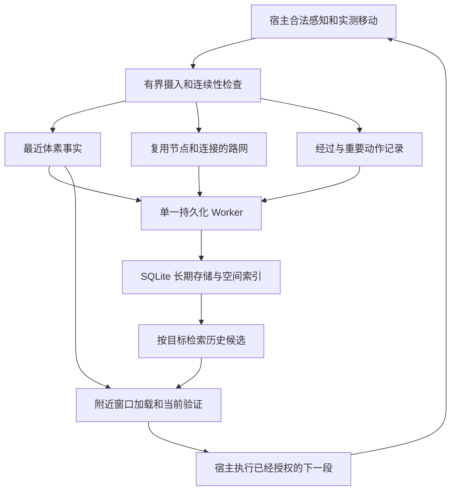

# v0.11.0 空间记忆升级方案

日期：2026-11-10。代码基线：`3e337cb009d14b518016ed2f543e67a3738ec0d9`，包版本 `0.10.0`，SQLite schema 8。

状态：升级设计，尚未实现。本文给出 v0.11.0 的范围、实现顺序与发布门槛；性能审查中的实测单独标注。本次不修改包版本、已有数据库或宿主运行逻辑。

## 1 版本目标

Agent 的真实移动应持续形成可复用的空间地图：走到新地方时扩展，重走旧路时复用，实际走通两个区域时建立连接；给定目的地后，能检索和拼接已知通路，逐段重新观察、验证并执行。探索范围增长时，长期地图可以增长，热内存和每轮处理工作必须有界。

“完整记忆”指保留合法观察到的最近空间状态、真实走过的连接、必要的历史来源与稳定身份。它不意味着补全未观察空间，也不意味着永久在内存中保留每次采样、每份重复折线和全部临时缓存。过去的完整世界状态回放不是本版本承诺。

v0.11.0 必须交付以下结果：

1. 基础移动、代码技能和导航共用实测移动记录入口，自动维护路网，不要求 Agent 手动合并碎片。
2. 同一路往返 100 次，唯一站位、连接和几何规模在双向连接建立后稳定；不同真实经过的时间与来源仍可查。
3. 无需提供 `pathId`，按明确目标找回并拼接历史通路；指定 `pathId` 时仍遵守原路线约束。
4. 远处历史过期不妨碍产生候选路线；只有附近已验证的前缀可以执行。
5. 已保存的远处地图和历史退出热内存后仍可精确取回；临时数据与冗余表示不会挤掉长期地图。
6. 消除实时路径中的全图扫描、全量回滚副本和重复全路线快照，以复杂度计数与密集持续输入验证，而不只提高上限。

Agent 继续决定目标、探索、施工、材料和风险取舍。库不自动挖掘、搭桥、造船、改目标或进行救援。容器内容仍由宿主精确账本管理。

## 2 当前缺口与需要保留的基础

| 当前实际行为 | 对目标的影响 | v0.11.0 处理 |
|---|---|---|
| `saveFragment` 按 ID 查重，不同 ID 的相同几何照样新增 | 重走容易积累重复片段，满额后拒绝 | 自动移动写入规范路网，复用已有局部几何 |
| `mergeFragments` 只追加连接分组，不减少片段 | 连通分量减少不代表存储被整理 | 保留旧语义，新增路网写入承担真正的几何复用 |
| 执行器主要积累本次 trace，历史保存依赖宿主回调 | 普通移动未必形成长期历史 | 统一接入真实身体反馈，不依赖某个导航函数结束 |
| 默认 eager；manual 只覆盖体素，历史和目录仍整体驻留 | 冷库增长仍带动内存与启动成本 | 新建明确的有界会话，全部持久化域按索引和页读取 |
| 总世界容量与快照预算混用 | 达上限后保存失败，脏数据不能换出 | 分开热内存、单批工作、总磁盘预算 |
| 历史/拓扑任一变化仍整域捕获和替换 | 小更新的成本随全库增长 | 按记录保存增量，统计随事务更新 |
| `planRoute(auto)` 无 `pathId` 时直接进入搜索入口 | 历史通路没有形成目标驱动的自动复用流程 | 历史索引检索、加权图搜索、局部接入与退出段 |

依据：[碎片存储](../src/topology/fragment-store.ts)、[合并与拓扑](../src/topology/topology-store.ts)、[执行器](../src/execution/walk-route-executor.ts)、[自动规划](../src/navigation/route-plan.ts)、[持久化会话](../src/storage/sqlite/spatial.ts)。

保留现有的 world/dim/session 隔离、空气与未知区分、观测时间、已确认效果、方向性、历史与当前通行性分离、单 Worker、保存确认和局部失效模型。优化数据表示和处理流程，不降低事实精度。

现有总设计中“fragment 按 lastUsedAt 淘汰”等表述，需要在实现时同步澄清：默认只退出工作集，不删除唯一历史路线。本方案作为 v0.11.0 的增量设计；原设计文档已有的未提交修改不在本次改写范围。

## 3 数据组织与自动路网形成

### 3.1 一个空间事实来源

继续使用现有节点、边和体素模块，不另建一张互相覆盖的导航图。新增的自动记录器把已确认的连续移动写入规范节点和有向连接；每条连接引用一份局部几何。历史经过记录引用有序连接，保留时间、会话、实际模式、执行/动作关联和中断信息。



数据量应按不同原因计量：唯一空间几何随新探索增长；经过记录随真实经历增长；运行态缓存随配置预算变化。不能以删除经历冒充几何压缩，也不能把连通分量变少当作碎片数量减少。

### 3.2 实测移动输入

拟新增 `recordMotion` 写入口，输入包含 world/dim/session、稳定流与批次身份、按序实测位置、实际时间、移动模式、已确认连续段及中断原因。动作归属未知时明确未知。规划点列、动作请求和函数成功返回不能替代实测轨迹。

宿主负责证明样本连续性：来自真实身体反馈且没有采样断档、服务器位置纠正、传送、重生、换维或断线。库只连接这些已确认连续段。仅提供两个邻近位置时，最多保存端点，不能推断中间经过；丢样后新起一段。中途取消或失败仍写入已经确认的前缀。

接线覆盖普通行走、基础动作、嵌套代码技能、路线跟随，以及宿主已经确认的跳跃、台阶、梯子、下落、水面和已乘船移动。能够记录一种模式不表示执行器已经支持它。统一入口以流身份与原证据 ID 去重，重复回调不增加经过次数。

入口可由宿主主动喂入；库不得反向持有 bot 或新增全世界扫描。宿主动作保持独立可用，不必先经导航才能被记住。

### 3.3 站位与连接复用规则

站位以作用域、水平单元、实际脚高和可确认的支撑面区分。处理期间保留原始实测位置，落盘保留契约要求的关键原坐标与连续性证据，不因此永久保留全部 tick。同一支撑面上的小幅位置变化可以归属同一站位；支撑面解析来自真实观测形状或宿主明确提供的规范站位，不能靠任意距离阈值猜测。

不得仅将 XYZ 全部取整：半砖、楼梯、桥上桥下可能需要不同站位。无法明确归属时返回规范化缺口、保留原证据，暂不合并。水面和船使用相应模式的实测位置及液面/乘骑身份，不套用陆地支撑假设。

有向连接按实际局部通路复用，包含端点、模式及必要的中间几何区别。相同首尾的绕行和跳越不能只按端点去重；A→B 也不推出 B→A。状态和证据版本变化更新验证信息，不因此制造另一份相同空间身份。

空间切段按规范站位转换和实际模式转换进行，输入批次或执行调用的结束不成为空间边界。普通行走按已确认的站位转换记录；跳跃按实际起落及被证实的中间通路区分；梯子按实测高度单元转换；水面按其模式位置单元及状态转换。采样密度足够证明同一组转换时，不同批次大小和同面小幅抖动应得到同一规范图。若 A→C 的稀采样不足以确认中间站位 B，不插值造 A→B→C，也不制造任意跨度的永久亲历边；保留经历与解析缺口，等待实际证据。M0 需固定每种模式的最小输入画像及规范化用例。

首版使用局部空间桶查候选，比较候选几何和已有证据后复用，不对所有旧片段两两匹配。热桶无匹配时，新增身份前必须查询对应冷索引，或由持久化层按规范 key 解析已有 ID；未完成冷查返回待解析，不能直接再建一份。每批结果明确列出新增、复用、无法归属和中断数量。

### 3.4 接续 分叉 环与片段

先保存可复用的局部站位和连接，再生成可折叠的走廊视图。经过已有站位形成分叉或闭环；A→B 后又走 B→C，自然复用 B。线段相交或距离近只用于候选检索，历史连接必须由实际连续经过建立。

`traversed` 连接必须由实际连续经过支持。单独当前几何验证只产生带有效期的候选或接入段，不增加经过次数、不制造永久亲历连接；真正执行并确认后再记为走过。

无分叉的连续链可以在查询/存储块中压缩，但必须保留逐段连接、转弯、模式转换、证据引用和精确端点。不得用两端直线替代未经观察的中间空间。首版不做破坏稳定边 ID 的全图折线重排，也不引入复杂动态连通算法。

新增 `MotionEpisode` 或等价记录表达一次真实经历，引用有序连接。长经历按有界块存储，不能不断重写越来越长的整条数组。`uses/lastUsedAt` 是摘要，不替代必要的经过证据。

### 3.5 旧记录兼容

旧 `PathFragment` 保留 ID、完整字段、精确折线、分页、计数和删除语义；可以建立到共享几何的映射，但旧查询不得悄悄隐藏“合并别名”而改变 total。新的规范路网查询使用独立的计数语义。自动移动不再每次生成新的旧式 Fragment。

`TraversalEvidence.fragmentId` 当前必填；新网络经历使用独立类型或显式所有者联合，不能塞一个虚构的主 fragment ID。旧数据缺连续证据的几何只作候选，迁移不补造亲历连接。

删除旧 fragment 仍只删除其原来拥有的记录及映射，其他经历支持的共享几何保留。最后一条支持某连接的亲历证据被删除后，该连接立即失去 traversed 资格，并局部失效相关候选/缓存；可保留无亲历保证的几何，但不能继续作为已走路线。删除使用显式删除记录；重试、重启和迁移不能复活它。`mergeFragments` 维持“连接分组”的兼容语义，文档不再称其已完成几何压缩。

## 4 体素与记忆生命周期

### 4.1 分开三种预算

| 预算 | 限制对象 | 达到限制的行为 |
|---|---|---|
| `residentLimits` | 当前驻留体素、路网页、历史页、目录页、派生缓存 | 换出已保存冷数据；不能把缺页当不存在 |
| `batchLimits` | 每批输入、同步切片、编码、传输、事务 | 分批继续；不是整个世界达到容量上限 |
| `storagePolicy` | 可选总磁盘配额、磁盘压力和保留策略 | 先清冗余和可回收数据，仍不足则明确报告压力/记录缺口 |

新会话不再默认用 64 MiB 快照预算或 100 万观察格限制整个世界。有限磁盘不可保证无限记忆；长期写盘失败时也不可能无限接收。必须暴露已应用、待保存、未接收的范围，不能承诺“永不丢”后悄悄漏记。

### 4.2 热工作集与冷库

SQLite 保存全部已接受并确认保存的最近体素状态及历史路网。热内存仅保留当前位置、活跃路线窗口、必要邻格、有限查询页和待保存数据。沿现有 `WorkingSetManager` 改造，保护范围按实际依赖登记，不能永久 pin 整条远程路线。

Section 目录、历史节点、连接、经历和兼容账本同样分页，不把无限目录常驻后宣称内存有界。冷读通过 Worker 的空间/主键索引进行。同步只读入口保留 `not_resident`；新的异步读取允许只加载磁盘数据，不观察世界、不更新证据时间。

已有冷 Section 收到新观测时，先加载或在有界写队列中等待合并；原观测时间和顺序不变。新观察不得以“新建空 Section”的方式覆盖该处旧事实。缺页、真正无记录、加载失败、处理预算不足分别返回。

### 4.3 无损减重

1. 内部逐格证据不再重复 world/dim/pos/full BlockState，所属 Section、格内索引和 palette 已能提供这些值；保留逐格时间、来源、会话、完整性、有效期、动作关联。公开读取重建原对象，调用者不能修改内部事实。
2. 字典增加状态到索引的映射，避免每次写入线性 `indexOf`。回收未被当前已观察格引用的 palette 项并重算位宽；air 仍为 0，未知不变成空气。回收放在有界维护/编码阶段，不能每次观察都重排整段。
3. 逐格大小变化、Section 字节和域计数增量维护。重复刷新仅核算实际差分，避免当前保守预检把一次刷新当作新建 Section 而误拒绝。
4. 在线变化先处理、失效先通知；已处理的同状态时间刷新可合并为待保存的最新版本。障碍出现/清除、动作效果及必要顺序关联不能在入库前被覆盖合并掉。
5. 保留 Section 级保存作为第一步，先减少对象和重复捕获。若测量仍显示刷新证据导致不可接受的写放大，再采用明确版本化的状态与证据增量编码；不预先引入多套日志重放权威。

无需永久保存每个身体 tick 的原始样本。只有在规范几何、关键中间点、连续性证据和必要经历已经形成并确认保存后，才能释放处理缓冲；这不是删除已有公开经历记录。重要动作及已接受的历史事件继续冷存。

### 4.4 保留与回收规则

| 数据 | 默认规则 |
|---|---|
| 最近体素、已走连接、必要几何、Agent 命名点、容器身份关联 | 冷存长期保留；不按时间删除；对象消失按实际证据标记 |
| 不同真实经过、重要动作、重要阻塞/恢复事件 | 保留身份、原时间和来源，分页冷存；同 ID 重投递不重复 |
| 派生通行缓存、计划句柄、临时实体占位 | 有界、到期回收，活跃使用者按必要范围保护 |
| 程序生成的普通检索点 | 只淘汰非 durable 且无持久事实引用者；有引用者退出热工作集，不为腾配额删除真实连接；不与 Agent 命名点或容器账本争配额 |
| 未引用 palette、可重建列表缓存、中间保存快照 | 有界回收，不影响事实 |
| checkpoint 元数据 | 事实迁出后只保留各域有效基线、在途确认、迁移所需行及配置的诊断窗口 |
| 宿主明确分类为可丢的普通诊断 | 独立预算，超额采样或拒收有回执；不能把重要事件重新分类以逃避容量问题 |

默认不以 TTL 删除唯一历史路线。若将来需要删除历史以节约磁盘，必须另有显式保留策略、范围和审计结果；同一数据库换一个“冷表”不等于减少磁盘占用。

## 5 历史路线检索与执行

### 5.1 从目标检索

输入保留原目标、解析目标、完成条件、允许模式、身体能力、风险/材料约束、期限及取消信号。`pathId` 可用于限定路线，但普通目标不要求 Agent 知道内部 ID。

通过 world/dim/空间桶索引获取起终点附近候选，距离只表示候选匹配。起点进入旧路、旧路到达目标的连接段也必须有历史连续证据或当前合法几何验证，不能隔墙吸附、换高度或悄悄把精确目标改为附近点。

在有向、模式匹配的规范图上做有预算的 Dijkstra，优先队列用最小堆，不每轮排序全部开放节点。开放集、已访问节点、边扩展、冷邻接页和输出均有预算；访问 Vq 个节点、Eq 条边时，图搜索目标工作量为 O((Vq+Eq) log Vq)，另计实际读取和几何输出。以后只有测量证明需要才增加 A* 启发式。默认成本为完整几何距离，不能用 fragment 数、最少边或端点直线长度代替。目标驱动的历史查询返回来源链、方向、成本、缺口和当前状态，预算耗尽或邻接页未读完不等于无路。

时间优先仅在调用者明确选择时生效。时长来自连续实测的有效移动时间，排除断线、暂停和未归属等待；无时间证据时使用显式版本化模型换算成秒并标记估算。没有适用模型则返回时间规划缺口，只有调用者明确允许才退回距离模式；不能静默排除未知时间的真实通路而把余下结果称为最快路线。不能把未知当 0，不能无说明混用米与秒。只承诺给定搜索范围与预算内的结果，不声称世界全局最优。

历史候选、当前可执行前缀和未复验后缀分别返回。拓扑查询只读，不启动身体动作或隐式扫描。

### 5.2 滚动验证

路线保存完整候选引用、已执行前缀和有限的当前窗口。窗口长度是处理上限，不是必须提前看清的距离。

执行前加载当前窗口及支撑/碰撞/流体邻格依赖，复用宿主现有感知，只验证即将执行的段。当前段 OPEN 且授权、身体、任务归属有效才执行。实际到达后推进窗口，释放后方不再需要的 pin。远处 STALE 仍是待复验历史，不能升级为 OPEN，也不因此要求全图先变新。

当前段证据不足时等待有界的既有感知更新，或返回 `needs_observation`。额外转头、移动观察依然走宿主授权，不自行探索。当前障碍变化立即使受影响段失效；不得等保存结束或下一次 LLM 调用。

普通同目标导航在原委托允许的情况下可以改选另一条已知路线，共享剩余期限和预算；指定历史路线不能被静默换路。完成一页、一段窗口或一次函数调用都不代表到达，`ARRIVED` 仍由原完成条件的实测证据确认。

### 5.3 更深探索需要的陆地转换

v0.11.0 的必需执行子集包括平走、台阶/楼梯、具备实际动作模型的一格跳上、委托约束内且落点明确的下落、已有梯子的上下和进出。查询与记忆保留其他已确认模式，但任意跨沟跳跃、复杂跑酷、水面/船的完整执行扩展不作为本版本顺带承诺。

复用现有 land geometry，但 `geometry_only` 不能直接改成 executable。Minecraft 1.20.1 适配器必须提供真实动作、支撑/碰撞模型和取消反馈，并通过联机验收。尤其现有同高 jump 模型不能直接充当跳上一格的物理模型。任何模式缺失时能力表如实为 false，不能回退到会挖掘/放置的底层寻路。

## 6 性能审查与修正要求

### 6.1 当前复杂度结论

变量：`V/E` 为节点/边数，`F/T` 为片段/经过数，`P` 为几何点数，`S` 为全部 Section 数，`C` 为一个 Section 的已观察格数，`L` 为路线长度，`b` 为每次推进步数，`Q` 为候选桶大小，`k` 为页大小，`D` 为脏数据规模。`B(X)` 表示 X 的总字节量。以下指当前方法体，不是未来目标。

| 当前操作 | 工作量与所在位置 | v0.11.0 必修方向 |
|---|---|---|
| 新节点写入先 `countNodes(source)` | 单次 O(V)，连续增加 N 个节点累计 O(N²)，主线程 | 各来源常量计数，写入/删除/恢复维护 |
| `writeConfirmedCorridor` 进入两层 `runAtomic` | 小写也复制全部历史、拓扑 Map/Set，O(F+T+V+E)，主线程 | 完整预验证后提交或只记录本批受影响项的回滚状态，保留原子性 |
| manual 单格重复 observe | 前后各估算整个 Section，O(C)；同段批量可摊薄，主线程 | 增量字节账、批量摄入、真实差分容量预检 |
| 规划/执行推进返回全路线状态 | 多次推进各复制 O(L) 状态，规划可累计 O(L²/b)，逐步执行可累计 O(L²)，主线程 | 热循环返回进度/变化或单步视图；显式详情才复制有界页 |
| WalkRouteSearch 每次 advance 校验累计依赖、投影累计输出 | 单次 O(累计依赖 Section + 已积累输出) 在扩展预算外；小 b 多次重复，主线程 | 变化驱动失效、过期队列、限量/分页结果，把这些成本计入切片预算 |
| 局部复验及到期维护 | pending 循环只计实际验证步数，可能继续扫过大量已验证步；局部失效后的到期重算也可 O(L)，主线程 | 待验证步索引与有界到期维护，检查/跳过的工作也计入预算 |
| `TraversabilityCache` 长期累积 | 没有容量上限；TTL 到期本身不删除未再访问的 key，内存随累计位置/上下文增长 | 显式容量、过期清理与反向索引同步删除，保护仅限活跃窗口 |
| 增量 checkpoint 前全量计数与脏快照捕获 | O(S)+O(B(D))，当前一次捕获全部待存，主线程 | 域增量统计、脏 key 游标、按字节与时间切片捕获 |
| history/topology 一条更新触发整域保存 | 主线程 O(域字节) 估算/复制，Worker 整域删除再插入 | 记录级 upsert/delete 和精确捕获 token |
| voxel/journal 每批落盘后的 COUNT/SUM | Worker O(全世界匹配行数)，并非只与增量相关 | 同一事务更新统计，ACK 复用统计，诊断才全量重算 |
| ledger delta 后全量读取并 stringify | Worker O(全部账本字节) | 行级大小差分与事务统计，删除全量重读 |
| `segments(fragmentId)` | 扫所有 E，切点 `some` 去重最坏 O(E+Cuts²+P)，主线程 | fragment→edge 索引、切点 Set |
| fragmentation/components | 全量克隆/重建连接或邻接及排序，至少随 P+T 或 V+E 增长，主线程 | 从唯一连接构图、版本缓存、局部索引；全图统计改为显式有预算任务 |
| 写后列表/统计的第一次读取 | 排序缓存失效后 O(N log N) 重建；多条件 q 页可重复 O(qQ)，主线程 | count 独立；受影响索引更新；冷查询 SQL 索引分页；兼容 total 语义 |
| 坐标定位附近路网节点 | 当前先 drain/clone 全维度节点 O(V)，主线程 | Section 空间桶/数据库坐标索引，限量候选 |
| Frontier 限量查询 | 当前先构造全部候选再 slice，limit=1 仍与全部候选/诊断量相关 | 将 limit 下推到来源与投影，诊断与候选分别分页 |

对应代码：[节点/原子写/分段/连通与分页](../src/topology/topology-store.ts)、[历史原子写和快照](../src/topology/fragment-store.ts)、[门面统计和位置检索](../src/store/spatial-memory-store.ts)、[体素计数及摄入](../src/voxel/voxel-map.ts)、[路线验证](../src/traversability/route.ts)、[路线规划验证](../src/navigation/route-plan-support.ts)、[执行状态](../src/execution/walk-route-executor.ts)、[搜索](../src/navigation/walk-search.ts)、[主线程持久化](../src/storage/sqlite/spatial.ts)、[Worker](../src/storage/sqlite/worker.ts)。

上述高频全量工作可能产生长同步停顿；Worker 的全量工作主要延长保存、加载的排队与 ACK，不可直接称为相同时长的主线程停顿。`async` 声明不会把 `postMessage` 之前的遍历和复制移出控制线程。

已优化部分必须保留：搜索使用带游标队列和邻接索引，没有每步排序开放集或 `shift()`；热的单条件列表页已有排序索引和二分游标；内置 `getFragmentScope` 不复制整条折线。门面中的旧 `fragmentationGeometric` 存在两两距离 O(P²) 循环，但当前没有调用，不能用它解释现有卡顿。

### 6.2 本次摄入探针

2026-11-10 在当前源码重新构建后，使用 Node v24.14.1、Windows x64 运行 [observation-ingest.bench.mjs](../benchmarks/observation-ingest.bench.mjs)。一个驻留 Section 内，预填不同数量的已知格，然后对同一已知石头格连续提供 256 次新时间的同状态观测。分别逐条 `observe` 和一次 `observeBatch`；输入构造及初始化不计时，预热 2 轮、计时 5 轮。下表为每轮同步调用耗时中位数，单位 ms。

| Section 已知格数 | eager 逐条 | manual 逐条 | manual 批量 |
|---:|---:|---:|---:|
| 128 | 0.201 | 7.588 | 0.327 |
| 512 | 0.128 | 29.496 | 0.467 |
| 2048 | 0.061 | 119.573 | 0.715 |
| 4096 | 0.051 | 245.029 | 1.191 |

逐条 manual 的 256 次循环没有让出事件循环；满 Section 本次约占用 245 ms，证明该调用方式存在可复现的同步处理成本。批量显著摊薄了重复估算，但尚未消除随 Section 密度增长的部分。eager 的小数值受 JIT/噪声影响，不用于比较各密度的优劣。

这是合成摄入探针，无游戏、数据库、持续扫描或真实宿主调度。它不能证明现网卡顿根因，也不能外推整体吞吐。不能用批内 256 次相同格刷新代替长期移动的密集空间负载；正式验收另测多格、多 Section、状态变化和冷区切换。

复现：

```sh
npm run build
node benchmarks/observation-ingest.bench.mjs
```

已有 [2026-11-07 checkpoint 基准](../benchmarks/m8-3c.md) 中，修改一个 topology 节点的完整保存 p95 约 298.99 ms，ledger 小增量约 43.17 ms。这是过去合成场景的端到端保存耗时，不能称为主线程卡顿。已有 10,000 Section 场景每段仅一格观测，不能替代密集长期地图验收。

### 6.3 优化后工作量约束

不只检查耗时，还记录本次访问/复制的记录数。确认一条已存在连接，不得扫描全部历史；读取总数不排序全图；更新一个节点不捕获全域；读取下一页不重复筛选全部匹配结果；推进一个路线窗口不复制整条路线。

单 Worker 的 world/domain 统计行与事实更新同事务提交：按主键读旧行小元数据，更新记录数、payload 字节、观察格和字典项差额。幂等重投不重复计数。迁移时有界重建统计；全量核验只放在显式检查/修复入口，不放回每次保存。

会话切换和整维观察中断采用已有 session/boundary 的读时判断及运行态 generation，使活跃依赖立即失效，避免全世界逐格重建 STALE 对象并制造脏数据。公开 freshness、staleReason、变更报告与保存语义必须一起迁移，不能仅删循环导致消费者漏失效。

不预先引入动态连通服务、分布式队列、图数据库、复杂压缩算法或第二写者。索引、增量计数、有界批处理和局部快照先解决已识别的成本。

形状 Provider 的一次调用和单边几何工作也要测量。现有边/步数预算没有覆盖回调内部、全部碰撞盒和支撑区间处理；使用正常 Minecraft 身体和楼梯、栅栏、门等真实形状测试，不以任意巨人体型作为扩展复杂度的理由。

## 7 保存 读取与接口接缝

### 7.1 有界会话

拟新增 `openManagedSpatialSession`，组合现有地图、路网、单 Worker 与保存调度。名称在 M0 冻结，不代表当前已有导出。

旧同步 `FragmentStore/TopologyStore` 和 eager 会话保持完整内存契约；不能暗中把它们改成只含热页的对象，否则 total、找不到、连通判断都会失真。新的有界会话使用显式异步读取，宿主必须迁移生命周期与查询调用。

最小接口责任如下，避免再增加互相覆盖的入口：

| 入口 | 契约 |
|---|---|
| 批量观测摄入 | 有界队列、必要冷读、应用后返回版本与缺口；进入队列不等于已经应用或保存 |
| `recordMotion` | 接收实测连续移动并维护规范路网；返回新增/复用/缺口及保存状态 |
| 有界异步 query | 分页读取体素、路网、旧 fragment 和经历；明确缺页/预算/确无记录 |
| 目标路线查询 | 返回历史候选、成本、来源和待复验边界；不触发身体动作 |
| 保存与维护 | 返回捕获/确认版本、剩余脏数据、压力与失败原因 |
| stats | 常量或有界统计，不通过列表投影重建全图索引 |

新能力协商拟升级为 `memory-host-contract/2`。记忆、查询、规划、每种执行模式、持久化分别报告，宿主与库共同支持才可用。版本 1 继续显式适配，不能把新增模式塞进原先字面量 walk 的契约。

### 7.2 自动保存与事务

新会话显式配置 `savePolicy` 后，按待存字节和最老等待时间调度小批保存。调度只处理记忆和磁盘，不产生游戏动作。每轮同步工作、队列和事务均有预算，慢盘或失败使用有界重试/退避并报告压力，不占满控制循环。

捕获使用脏 key 游标，不先复制全体 pending 再截取。每批保留捕获 token，ACK 只确认对应版本；更晚变化保持 dirty。原子单元是一次局部事实更改及其本次新建/删除的必要依赖；已经提交且未修改的引用对象只查存在性，不递归捕获整个连通图。不能为了分批留下半条通路。单个原子单元超过预算时，在接收前报告具体缺口，或按约定的有界经历块提交，不能接受后无限延期。

重要事实和动作保留其原子关系。可丢诊断使用独立接收预算，不能因普通诊断满额让地图保存整批回滚；已接受的重要记录不得静默撤回。多批保存报告“目标版本已确认”和“仍有更晚变化”，不使用含糊的整体成功。

旧 `flush/close` 保留现有含义；新管理会话关闭时先冻结接收序列，在原截止时间内完成已接收队列的应用（包括必要冷读），再保存产生的目标版本。到期时分别返回未应用输入、已应用未保存事实、未确认批次及原因。正常关闭不再依赖宿主记住先手工 checkpoint，但不能无限延长退出期限。

## 8 数据库迁移与兼容

schema 9 为本方案暂定目标，M0 冻结迁移序列后确定。优先增加必要索引和元数据：节点空间范围、连接端点、经过的所有者、fragment 边界盒、行级 payload 字节和域统计。体素编码可用新版本、读兼容旧 v1/v2；不以改成 BLOB 本身作为性能达标依据。

网络经过和几何引用加入明确结构。门户边与 fragment merge 等真实事实先从 `checkpoints.topology_extras` 迁到独立权威记录，再清理旧 checkpoint。各域基线可能不同，不能简单只留最后一行。

迁移流程：

1. 停止并发写入，建立包含已提交 WAL 状态的有效备份；不直接复制正在写入的主数据库文件充当完整备份。
2. 在同一数据库中分批建立新结构、索引与统计，记录迁移进度；迁移期间继续以旧结构为权威且禁止业务写入。
3. 核对世界作用域、ID 集、位置/状态/时间/来源、历史位图、原始 fragment 字段、门户事实、计数与删除结果。
4. 完成校验后事务性切换 schema/权威标记，再允许新写入；中断时恢复迁移或明确拒绝打开，不能半新半旧混用。
5. 失败可从备份恢复；新格式开始接受写入后，不承诺旧程序可直接打开。旧 SQLite 升级与 Curio 旧 JSON 权威切换分别验收，不能顺带宣称迁移完成。

重复空间可共享规范几何，但旧 ID 查询、分页与删除含义不改变。旧记录缺少连续性/会话/时间时保留未知，不能为让图连通而编造。新增索引与缓存不是第二份事实权威。

## 9 实施顺序与文件范围

| 阶段 | 可评审交付物 | 主要代码接缝 | 退出条件 |
|---|---|---|---|
| M0 契约与负载基线 | 新旧接口映射、移动连续性合同、记录分类、参考机器和真实扫描画像 | memory/adapter/query/types、宿主感知和身体反馈 | 数据身份、预算、性能目标、迁移序列冻结；不把计划当能力 |
| M1 实时热路径 | 增量计数、轻量路线状态、摄入字节差分、局部原子写 | voxel、topology、traversability、execution、navigation | 第 6 节最高频全量工作移出热循环，增长探针通过 |
| M2 自动路网形成 | recordMotion、规范站位/连接、网络经历、基础动作共享接线 | memory ingest、topology、adapter 与宿主 | 往返/分叉/环/断档/多高度和幂等用例通过 |
| M3 完整冷热与增量保存 | 管理会话、索引分页、记录级 delta、事务统计、保存调度 | storage/sqlite、voxel/residency、query | 冷库超过旧总量上限仍可启动和局部读写，热内存有界 |
| M4 目标检索与滚动执行 | 无 pathId 找旧路、距离/时间口径、有限前缀验证、自然高差接入 | navigation、land-route、execution 与宿主动作端 | 长历史后缀 stale 仍可推进；每次实际执行都有当前证据 |
| M5 迁移与回收 | schema 迁移、旧 API 适配、checkpoint 清理、普通诊断保留策略 | storage migration、compat、公开 exports | 旧数据逐项等价、删除不复活、重要事实不丢 |
| M6 联机与长期发布验收 | 独立安装、真实游戏场景、8 小时持续输入、故障恢复报告 | tests、benchmarks、acceptance、宿主集成 | 下节所有发布门槛通过，文档和能力报告一致 |

M1 与 M2 可按不重叠文件分工；M3 的持久化模型需在 M0 与 M2 对齐后实施。宿主感知/移动接线从 M0/M2 开始，不推迟到最后才验证。每批先运行对应测试，跨域整合和发布时再跑完整检查。

README、接口契约、旧总设计和审计状态在实现阶段同步更新；当前不把路线图写成已经发布的能力，也不在设计提交中升级 package.json。

## 10 验收矩阵与性能门槛

以下为拟定发布门槛，尚未通过；M0 在固定参考机器、Node/SQLite 版本和真实输入画像后记录最终数值。修改门槛必须保留依据，不得以降低输入、缩小密度或把拒收当成功方式达标。

| 场景 | 必须观察到的结果 |
|---|---|
| 同一路往返 100 次 | 第一轮双向建立后唯一节点/边/几何稳定，真实经过次数正确；确认下一步不扫描累计经历 |
| 批次 采样与冷路网重访 | 在证据足够的前提下，同一实测轨迹按不同批次/密度重放得到一致图；稀采样缺口不补线；全部路网页换出、重启后重访仍复用唯一几何 |
| 接续 分叉 环 | A→B→C 与 B→D 自动形成网络，旧 ID 可查；几何交叉但未经过的空间不误连 |
| 桥上桥下 半砖 梯子 | 同 XZ 不同高度分离，同一真实支撑上的小幅位置变化不增殖；方向与模式正确 |
| 断线 重生 传送 丢样 取消 | 无虚构跨缺口连接，已确认前缀仍保存，未知归属不补造 |
| 自动历史查询 | 无 pathId 跨至少 3 段旧区域到原目标；成本与离线参考最短路一致，fragment 切分不改变距离排名 |
| 滚动长路 | 至少 512 格且总行程超过 TTL，远端起初 STALE；只靠合法持续感知实际完成原目标，0 次基于 UNKNOWN/STALE 当前段发动作 |
| 动态阻挡 | 下一控制轮前失效当前段；历史仍在，无关区块更新不重算全图 |
| 冷库与恢复 | 至少 400 万 distinct 已观察格，混合密集/稀疏区与大于旧 64 MiB 的数据；旧坐标可取回、原时间不变 |
| 日志压力和磁盘故障 | 普通诊断不挤掉地图保存；重要记录不静默丢失；恢复后只声称确认批次已保存 |
| 旧契约 | 原 ID、字段、分页、计数、删除和来源精度等价；分别验证唯一/共享证据所有者删除及冷加载重启，共享几何不误伤、已删亲历资格不复活 |
| 真实游戏 | Minecraft Java 1.20.1 平路、自然台阶/楼梯、跳上一格、下降、梯子各至少 20 次完整往返；无扰动且声明支持的场景各自成功率 ≥95%，0 次虚报到达；取消/故意阻挡另组测试，失败有结构化原因；墙后变化不污染记忆 |

性能验收必须覆盖三组增长曲线：

1. **固定局部输入，扩大冷库**：100 万到 400 万已观察格，固定热点和路线窗口；热对象、目录页和驻留 Section 不随全库近线性增长。
2. **固定新空间，增加重复经历**：100、1,000、10,000 次重走；局部几何写入与下一步处理量不随经历总数增长，经历分页不全量载入。
3. **扩大本次任务规模**：路线 128/512/2048 段、图节点分级增加、Section 密度 128/512/2048/4096；区分必要输出规模与重复全量成本，验证删除平方增长路径。

持续负载采用真实扫描回放与合成状态变化，拟定至少 10,000 格观测/秒、8 小时，包含重复确认、多格变化、移动、冷区加载和保存；若真实宿主峰值更高，按实测提高画像。记录 processed、applied、persisted、rejected，不能只统计接收函数调用次数。

拟定实时性目标：库内同步切片 p95 ≤5 ms、p99 ≤10 ms，最长连续同步占用 ≤50 ms；稳态应用队列延迟 p99 ≤250 ms、保存 ACK p99 ≤2 秒，队列及脏数据不持续增长。单个不可分工作单元也须测最坏耗时，不能只在外层循环尾检查预算。

同时记录事件循环延迟、取消响应、GC 后 heap、RSS、驻留估算、每轮复制字节、Worker 编码/SQL/排队时间、写放大和扫描记录数。RSS/heap 与估算字节分别报告。磁盘变慢测试允许明确的背压，但不能混入稳态吞吐达标数据。

Fake 测试证明库内数据与控制合同，真实游戏验证感知、动作与连续性。库自身可先完成开发批次；任何必需联机门槛未通过，不能将 v0.11.0 描述成已经完成长期探索闭环。

## 11 取舍与不进入本版的工作

主要新增成本是统一移动证据接缝、异步冷查询和数据库迁移，这些分别对应已确认的碎片增殖、全量驻留和全量保存问题。优先复用现有 Store/Worker，不建立新的服务体系。

本版不引入全知世界扫描、自动探索目标选择、施工路线、无限保留每个原始 tick、任意时刻完整世界回放、飞行/鞘翅/水下三维导航。物理几何大规模内容寻址去重、复杂动态连通算法和新压缩依赖，只有测量表明必要时另立变更。

最重要的完成证据是：Agent 重走不会制造重复地图，实际连接能自动被下一次查询使用，旧空间能冷存取回，实时工作不会被全部过去经历拖慢。接口数量、测试条数和构建成功均不能单独替代这些结果。
